# E3 — Object-Oriented Programming

**Java 25 · Practice without AI-generated code**

Implement the exercises yourself and validate your work with the supplied tests where available. The sections follow the order of the covered course topics; exercises may combine earlier skills.

[Course slides and module index](../../../../../../../../../README.md#slides) · [AI exercises](../../../../../../../../exercises-ai/E3%20-%20Java%20Object-Oriented%20Programming.md)

## Contents

- [Classes, constructors and encapsulation](#classes-constructors-and-encapsulation)
- [Inheritance and polymorphism](#inheritance-and-polymorphism)
- [Interfaces and composition](#interfaces-and-composition)

## Running tests

From `exercises/exercises-no-ai/`:

```sh
mvn test
mvn -Dtest="com.nbicocchi.exercises.e3_oop.**" test
```

Exercises using collections or exception handling also require the relevant E4/E5 concepts. Before the interfaces and composition exercises, generate JavaDoc for `e3_oop` (in IntelliJ IDEA: select the package, then **Tools → Generate JavaDoc**).

## Classes, constructors and encapsulation

### Exercise 1 — ClickCounter

Source: [ClickCounter.java](ClickCounter.java). Tests: [ClickCounterTest.java](../../../../../../test/java/com/nbicocchi/exercises/e3_oop/ClickCounterTest.java).

Write a class named ClickCounter representing a simple device to keep track of how many times a button (in this case a method) is clicked.
Internally, the class represents the number of clicks with an int value (starting from 0).
The class provides the following methods:
* public int getValue() returning the current number of clicks.
* public void click() increasing the number of clicks by 1.
* public void undo() decreasing the number of clicks by 1 (but preventing negative click values).
* public void reset() setting the number of clicks to 0.

Refer to the UML diagram, JavaDoc documentation, and unit tests for further inspiration.

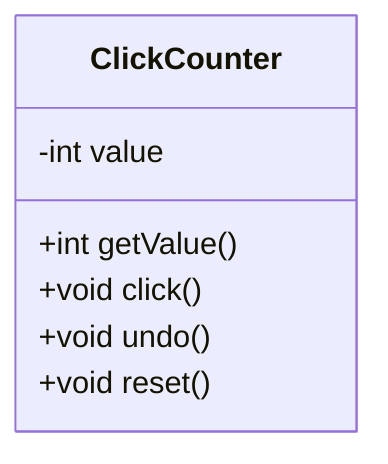

---

### Exercise 2 — RationalNumber

Source: [RationalNumber.java](RationalNumber.java). Tests: [RationalNumberTest.java](../../../../../../test/java/com/nbicocchi/exercises/e3_oop/RationalNumberTest.java).

Write a class named RationalNumber representing a rational number.
RationalNumber objects are immutable: they cannot be changed after creation.
Internally, the class represents the numerator and denominator as int values. RationalNumber objects must support equality with other RationalNumber objects (see Object.equals() and Object.hashCode()).
The class provides the following methods:
* public RationalNumber(int numerator, int denominator) creating the rational number. Before creating the object, numerator and denominator have to be simplified (i.e., divided by their greatest common divisor). 
* public int getNumerator() returning the numerator.
* public int getDenominator() returning the denominator.
* public RationalNumber add(RationalNumber o) returning a RationalNumber object representing the sum of the current number and another number. 
* public RationalNumber multiply(RationalNumber o) returning a RationalNumber object representing the multiplication of the current number and another number.
* public String toString().

You can use the following two methods to compute the greatest common divisor and least common multiple of two integers. They handle zero arguments; assume absolute values and intermediate products fit in an int.

```java
public static int greatestCommonDivisor(int a, int b) {
    int max = Math.max(Math.abs(a), Math.abs(b));
    int min = Math.min(Math.abs(a), Math.abs(b));

    while (min != 0) {
        int remainder = max % min;
        max = min;
        min = remainder;
    }
    return max;
}

public static int leastCommonMultiple(int a, int b) {
    if (a == 0 || b == 0) {
        return 0;
    }
    return Math.abs((a / greatestCommonDivisor(a, b)) * b);
}
```

Refer to the UML diagram, JavaDoc documentation, and unit tests for further inspiration.

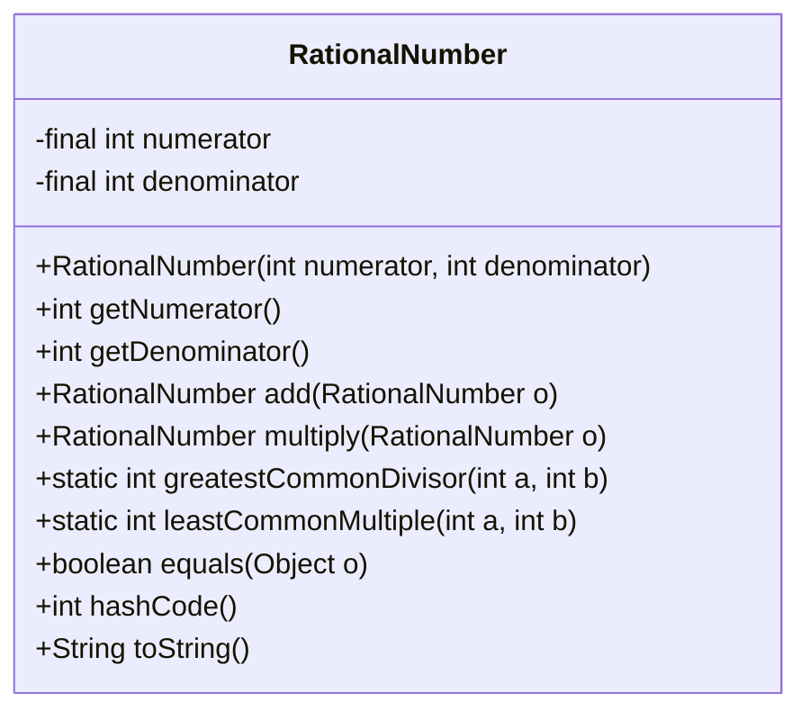

---

### Exercise 3 — Circle

Source: [Circle.java](Circle.java). Tests: [CircleTest.java](../../../../../../test/java/com/nbicocchi/exercises/e3_oop/CircleTest.java).

Write a class named Circle representing a circle on a 2D plane.
Internally, the class uses a java.awt.Point object and an int value to represent the center and radius, respectively.
The class provides the following methods:
* public Circle(Point center, int radius) creating the circle.
* getters and setters.
* public double getPerimeter() returning the perimeter of the circle.
* public double getArea() returning the area of the circle.
* public boolean contains(Point point) returning true if point is contained within the circle.
* public void translate(int dx, int dy) moving the circle on the 2D plane. dx and dy are the x and y components of the translation vector.
* public String toString().

Refer to the UML diagram, JavaDoc documentation, and unit tests for further inspiration.

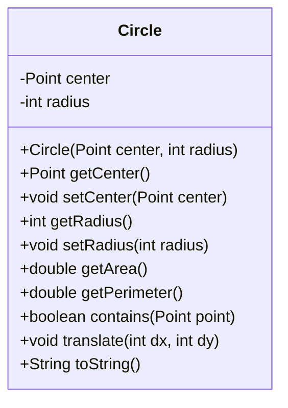

---

### Exercise 4 — Polygon

Source: [Polygon.java](Polygon.java). Tests: [PolygonTest.java](../../../../../../test/java/com/nbicocchi/exercises/e3_oop/PolygonTest.java).

Write a class named Polygon representing an irregular polygon.
Internally, the class uses a `java.awt.geom.Point2D.Double[]` to represent the polygon's vertices in boundary order.
The class provides the following methods:
* public Polygon(Point2D.Double[] vertices) creating the polygon.
* public int getVerticesCount() returning the number of vertices.
* public double getPerimeter() returning the perimeter of the polygon. 
* public double getArea() returning the area of the polygon. 
* public String toString().

Polygons must have at least three vertices. We can throw an *exception* within the constructor to avoid the creation of invalid objects, as shown below:

```java
public Polygon(Point2D.Double[] vertices) {
    if (vertices.length < 3) {
        throw new IllegalArgumentException("At least three vertices are required");
    }
    this.vertices = vertices;
}
```

Refer to [this guide](https://arachnoid.com/area_irregular_polygon/index.html) for computing perimeter and area.

Refer to the UML diagram, JavaDoc documentation, and unit tests for further inspiration.

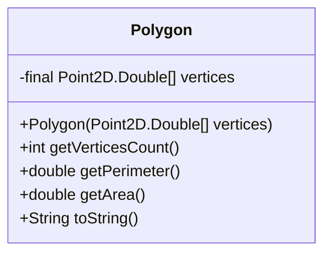

---

### Exercise 5 — BankAccount

Source: [BankAccount.java](BankAccount.java). Tests: [BankAccountTest.java](../../../../../../test/java/com/nbicocchi/exercises/e3_oop/BankAccountTest.java).

Write a class named BankAccount representing a bank account.
Internally, the class uses a double value for representing the balance of the account.
The class provides the following methods:
* public BankAccount() creating an empty account.
* public BankAccount(double balance) creating an account with the specified balance.
* public double getBalance() getting the current balance.
* public void deposit(double amount) depositing the specified amount into the account.
* public void withdraw(double amount) withdrawing the specified amount from the account.

Refer to the UML diagram, JavaDoc documentation, and unit tests for further inspiration.

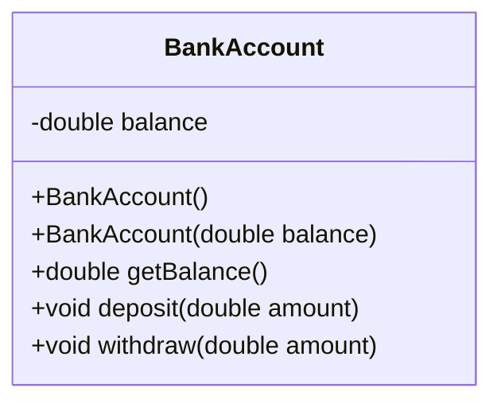

---

### Exercise 6 — EnhancedResizableArray

Source: [EnhancedResizableArray.java](EnhancedResizableArray.java). Tests: [EnhancedResizableArrayTest.java](../../../../../../test/java/com/nbicocchi/exercises/e3_oop/EnhancedResizableArrayTest.java).

Write a class named EnhancedResizableArray representing a resizable array. It internally keeps an int array, enlarges it when needed, and provides its key functionalities via a set of methods:

* public EnhancedResizableArray() creating an empty resizable array (the underlying int[] has a default capacity of DEFAULT_CAPACITY items).
* public int get(int index) returning the element at the specified index.
* public void set(int index, int value) setting the element at the specified index to value. If index is greater than or equal to the current capacity, allocate a new int[] with a capacity of index * 2 items and copy the existing elements. Newly added positions start at 0, except for the specified index, which receives value.
* public boolean contains(int value) returning true if the specified value is contained within the internal array.
* public void fill(int value) setting all the elements of the internal array to the specified value.
* public int length() returning the capacity of the internal array.
* public int[] toArray() returning a copy of the internal array.

Refer to the UML diagram, JavaDoc documentation, and unit tests for further inspiration.

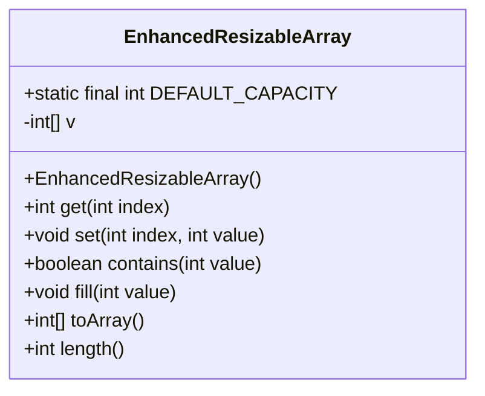

---

### Exercise 7 — Letter

Source: [Letter.java](Letter.java). Tests: [LetterTest.java](../../../../../../test/java/com/nbicocchi/exercises/e3_oop/LetterTest.java).

Write a class for authoring a simple letter.
In the constructor, supply the names of the sender and the recipient:

```java
public Letter(String from, String to);
```

Supply a method to add a line of text to the body of the letter.

```java
public void addLine(String line);
```

Supply a method that returns the entire text of the letter.

```java
public String getText();
```

The text has the form:

```text
Dear recipient name: 
blank line
first line of the body 
second line of the body 
. . .
last line of the body 
blank line 
Sincerely,
blank line
sender name
```

Refer to the UML diagram, JavaDoc documentation, and unit tests for further inspiration.

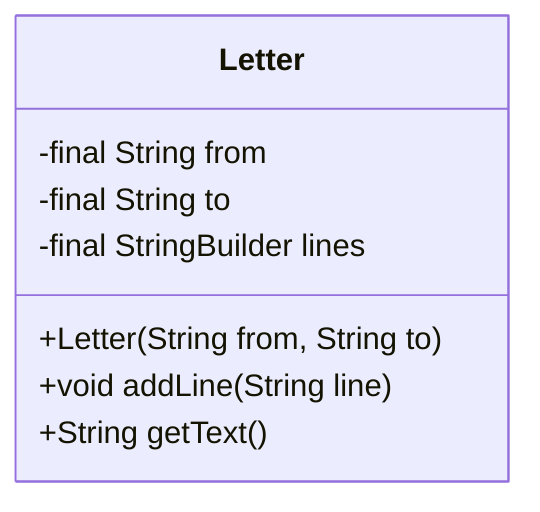

---

## Inheritance and polymorphism

### Exercise 8 — employees

Source: [employees/](employees/). Tests: [employees/](../../../../../../test/java/com/nbicocchi/exercises/e3_oop/employees).

**Employee**

* `name` (String)
* `salary` (double)
* `getDetails()` →

  ```
  Employee{name='name', salary=salary}
  ```
* `toString()` → delegates to `getDetails()`

**Manager**

* `teamSize` (int)
* overrides `getDetails()` →

  ```
  Manager{name='name', salary=salary, teamSize=teamSize}
  ```

**Developer**

* `programmingLanguage` (String)
* overrides `getDetails()` →

  ```
  Developer{name='name', salary=salary, language='language'}
  ```

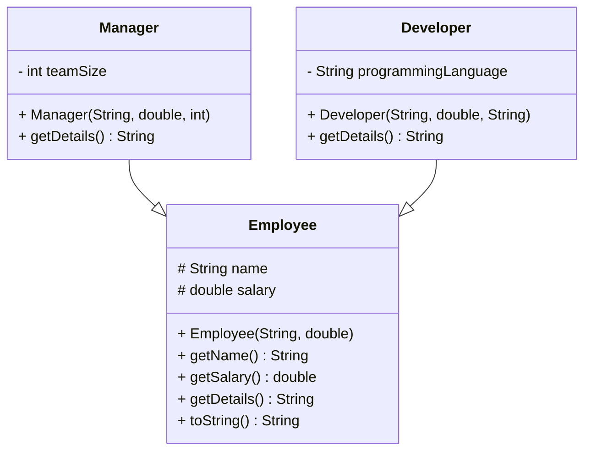

---

### Exercise 9 — animals

Source: [animals/](animals/). Tests: [animals/](../../../../../../test/java/com/nbicocchi/exercises/e3_oop/animals).

**Animal**

* `name` (String)
* `makeSound()` → `"generic"`

**Dog**

* overrides `makeSound()` → `"woof"`

**Cat**

* overrides `makeSound()` → `"meow"`

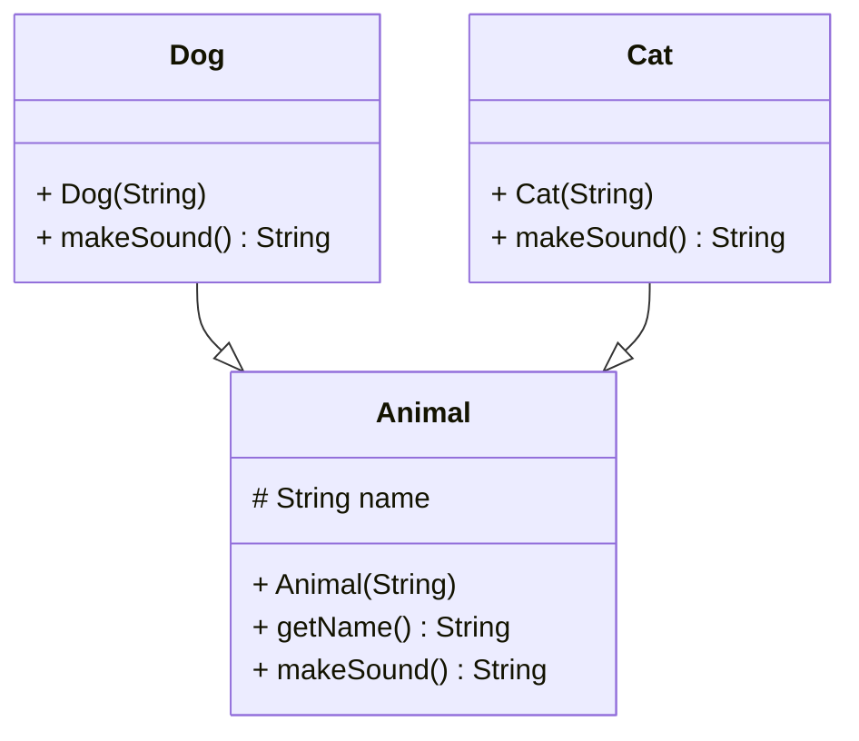

---

### Exercise 10 — shapes

Source: [shapes/](shapes/). Tests: [shapes/](../../../../../../test/java/com/nbicocchi/exercises/e3_oop/shapes).

**Shape**

* `color` (String)
* `getArea()` → `0`
* `getDescription()` →

  ```
  Shape{color='color'}
  ```
* `toString()` → delegates to `getDescription()`

**Circle**

* `radius` (double)
* overrides `getArea()` → `Math.PI * radius^2`
* overrides `getDescription()` →

  ```
  Circle{color='color', radius=radius}
  ```

**Rectangle**

* `width`, `height` (double)
* overrides `getArea()` → `width * height`
* overrides `getDescription()` →

  ```
  Rectangle{color='color', width=width, height=height}
  ```

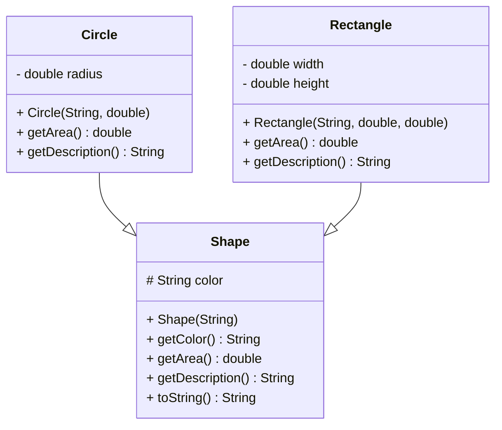

---

### Exercise 11 — vehicles

Source: [vehicles/](vehicles/). Tests: [vehicles/](../../../../../../test/java/com/nbicocchi/exercises/e3_oop/vehicles).

**Transport**

* `name` (String)
* `maxPassengers` (int)
* `getCapacityInfo()` →

  ```
  Transport{name='name', maxPassengers=maxPassengers}
  ```
* `toString()` → delegates to `getCapacityInfo()`

**Bus**

* `hasDoubleDeck` (boolean)
* overrides `getCapacityInfo()` →

  ```
  Bus{name='name', maxPassengers=maxPassengers, doubleDeck=true/false}
  ```

**Motorcycle**

* `hasSidecar` (boolean)
* overrides `getCapacityInfo()` →

  ```
  Motorcycle{name='name', maxPassengers=maxPassengers, sidecar=true/false}
  ```

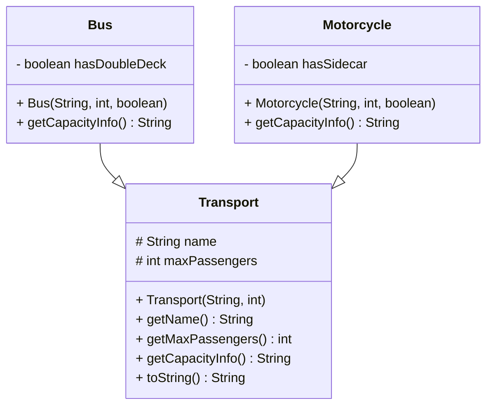

---

### Exercise 12 — electronics

Source: [electronics/](electronics/). Tests: [electronics/](../../../../../../test/java/com/nbicocchi/exercises/e3_oop/electronics).

**Gadget**

* `brand` (String)
* `batteryLife` (double)
* `getStatus()` →

  ```
  Gadget{brand='brand', batteryLife=batteryLife}
  ```
* `toString()` → delegates to `getStatus()`

**Tablet**

* `screenSize` (double)
* overrides `getStatus()` →

  ```
  Tablet{brand='brand', batteryLife=batteryLife, screenSize=screenSize}
  ```

**Smartwatch**

* `supportsHeartRate` (boolean)
* overrides `getStatus()` →

  ```
  Smartwatch{brand='brand', batteryLife=batteryLife, heartRate=true/false}
  ```

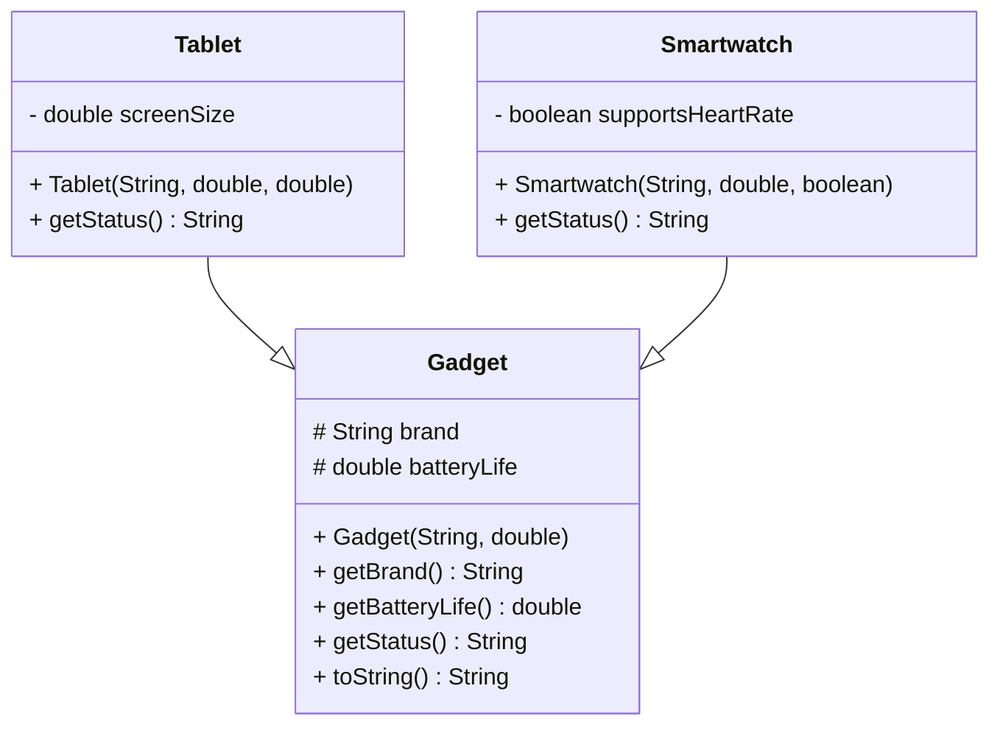

---

## Interfaces and composition

### Exercise 13 — reverse

Source: [reverse/](reverse/). Tests: [reverse/](../../../../../../test/java/com/nbicocchi/exercises/e3_oop/reverse).

Given the Reverser interface defining a single method *reverse* for reversing a string, provide two implementations namely ReverserFast and ReverserSlow providing two different strategies for reversing a String. As a suggestion, ReverserSlow could use a char array (see String.valueOf()), while ReverserFast could use a StringBuilder. Try also to write an anonymous implementation of the Reverser interface within a test.

Refer to the UML diagram, JavaDoc documentation, and unit tests for further inspiration.

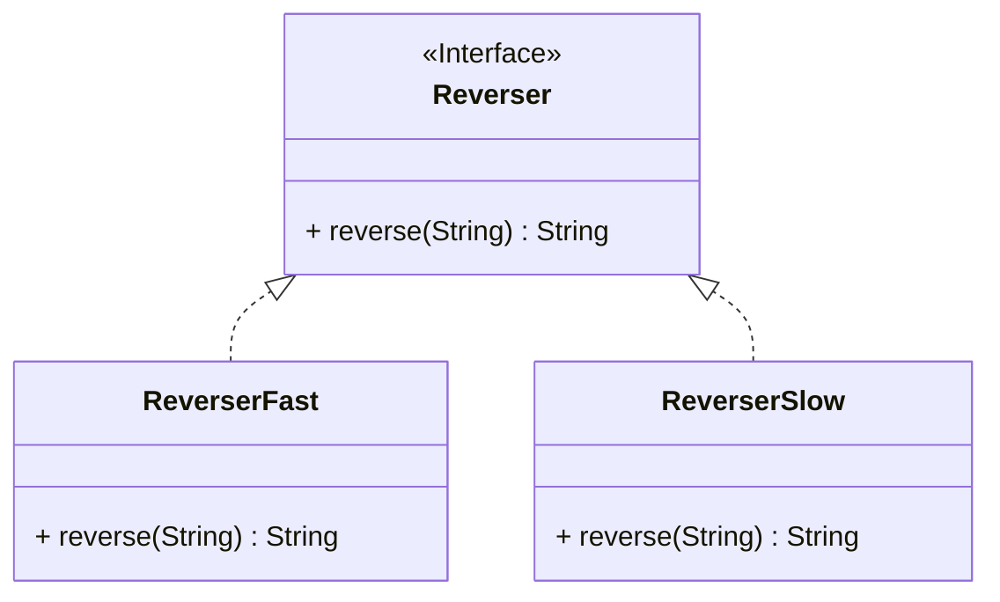

---

### Exercise 14 — phonebook

Source: [phonebook/](phonebook/). Tests: [phonebook/](../../../../../../test/java/com/nbicocchi/exercises/e3_oop/phonebook).

Define two classes, namely PhoneBookArray and PhoneBookList implementing the PhoneBook interface (reported below). 

* PhoneBookArray internally models the phone book as a ```Person[]```.
* PhoneBookList internally models the phone book as an `ArrayList<Person>`.

The methods searchByLastname and searchByNameAndLastname of the PhoneBook interface return all instances matching the search criteria. Both implementations limit the number of people to 256 and do not accept duplicate elements. Represent each person with the `Person(String name, String lastname, String phone)` record supplied in the source; its accessors are `name()`, `lastname()`, and `phone()`.

Refer to the UML diagram, JavaDoc documentation, and unit tests for further inspiration.

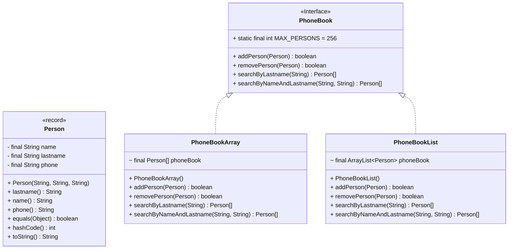

---

### Exercise 15 — bankaccount

Source: [bankaccount/](bankaccount/). Tests: [bankaccount/](../../../../../../test/java/com/nbicocchi/exercises/e3_oop/bankaccount).

Define two classes, namely BankAccountEasy and BankAccountPro implementing the BankAccount interface (reported below).
* BankAccountPro represents a fully fledged bank account, allowing international transfers, negative balances, and a 2% interest rate. Deposits and withdrawals each incur a fee of 1 euro.
* BankAccountEasy represents a basic bank account, which does not support negative balances, international transfers, and does not pay any interest. Nevertheless, deposits and withdrawals are free.

Note well:
* for this exercise, an IBAN must contain between 8 and 34 characters inclusive, and its first two characters (representing the country) must be uppercase letters; full IBAN validation is not required;
* the operationFee (the amount subtracted for each operation) must be greater than or equal to zero;
* the deposit or withdrawal amount must be greater than or equal to zero.

Both accounts must refuse to set **invalid IBANs**, to set **negative fees** and to operate with **negative amounts**.
To implement these functionalities, you can throw an IllegalArgumentException as shown below:

```java
protected void checkPositiveValue(double value) {
    if (value < 0.0) {
        throw new IllegalArgumentException("Negative values are not allowed for this operation");
    }
}
```

Refer to the UML diagram, JavaDoc documentation, and unit tests for further inspiration.

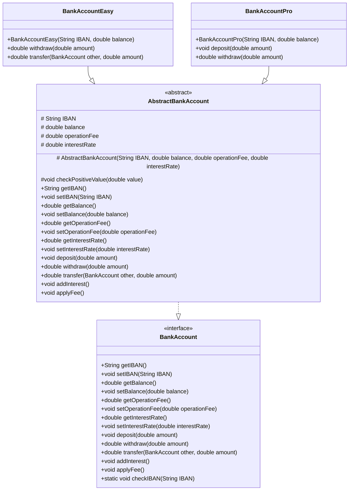

---

### Exercise 16 — shape

Source: [shape/](shape/). Tests: [shape/](../../../../../../test/java/com/nbicocchi/exercises/e3_oop/shape).

Define two classes, namely Circle and Rectangle representing a circle and rectangle on a 2D plane.
* Circle internally uses a Point object and a double value for representing its center and radius.
* Rectangle internally uses two Point objects for representing its upper-left and bottom-right vertices. The edges of the rectangle have to be parallel to the x and y axes.

Both shapes must also support:
* an id (String) for identifying the shape
* a color (String) for coloring the shape (RGB Web Standard #RRGGBB, see https://en.wikipedia.org/wiki/Web_colors)
* the capability of moving on the 2D plane (move() method)
* the capability of resizing (resize() method)
* the capability of computing area and perimeter (getArea(), getPerimeter() methods)

Refer to the UML diagram, JavaDoc documentation, and unit tests for further inspiration.

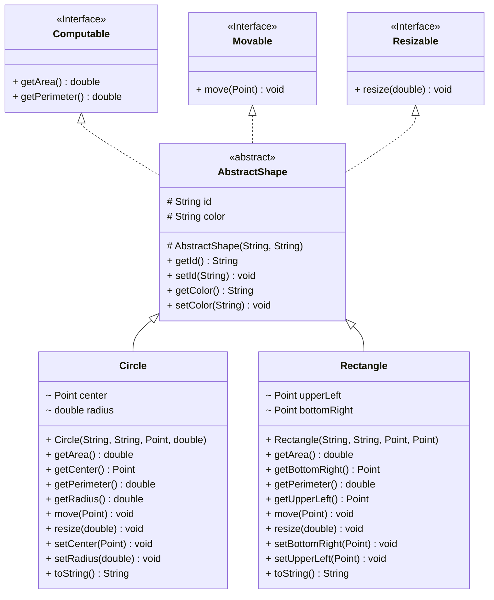

---

### Exercise 17 — polynomials

Source: [polynomials/](polynomials/). Tests: [polynomials/](../../../../../../test/java/com/nbicocchi/exercises/e3_oop/polynomials).

Define two classes, ArrayPoly and ListPoly, implementing the Poly interface to represent a polynomial p = c0 + c1 * x^1 + c2 * x^2 + ... + cn * x^n.
* ArrayPoly internally stores the coefficients (c0 ... cn) as a double[].
* ListPoly internally stores the coefficients (c0 ... cn) as an ```ArrayList<Double>```.

As prescribed by the Poly interface, both implementations must provide:
* a method *coefficient(int degree)* returning the coefficient of a given degree (0 ... n).
* a method *coefficients()* returning a double[] containing all the coefficients.
* a method *degree()* returning the degree of the polynomial (the number of coefficients - 1).
* a method *derivative()* returning the derivative polynomial.

Both implementations must also redefine *equals()* and *hashCode()* in order to be compared with other Poly objects.

Refer to the UML diagram, JavaDoc documentation, and unit tests for further inspiration.

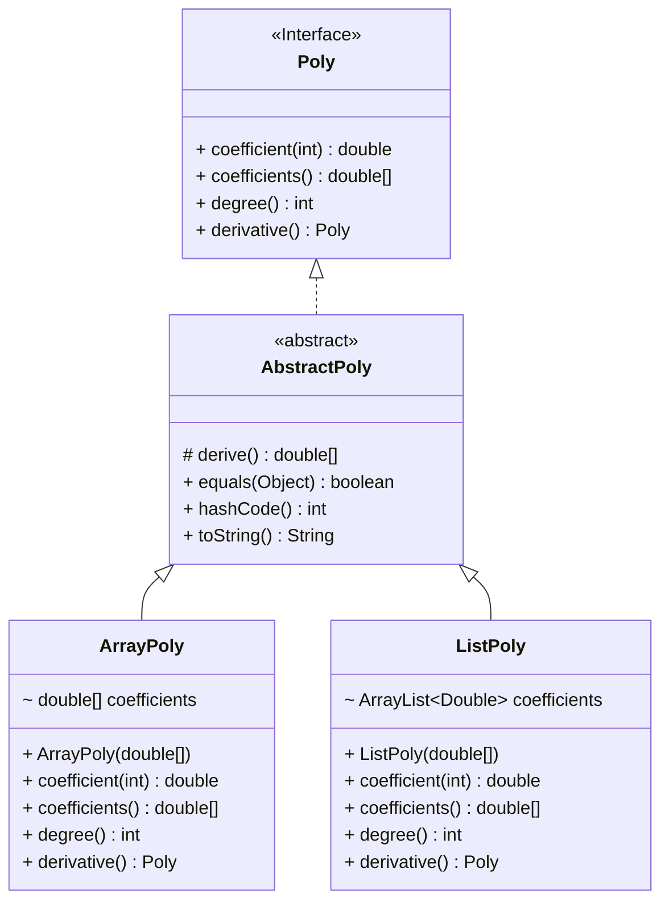

---

### Exercise 18 — library

Source: [library/](library/). Tests: [library/](../../../../../../test/java/com/nbicocchi/exercises/e3_oop/library).

A library needs a software system to manage subscribers, book and DVD loans, and overdue returns.
* Books can be modelled with a title (String), a publication year (int), and a number of pages (int).
* DVDs can be modelled with a title (String), a publication year (int), and a length in minutes (int).
* People can be modelled with an id (String), a first name (String), and a last name (String).
* Loans (Rent objects) contain an item (a book or a DVD), a person, and two dates representing the start and due date of the loan.
* The library itself can be modelled as a `List<Rent>`. It provides methods to add and remove loans, plus `getExpired(LocalDate now)`, which returns the loans whose due date is before the supplied date.

Provide an implementation of all the required classes.

Refer to the UML diagram, JavaDoc documentation, and unit tests for further inspiration.

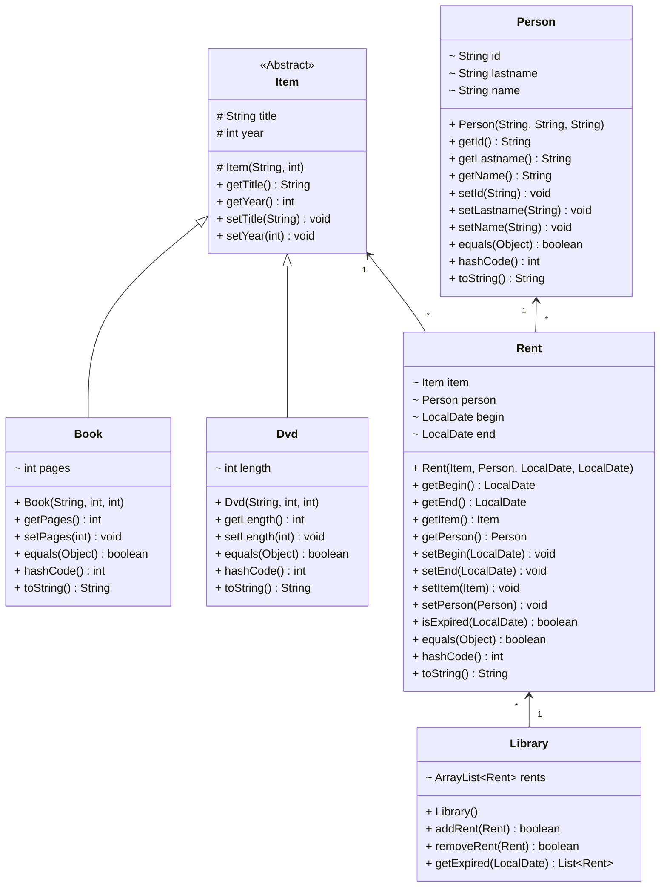

---
