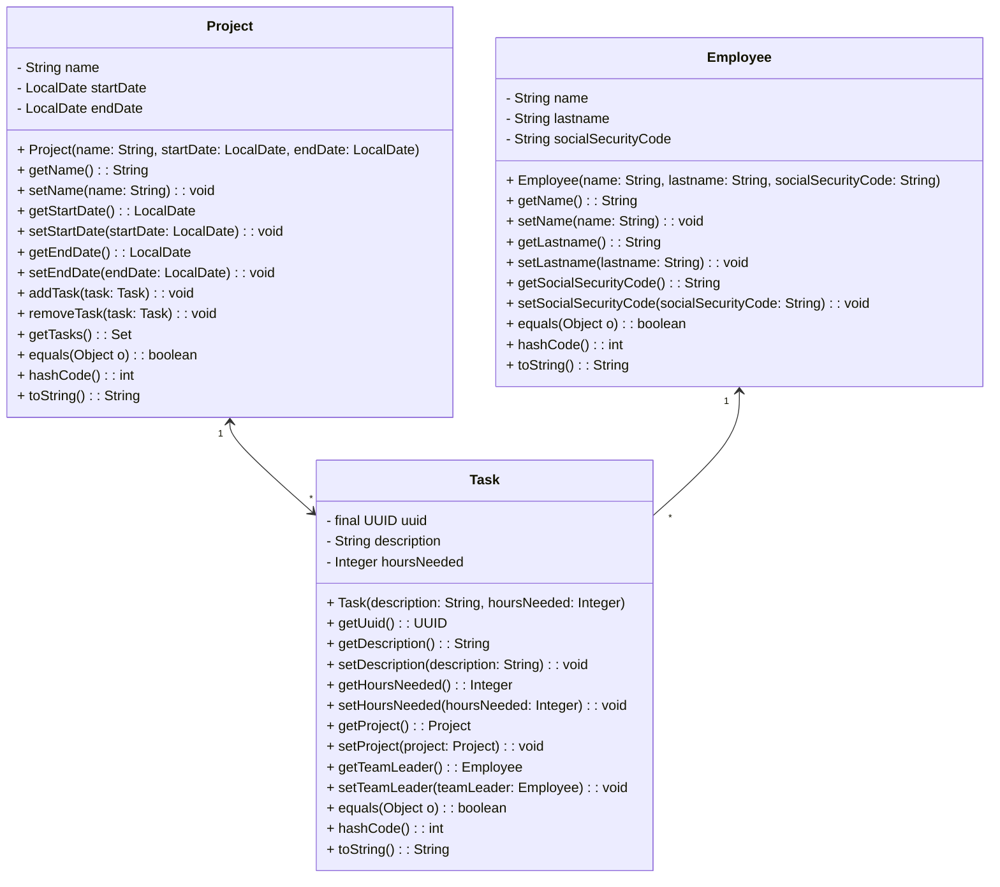

# E4 — Collections

**Java 25 · Practice without AI-generated code**

Implement the exercises yourself and validate your work with the supplied tests where available. The sections follow the order of the covered course topics; exercises may combine earlier skills.

[Course slides and module index](../../../../../../../../../README.md#slides) · [AI exercises](../../../../../../../../exercises-ai/E4%20-%20Java%20Collections.md)

## Contents

- [Lists and iterators](#lists-and-iterators)
- [Sets](#sets)
- [Queues and deques](#queues-and-deques)
- [Maps](#maps)
- [Collection ordering](#collection-ordering)
- [Supporting collection framework](#supporting-collection-framework)

## Running tests

From `exercises/exercises-no-ai/`:

```sh
mvn test
mvn -Dtest="com.nbicocchi.exercises.e4_collections.**" test
```

## Lists and iterators

### Exercise 1 — CollatzSequence

Source: [CollatzSequence.java](CollatzSequence.java). Tests: [CollatzSequenceTest.java](../../../../../../test/java/com/nbicocchi/exercises/e4_collections/CollatzSequenceTest.java).

Consider the following operation on an arbitrary positive integer:

* If the number is even, divide it by two.
* If the number is odd, triple it and add one.

The [Collatz conjecture](https://en.wikipedia.org/wiki/Collatz_conjecture) is one of the most famous unsolved problems in mathematics. The conjecture asks whether repeating the two simple arithmetic operations above will eventually transform every positive integer into 1. Write a static method returning the Collatz sequence for a given integer number greater than 0.

Examples:

* collatzSequence(1) -> [1]
* collatzSequence(2) -> [2, 1]
* collatzSequence(3) -> [3, 10, 5, 16, 8, 4, 2, 1]
* collatzSequence(4) -> [4, 2, 1]

The method has the following prototype:

```java
public static List<Long> collatzSequence(long n);
```

where:

* **n** represents the starting number of the sequence

---

### Exercise 2 — LookAndSay

Source: [LookAndSay.java](LookAndSay.java). Tests: [LookAndSayTest.java](../../../../../../test/java/com/nbicocchi/exercises/e4_collections/LookAndSayTest.java).

Consider the following sequence:
 * 1
 * 11
 * 21
 * 1211
 * 111221

The sequence is generated by "reading out loud" the previous number:
* The first number is "1"
* The second number is "11", obtained by reading the first number which is *one 1*
* The third number is "21", obtained by reading the second number which is *two 1*
* The fourth number is "1211", obtained by reading the third number which is *one 2, one 1*
* The fifth number is "111221", obtained by reading the fourth number which is *one 1, one 2, two 1*

The reading process is on adjacent digits, so the fifth number is not "3112" but "111221".

Examples:

* lookAndSay(0) -> []
* lookAndSay(1) -> [1]
* lookAndSay(2) -> [1, 11]
* lookAndSay(3) -> [1, 11, 21]
* lookAndSay(4) -> [1, 11, 21, 1211]
* lookAndSay(5) -> [1, 11, 21, 1211, 111221]

The method has the following prototype:

```java
public static List<Long> lookAndSay(long n);
```

where:

* **n** represents the number of elements of the sequence

---

### Exercise 3 — DownSize

Source: [DownSize.java](DownSize.java). Tests: [DownSizeTest.java](../../../../../../test/java/com/nbicocchi/exercises/e4_collections/DownSizeTest.java).

Write a method that removes every nth string from a `List<String>`, counting positions from 1. Modify the list in place; assume n is positive.

Examples:

* downsize(["A", "B", "C", "D", "E", "F"], 2) → ["A", "C", "E"] (final list contents)
* downsize(["A", "B", "C", "D", "E", "F"], 3) → ["A", "B", "D", "E"] (final list contents)

The method has the following prototype:

```java
public static void downsize(List<String> list, int n);
```

where:

* **list** is the list to be downsized
* **n** is the interval between removed elements, using their original positions

---

### Exercise 4 — SpeedTest

Source: [SpeedTest.java](SpeedTest.java). Tests: [SpeedTestTest.java](../../../../../../test/java/com/nbicocchi/exercises/e4_collections/SpeedTestTest.java).

Demonstrate that the position in which elements are added to a List impacts performance in a significant way.
Write two methods for inserting an element at the beginning (or end) of a List a certain number of times, returning the elapsed time.
Compare ArrayList and LinkedList using System.nanoTime(), returning elapsed times in nanoseconds. Inserting at the beginning requires shifting elements in an ArrayList, whereas a LinkedList can link a new first node in constant time. Both support constant-time append (amortized for ArrayList). Measure the observed performance, but do not assume a fixed winner or speedup: results depend on JVM warm-up, allocation, and the environment.

The methods have the following prototypes:

```java
public static long insertBeginning(List<String> list, String item, int times);
public static long insertEnd(List<String> list, String item, int times);
```

where:

* **list** is the list used for adding elements.
* **item** is the item to be added.
* **times** is the number of times to repeat the add operation.

---

## Sets

### Exercise 5 — Intersection

Source: [Intersection.java](Intersection.java). Tests: [IntersectionTest.java](../../../../../../test/java/com/nbicocchi/exercises/e4_collections/IntersectionTest.java).

Write a method returning the intersection of two given sets of integers without modifying either input. Set examples show membership, not a guaranteed iteration order.
Write two versions of the same method with and without using Set.retainAll().

Examples:

* intersection([1,2,3], [4,5,6]) → []
* intersection([1,2,3], [3,4,5]) → [3]
* intersection([], []) → []

The methods have the following prototypes:

```java
public static Set<Integer> intersection(Set<Integer> first, Set<Integer> second);
public static Set<Integer> intersectionRetainAll(Set<Integer> first, Set<Integer> second);
```

where:

* **first** is the first Set.
* **second** is the second Set.

---

### Exercise 6 — Union

Source: [Union.java](Union.java). Tests: [UnionTest.java](../../../../../../test/java/com/nbicocchi/exercises/e4_collections/UnionTest.java).

Write a method returning the union of two given sets of integers without modifying either input. The result's iteration order is unspecified.
Write two versions of the same method with and without using Set.addAll().

Examples:

* union([1,2,3], [4,5,6]) → [1,2,3,4,5,6]
* union([1,2,3], [3,4,5]) → [1,2,3,4,5]
* union([], []) → []

The methods have the following prototypes:

```java
public static Set<Integer> union(Set<Integer> first, Set<Integer> second);
public static Set<Integer> unionAddAll(Set<Integer> first, Set<Integer> second);
```

where:

* **first** is the first Set.
* **second** is the second Set.

---

### Exercise 7 — RecurringChars

Source: [RecurringChars.java](RecurringChars.java). Tests: [RecurringCharsTest.java](../../../../../../test/java/com/nbicocchi/exercises/e4_collections/RecurringCharsTest.java).

Write a method accepting a string and returning a set comprising all recurring characters of
the string.

Examples:

* recurringChars("Ciao") → []
* recurringChars("Hello") → ['l']
* recurringChars("Hello World!") → ['l', 'o']

The method has the following prototype:

```java
public static Set<Character> recurringChars(String string);
```

where:

* **string** is the string to be processed.

---

### Exercise 8 — RemoveDuplicates

Source: [RemoveDuplicates.java](RemoveDuplicates.java). Tests: [RemoveDuplicatesTest.java](../../../../../../test/java/com/nbicocchi/exercises/e4_collections/RemoveDuplicatesTest.java).

Write a method returning a new `List<Integer>` containing each distinct input value once. Do not modify the input list. The result's order is unspecified; the examples show one valid order.

Examples:

* removeDuplicates([1,2,3,4,5]) → [1,2,3,4,5]
* removeDuplicates([1,1,1,2,2]) → [1,2]

The method has the following prototype:

```java
public static List<Integer> removeDuplicates(List<Integer> list);
```

where:

* **list** is the list to be processed.

---

### Exercise 9 — Eratosthenes

Source: [Eratosthenes.java](Eratosthenes.java). Tests: [EratosthenesTest.java](../../../../../../test/java/com/nbicocchi/exercises/e4_collections/EratosthenesTest.java).

Implement the [sieve of Eratosthenes](https://en.wikipedia.org/wiki/Sieve_of_Eratosthenes): a method for computing prime numbers, known to the ancient Greeks.
Compute all primes up to *n*, inclusive. Insert the integers from 2 to *n* into a set. For each integer p from 2 through floor(sqrt(n)), remove the multiples 2p, 3p, ... up to n, without removing p itself. The remaining elements are prime. Return an empty set when n is less than 2.

The method has the following prototype:

```java
public static Set<Integer> eratosthenes(int n);
```

where:

* **n** is the upper limit for searching primes.

---

### Exercise 10 — WordAfterWord

Source: [WordAfterWord.java](WordAfterWord.java). Tests: [WordAfterWordTest.java](../../../../../../test/java/com/nbicocchi/exercises/e4_collections/WordAfterWordTest.java).

Use [Ulysses by James Joyce](https://github.com/laumann/ds/blob/master/hashing/books/) (a copy is supplied in `src/main/resources/james-joyce-ulysses.txt`). Read the words, convert them to lowercase, remove repetitions, and sort them alphabetically. Given a lowercase query word, return the first book word strictly greater than it in lexicographic order; the query need not occur in the book. Assume such a word exists (see TreeSet.tailSet()).

The method has the following prototype:

```java
public static String wordAfterWord(String filename, String word) throws IOException;
```

where:

* **filename** is the filename of the book.
* **word** is the query word.

For reading the file and transforming it into a ```List<String>```, you can use:

```java
public static List<String> getLines(String filename) throws IOException {
    return Files.readAllLines(Path.of(filename));
}
```

For splitting a line into a list of single words, you can use:

```java
public static List<String> lineToWords(String line) {
    return Arrays.asList(line.replaceAll("[^a-zA-Z ]", "").toLowerCase().split("\\s+"));
}
```

---

### Exercise 11 — ProjectManagement

Source: [ProjectManagement.java](ProjectManagement.java). Tests: [ProjectManagementTest.java](../../../../../../test/java/com/nbicocchi/exercises/e4_collections/ProjectManagementTest.java).

Sets are frequently used for representing *one-to-many* and *many-to-many* relationships between objects. In this exercise, we'll use the following three classes.

* `Project` represents a project. It encapsulates information such as the project name, start date, end date, and a collection of tasks associated with the project. Projects can have multiple tasks assigned to them.
* `Task` represents a specific task within a project. It contains details such as a unique identifier, description, estimated hours needed to complete the task, associated project, and team leader.
* `Employee` class represents an employee within the system. It contains information such as the employee's first name, last name, and social security code.

The meaning of the lines with one or two arrows in the UML diagram is the following: 
* The *one-to-many* relationship between `Project` and `Task` is bidirectional in that `Project` keeps in memory a Set of `Task`, while `Task` keeps a reference to a `Project` object.
* The *one-to-many* relationship between `Employee` and `Task` is unidirectional in that only `Task` keeps in memory a reference to its team leader `Employee`.

Concerning object equality parameters (which are very important to allow the method `Collection.contains()` to work properly!):
* Projects are considered equal if they have the same name, startDate, endDate.
* Tasks are considered equal if they have the same UUID, regardless of their other attributes.
* Employees are considered equal if they have the same name, lastname, socialSecurityCode.

Implement the described classes while keeping object relationships consistent. For example, assigning a task to a project must update both the `Project` and `Task` objects.
Remember also that relationships in UML (lines connecting classes) become attributes in terms of actual code!




---

## Queues and deques

### Exercise 12 — Reverse

Source: [Reverse.java](Reverse.java). Tests: [ReverseTest.java](../../../../../../test/java/com/nbicocchi/exercises/e4_collections/ReverseTest.java).

Write a method reversing the order of words in a sentence (represented as a `List<String>`) using a Deque implementation as a stack (see .push()/.poll() methods). Each word has to be pushed to the stack and fetched later in reverse order. The method returns void and modifies the original `List<String>`.

Examples:

* reverse(["Hello", "World!"]) → ["World!", "Hello"]
* reverse(["I", "am"]) → ["am", "I"]
* reverse([]) → []

The method has the following prototype:

```java
public static void reverse(List<String> sentence);
```

where:

* **sentence** is the list of words to be reversed.

---

## Maps

### Exercise 13 — CheckAnagrams

Source: [CheckAnagrams.java](CheckAnagrams.java). Tests: [CheckAnagramsTest.java](../../../../../../test/java/com/nbicocchi/exercises/e4_collections/CheckAnagramsTest.java).

Write a static method accepting two Strings and returning true if they are anagrams, false otherwise.

Two strings are considered anagrams if they contain the same characters with the same frequencies, ignoring case. Character order does not matter; identical strings also count as anagrams.

Examples:

* areAnagrams("dusty", "study") -> true
* areAnagrams("world", "sky") -> false
* areAnagrams("cheap", "") -> false
* areAnagrams("CAT", "act") -> true

The method has the following prototype:

```java
public static boolean areAnagrams(String first, String second);
```

where:

* **first** is the first string.
* **second** is the second string.

---

### Exercise 14 — MorseCode

Source: [MorseCode.java](MorseCode.java). Tests: [MorseCodeTest.java](../../../../../../test/java/com/nbicocchi/exercises/e4_collections/MorseCodeTest.java).

Write a static method accepting a String, converting it to lowercase, and returning its [Morse](https://en.wikipedia.org/wiki/Morse_code) translation. Support the 26 letters of the English alphabet and the digits from 0 to 9.

Use a `Map<Character, String>` as a conversion table (dot='.', dash='_') and separate encoded characters with spaces. If the input contains unsupported characters, throw IllegalArgumentException.

Examples:

* morseCode("hello") -> `.... . ._.. ._.. ___`
* morseCode("world") -> `.__ ___ ._. ._.. _..`
* morseCode("w0rld") -> `.__ _____ ._. ._.. _..`
* morseCode("w$rld") -> IllegalArgumentException

The method has the following prototype:

```java
public static String morseCode(String string);
```

where:

* **string** is the string to be converted to Morse code.

---

### Exercise 15 — RomanToDecimal

Source: [RomanToDecimal.java](RomanToDecimal.java). Tests: [RomanToDecimalTest.java](../../../../../../test/java/com/nbicocchi/exercises/e4_collections/RomanToDecimalTest.java).

Roman numerals are represented by seven different symbols: 
* `I` = 1
* `V` = 5
* `X` = 10
* `L` = 50
* `C` = 100
* `D` = 500
* `M` = 1000

Roman numerals are usually written largest to smallest from left to right. However, the numeral for four is not `IIII`. Instead, the number four is written as `IV`. 
Because the one is before the five we subtract it making four. The same principle applies to the number nine, which is written as `IX`. 

There are six instances where subtraction is used:
* `I` can be placed before `V` (5) and `X` (10) to make 4 and 9.
* `X` can be placed before `L` (50) and `C` (100) to make 40 and 90.
* `C` can be placed before `D` (500) and `M` (1000) to make 400 and 900.

Given a valid Roman numeral, convert it to a decimal integer.

Examples:
* romanToDecimal("III") -> 3
* romanToDecimal("LVIII") -> 58
* romanToDecimal("MCMXCIV") -> 1994

The method has the following prototype:

```java
public static int romanToDecimal(String s);
```

where:

* **s** is the string representing the Roman numeral.

Constraints:

* `1 <= s.length() <= 15`
* `s` contains only the characters `('I', 'V', 'X', 'L', 'C', 'D', 'M')`

---

### Exercise 16 — ValuesKeys

Source: [ValuesKeys.java](ValuesKeys.java). Tests: [ValuesKeysTest.java](../../../../../../test/java/com/nbicocchi/exercises/e4_collections/ValuesKeysTest.java).

Write a static method accepting a ```Map<String, String>``` and returning true if some values have been used as keys as well.

The method has the following prototype:

```java
public static boolean valuesKeys(Map<String, String> map);
```

where:

* **map** is the map to be checked.

---

### Exercise 17 — InvertMap

Source: [InvertMap.java](InvertMap.java). Tests: [InvertMapTest.java](../../../../../../test/java/com/nbicocchi/exercises/e4_collections/InvertMapTest.java).

Write a static method accepting a ```Map<Integer, String>``` and returning a `Map<String, Integer>` in which the original keys and values have been inverted.
In case of repeated values (thus associated to multiple keys) you can select one of the keys.

Examples:

* invertMap({1: "Hello", 3: "World"}) → {"Hello": 1, "World": 3}
* invertMap({1: "Hello", 3: "Hello"}) → {"Hello": 1} or {"Hello": 3}

The method has the following prototype:

```java
public static Map<String, Integer> invertMap(Map<Integer, String> src);
```

where:

* **src** is the map to be inverted.

---

### Exercise 18 — WordFrequency

Source: [WordFrequency.java](WordFrequency.java). Tests: [WordFrequencyTest.java](../../../../../../test/java/com/nbicocchi/exercises/e4_collections/WordFrequencyTest.java).

Use [Ulysses by James Joyce](https://github.com/laumann/ds/blob/master/hashing/books/) (a copy is supplied in `src/main/resources/james-joyce-ulysses.txt`). Write a method reading the file and returning a `Map<String, Integer>` whose keys are the unique lowercase words and whose values are their occurrence counts. Use the same word normalization as in WordAfterWord.

The method has the following prototype:

```java
public static Map<String, Integer> wordFrequency(String filename) throws IOException;
```

where:

* **filename** is the filename of the book.

For reading the file and transforming it into a ```List<String>```, you can use:

```java
public static List<String> getLines(String filename) throws IOException {
    return Files.readAllLines(Path.of(filename));
}
```

For splitting a line into a list of single words, you can use:

```java
public static List<String> lineToWords(String line) {
    return Arrays.asList(line.replaceAll("[^a-zA-Z ]", "").toLowerCase().split("\\s+"));
}
```

---

### Exercise 19 — WordFrequencySorted

Source: [WordFrequencySorted.java](WordFrequencySorted.java). Tests: [WordFrequencySortedTest.java](../../../../../../test/java/com/nbicocchi/exercises/e4_collections/WordFrequencySortedTest.java).

In WordFrequencySorted.java, write two methods returning a new `Map<String, Integer>` containing the `limit` most or least frequent words and their counts. Iterate in descending frequency order for `mostFrequent`, and ascending order for `lessFrequent`. Ties may appear in any order. Assume `0 <= limit <= map.size()`.

For sorting, transform the entries into a `List<Map.Entry<String, Integer>>` and use a `Comparator<Map.Entry<String, Integer>>`. LinkedHashMap preserves insertion order.

The methods have the following prototypes:

```java
public static Map<String, Integer> mostFrequent(Map<String, Integer> map, int limit);
public static Map<String, Integer> lessFrequent(Map<String, Integer> map, int limit);
```

where:

* **map** is the `Map<String, Integer>` to process.
* **limit** is the number of most or least frequent words to return.

---

### Exercise 20 — GetUserMemos

Source: [GetUserMemos.java](GetUserMemos.java). Tests: [GetUserMemosTest.java](../../../../../../test/java/com/nbicocchi/exercises/e4_collections/GetUserMemosTest.java).

Our task is to iterate through a list of Users and, for each user, retrieve the corresponding content from a list of Posts (see code below).

```java
public class GetUserMemos {
    public record User(Long userId, String name) {}
    public record Post(Long userId, String content) {}
    public record UserPost(String name, String content) {}

    public static List<User> getUsers() {
        List<User> users = new ArrayList<>();
        for (int i = 0; i < 4000; i++) {
            User user = new User((long)i, UUID.randomUUID().toString());
            users.add(user);
        }
        return users;
    }

    public static List<Post> getPosts() {
        List<Post> posts = new ArrayList<>();
        for (int i = 0; i < 4000; i++) {
            Post post = new Post((long)i, UUID.randomUUID().toString());
            posts.add(post);
        }
        return posts;
    }

    public static List<UserPost> getUserPosts() {
        List<UserPost> userPosts = new ArrayList<>();
        for (User user : getUsers()) {
            for (Post post : getPosts()) {
                if (user.userId().equals(post.userId())) {
                    userPosts.add(new UserPost(user.name(), post.content()));
                }
            }
        }
        return userPosts;
    }

    public static List<UserPost> getUserPostsFast() {
        // to do!
    }
}
```

* **User**: Represents a user with an ID and a name.
* **Post**: Represents a post associated with a `userId` and some content.
* **UserPost**: Represents a combined view of a post with the user's name and post content.
* **getUsers()**: Generates 4000 random users.
* **getPosts()**: Generates 4000 random posts.
* **getUserPosts()**

    * Combines users and posts by matching `userId`.
    * For each user, it checks all posts to find matches: O(u × p) comparisons for u users and p posts, or O(n²) when both counts are n. The example also regenerates the posts inside the outer loop, adding substantial overhead.
    * When a matching post is found, it creates a `UserPost` with the user's name and the post's content.

Implement `getUserPostsFast()` with the same matching rule: produce a UserPost containing the user's name and post content for each matching userId. The supplied generators use unique IDs from 0 to 3999 in ascending order, but generate new random names and contents on each call; separate calls therefore do not return equal records.

Generate each input list once in the fast version and use an index, such as a `Map<Long, User>`, to avoid nested scans. For a fair comparison of correctness and matching performance, give both algorithms the same pre-generated input lists. Aim for expected O(u + p) matching time with hash-based lookup; measure the speedup rather than requiring an environment-dependent factor such as 10×.

---

## Collection ordering

### Exercise 21 — SortAccount

Source: [SortAccount.java](SortAccount.java). Tests: [SortAccountTest.java](../../../../../../test/java/com/nbicocchi/exercises/e4_collections/SortAccountTest.java).

Given the following class Account:

```java
public static class Account {
    double amount;
    double interestRate;
    LocalDate duePayment;
    // ...
}
```

Write three methods accepting a `List<Account>` and returning void. Each method sorts the list in ascending order by the indicated attribute.

The methods have the following prototypes:

```java
public static void sortByAmount(List<Account> accounts);
public static void sortByInterestRate(List<Account> accounts);
public static void sortByDuePayment(List<Account> accounts);
```

where:

* **accounts** is the list of Account objects to sort.

---

## Supporting collection framework

The [mycollections package](mycollections/) contains the minimalist collection framework used by the [generic collections exercise](../e6_generics/README.md#putting-generics-into-practice) in E6. Its [automated tests](../../../../../../test/java/com/nbicocchi/exercises/e4_collections/mycollections/) remain alongside the E4 tests.
