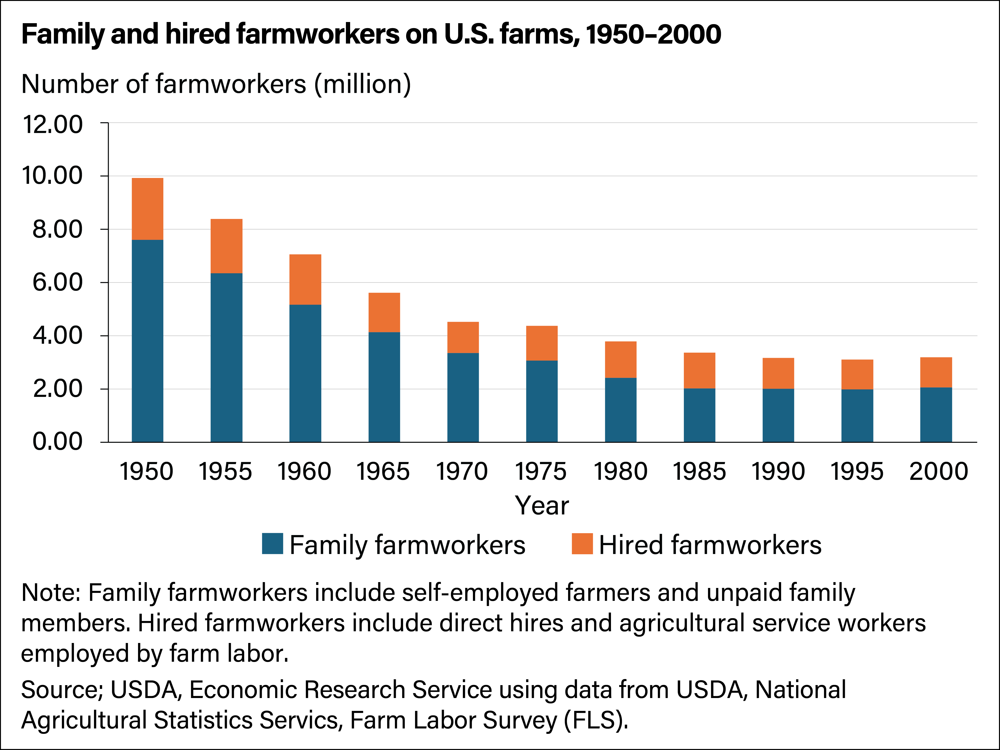
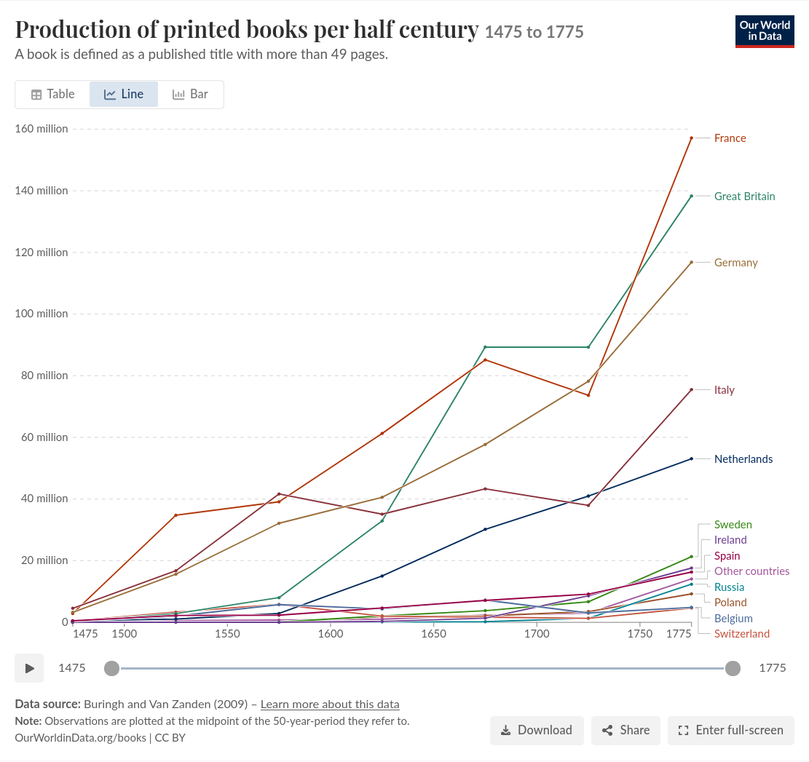

# A0 — Computing in the Age of AI

## Ten years from now: an open question

AI tools can generate code, explain programs, propose tests, and automate parts of software development.

But **[we do not know what computing jobs will look like in ten years](https://www.youtube.com/watch?v=vDjW_dRyKXY&t=3526s)**. Technical progress, reliability, adoption costs, regulation, and demand all affect the outcome.

We can examine how earlier technologies changed work and use those mechanisms to reason about possible futures.

**Historical analogies are tools for thinking, not predictions.**

## Bear case: the tractor

Agricultural mechanization made it possible to produce much more with far less human labor. Over time, agricultural employment fell sharply in many industrialized economies.

_Source: [USDA Economic Research Service](https://www.ers.usda.gov/media/23669/63450-chart-image-file.png)._

The tractor illustrates a possible mechanism:

> **A large increase in productivity can reduce the number of people needed, even when the product remains essential.**

Applied to software: if AI reduces the labor needed per project and demand does not expand enough to compensate, fewer developers may be needed overall.

The analogy has limits. Agricultural change took decades and involved much more than tractors, including fertilizers, changes in farm organization, and wider economic transformation.

## Bull case: the printing press

Printing with movable type greatly reduced the labor needed to reproduce texts. Its long-term significance was not just producing the same manuscripts with fewer workers.

Cheaper reproduction helped support a much larger market for books and, over time, newspapers and other publications, alongside expanding literacy and new institutions.

_Source: [Our World in Data](https://ourworldindata.org/books), based on Buringh and Van Zanden (2009). CC BY._

The printing press illustrates another possible mechanism:

> **Lower production costs can make previously uneconomic uses viable and help create a much larger market.**

Applied to software: small organizations, specialized professions, and individual users may obtain tools that are currently too expensive to build and maintain.

## What previously uneconomic software might look like

Consider:

* A small association that needs a tool for managing volunteers and equipment.
* A workshop that needs to connect an old machine to its planning system.
* A research group that needs a specialized data-processing application.
* A person who needs an accessibility tool adapted to a particular workflow.

The benefit may be real but too small to justify a conventional custom-software project. Lower development costs could change that calculation.

**Generating the first version is not the whole cost:** integration, security, hosting, support, and maintenance still matter. The optimistic scenario requires useful systems to become cheaper over their lifetime, not just cheaper code generation.

## More software does not automatically mean more jobs

The printing press did not preserve the occupation of manuscript copying simply because publishing expanded.

Likewise, a growing software market would not guarantee that every existing computing role survives—or that the number of workers grows as quickly as output.

Both scenarios can occur at once:

* Much more software is produced.
* Each project needs fewer people for some tasks.
* Some roles shrink, while other activities and roles expand.
* Outcomes differ across sectors, organizations, and career stages.

**Sector growth, employment, wages, and the security of a particular job are different outcomes.**

## Tasks change before job titles tell the whole story

Software work includes more than producing source code:

* Understand a problem and decide whether software is an appropriate solution.
* Turn incomplete requests into explicit requirements.
* Choose designs and integrate systems under real constraints.
* Check correctness, security, performance, and failure behavior.
* Operate systems and take responsibility for their consequences.

AI may assist or automate parts of all these activities. This is not a list of permanently protected tasks.

The useful distinction is **between activities and responsibilities**, not simply between “programmers” and “everyone else”.

## Is computer engineering still a sensible degree choice?

**Yes: it remains a well-motivated choice, including for employment. That is not a promise of an unchanged career or a guaranteed job.**

There are concrete reasons to choose it:

* **Breadth:** computing skills apply across manufacturing, healthcare, energy, finance, public services, and many other sectors.
* **Participation in automation:** understanding computing helps us build, integrate, and evaluate the tools changing those sectors, rather than only use them.
* **Different career directions:** software, infrastructure, security, data, and embedded systems offer different paths, each requiring further learning and specialization.

These are reasons for adaptability, not immunity to disruption. Entry-level opportunities may also become harder to access if organizations automate tasks through which beginners traditionally learned.

> **The payoff of studying computer engineering is being able to take on harder, better-paid problems—and build products of your own. Use the classroom to develop skills that are difficult to acquire by prompting alone: understanding systems, diagnosing failures, and making things work under real constraints. AI can help you build a demo; those skills help you turn it into something people pay for.**

## Resources
