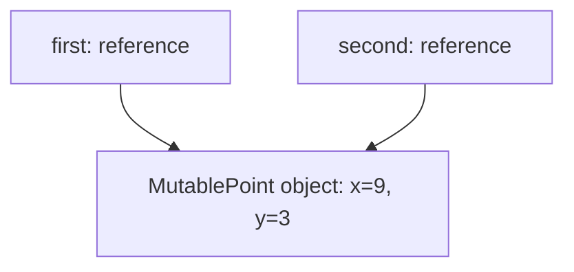
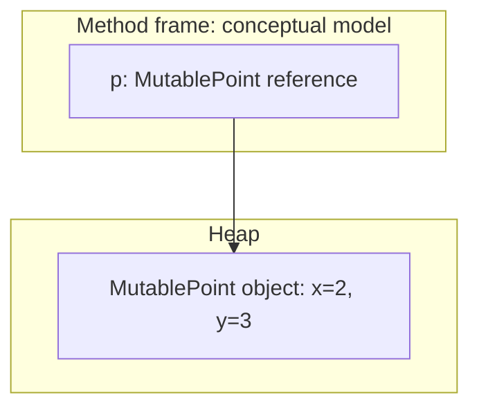
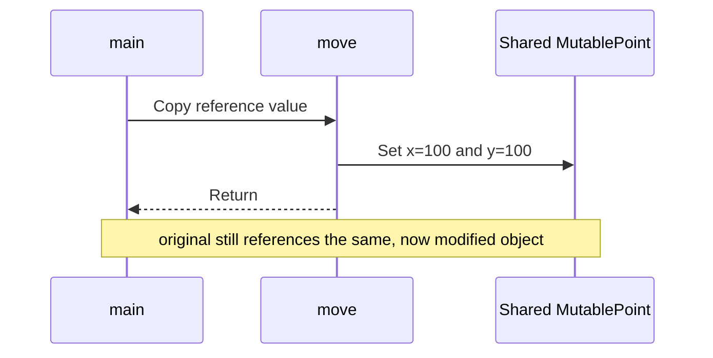
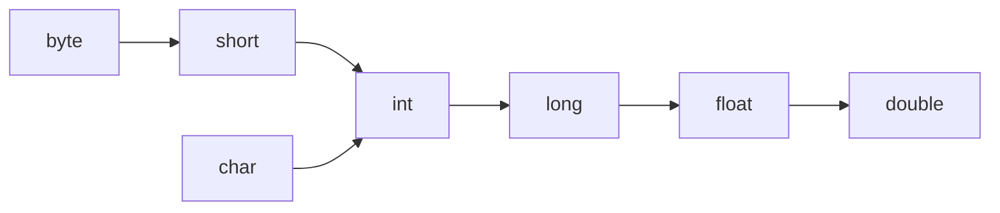

# Java Basics

## Why Java?

As discussed in E1.1, Java combines a static type system, a mature ecosystem, and a runtime designed for portable, long-lived applications.

Here we focus on **reading, running, and understanding small programs**.

All examples target **Java 25 without preview features**. We introduce compact source files alongside the conventional class and static `main` form; both are supported.

### How to use this lesson

**Prerequisites:** basic procedural programming, including variables, conditions, and loops (for example, in C). This lesson introduces their Java form rather than programming from scratch.

* **Core:** understand and apply the main explanations and examples.
* **Note:** supporting detail; not required on a first reading.
* **Reference:** tables and background to consult rather than memorize.

The core goals are to run a program, trace values and references, explain parameter passing, and recognize common numeric and control-flow errors.

## A first program

### Compact source file

Save this complete Java 25 program as `HelloCompact.java`:

```java
void main() {
    IO.println("Hello world!");
}
```

Run it directly with the JDK source launcher:

```bash
java HelloCompact.java
```

No class declaration, static modifier, command-line parameter, or preview flag is required. The compiler supplies an implicit class; the program still consists of a method belonging to a class. `IO` is the new `java.lang.IO` helper for simple line-oriented input/output.

### Explicit class and static main

The conventional form remains valid and useful for larger examples:

Save the following as `HelloWorld.java`:

```java
public class HelloWorld {
    public static void main(String[] args) {
        System.out.println("Hello world!");
    }
}
```

From the directory containing the file:

```bash
javac HelloWorld.java
java HelloWorld
```

* `javac` compiles the source into `HelloWorld.class`.
* `java` launches the program using the class name, without the `.class` suffix.
* `System.out.println` prints a line to standard output.

**Try:** change the message, save, compile, and run again. What happens if you save but do not recompile before running `java HelloWorld`?

## Programs, files and classes

A Java program can contain multiple packages and source files. An ordinary source file can declare multiple top-level types, such as classes, interfaces, enums, and records. A compact source file instead declares its class implicitly and cannot declare a package.

With the conventional file-based compilation used here, at most one top-level type in a file is `public`, and **the file name must match that public type's name**.


The explicit `HelloWorld` example has one named class and no package declaration. Larger examples use named packages to organize related types.

### Imports and the Java 25 source forms

Ordinary source files automatically import `java.lang` types, including `String`, `Math`, and `IO`. Compact source files additionally import the public top-level types of packages exported by `java.base`, making types such as `List` available without explicit imports.

Java 25 also supports **module import declarations** in ordinary files:

```java
import module java.base;

class NameLengths {
    void main() {
        List<String> names = List.of("Ada", "Grace");
        names.forEach(name -> IO.println(name.length()));
    }
}
```

`void main()` is also valid inside an explicit class. For an instance main, the launcher needs a non-private no-argument constructor; this class receives one automatically. A module import imports types, not static methods, and does not add a dependency or replace a module descriptor. Explicit type imports remain useful for clarity and resolving name conflicts.

## Building and running


The compiler produces **bytecode** stored in `.class` files. The JVM loads and executes it; modern JVMs use **Just-In-Time (JIT) compilation** to translate frequently executed code into native machine code.

Distinguish three kinds of problem:

| Problem | Example | How to investigate |
|---|---|---|
| Compilation error | Undefined variable | Read the compiler diagnostic |
| Runtime failure | Integer division by zero | Read the exception and stack trace |
| Incorrect behavior | Wrong average | Compare actual results with requirements |

**A successful compilation does not establish that a program is correct.**

## History

**Reference — background, not a list of dates to memorize.**

* **1991–1996:** the Green project at Sun Microsystems led to Java's introduction and JDK 1.0.
* **2004 — Java 5:** generics, annotations, enums, and enhanced `for`.
* **2014 — Java 8:** lambdas and streams.
* **2018 / 2021 / 2023 / 2025:** Java 11, 17, 21, and 25 LTS releases.

Java has a six-month feature-release cycle. Recent LTS releases follow a two-year cadence; long-term support is provided according to the JDK vendor's policy.

The slides use Java 25 as their baseline. Compact source files, instance main methods, flexible constructor bodies, and scoped values are stable in this release. Not every feature discussed online is final: structured concurrency and primitive patterns are still preview in Java 25 and are not required by these examples.

See: [Java version history](https://en.wikipedia.org/wiki/Java_version_history), [The Java Story](https://www.youtube.com/watch?v=ZqGSg4b_cZA).

## Build tools

Compiling one file manually is simple. A project with dependencies, resources, and tests needs a repeatable build process.

* **Maven:** declarative configuration in `pom.xml`, standard directory layout, dependency management.
* **Gradle:** build configuration in Kotlin or Groovy, dependency management, incremental builds and caching.

Both can automate compilation, testing, and packaging. This repository uses **Maven**.

From a module directory containing `pom.xml`, with Maven installed:

```bash
mvn compile
mvn test
mvn package
```

These are lifecycle phases: later phases include earlier work. `package` normally includes running tests.

A successful command is only useful evidence if the expected sources were compiled and the expected tests actually ran. Read the build summary, including the test count.

> **Note:** a Java 25 example requires a compatible JDK and compiler configuration, not just updated slides. Check `java -version`, `javac -version`, and the build's configured release. The existing repository modules may still target an earlier release; their configuration is separate from this slide update.

## Maven project structure

```text
project-root/
 ├─ pom.xml
 └─ src/
    ├─ main/
    │  ├─ java/        (application source code)
    │  └─ resources/   (non-code application resources)
    └─ test/
       ├─ java/        (test source code)
       └─ resources/   (resources used by tests)
```

* `pom.xml` defines dependencies, plugins, and build configuration.
* Resources can include configuration files or test data.

> **Note:** unit and integration tests may require different execution configuration; a directory name alone does not make a test run.

Standard conventions help IDEs, build servers, developers, and assistants work with the same project structure.

## Methods

Behavior is organized into **methods** belonging to classes or interfaces, rather than standalone functions. In a compact source file, methods outside an explicit class body are members of the implicitly declared class, not free functions or top-level executable statements.

A method can receive parameters and return a value. `void` means that it does not return a value.

Replace the first `HelloWorld` example with:

```java
public class HelloWorld {
    public static void main(String[] args) {
        int result = multiplyByTwo(20);
        System.out.println(result); // 40
    }

    public static int multiplyByTwo(int number) {
        return 2 * number;
    }
}
```

* `int number` declares a parameter.
* `20` is the argument supplied by the caller.
* `return` supplies the result and ends that invocation.
* `static` allows this method to be called without creating a `HelloWorld` object.

The method name describes an operation, but not its complete contract: for large `int` inputs, multiplication can overflow. We return to this below.

## Code blocks and scope

Braces `{ }` delimit blocks. A local variable is available only within its scope and must be definitely assigned before use.

```java
public class ScopeDemo {
    public static void main(String[] args) {
        int number = 3;
        {
            int doubled = 2 * number;
            System.out.println(doubled); // 6
        }
        System.out.println(number); // 3
        // System.out.println(doubled); // Does not compile: out of scope
    }
}
```

```java
int count;
// System.out.println(count); // Does not compile: not initialized
count = 3;
System.out.println(count);
```

Fields receive default values; local variables do not receive the same automatic initialization. Keep variables close to where they are needed.

## Conventions

### Coding conventions

* **Packages:** lowercase, e.g. `com.nbicocchi.myapp`.
* **Classes and interfaces:** `UpperCamelCase`, e.g. `Point`, `List`, `Comparable`.
* **Fields, parameters, and local variables:** `lowerCamelCase`, e.g. `eventCount`.
* **Methods:** descriptive `lowerCamelCase`, e.g. `findMedian`, `distance`, `isEmpty`.
* **Constants:** typically `UPPER_SNAKE_CASE`, e.g. `MAX_SIZE`.
* **Braces:** opening brace on the declaration or statement line; closing brace on its own line.

Interfaces may have noun or adjective names. Getter/setter naming is common, but not every API needs getters and setters; records, for example, use component names for accessors.

Prefer meaningful names and consistent formatting over clever abbreviations. Use IntelliJ **Reformat Code** (`Ctrl+Alt+L`).

See: [Java Coding Standard](../books/Java-Coding-Standard.pdf).

### Comments

```java
// A single-line comment

/*
 * A block comment
 */

/**
 * Doubles a small integer without overflowing.
 * @param number a value between -100 and 100 (caller precondition)
 * @return twice number
 */
public static int multiplyByTwo(int number) {
    return 2 * number;
}
```


Comments are useful for **contracts, reasons, and constraints**. Do not merely translate every statement into English. A generated comment can be wrong or become outdated just like any other comment.

Here, the documented input range is a responsibility of the caller; the method does not enforce it. Documentation and runtime validation are different things.

## Primitive types

**Core:** distinguish integer, floating-point, character, and boolean values; use `int`, `long`, `double`, and `boolean` appropriately.

**Reference — sizes, ranges, and less frequently used types:**

| Type | Size (bits) | Range or meaning | Example |
|---|---|---|---|
| `byte` | 8 | −2^7 to 2^7 − 1 | `byte b = 100;` |
| `short` | 16 | −2^15 to 2^15 − 1 | `short s = 30_000;` |
| `int` | 32 | −2^31 to 2^31 − 1 | `int i = 100_000_000;` |
| `long` | 64 | −2^63 to 2^63 − 1 | `long l = 100_000_000_000_000L;` |
| `float` | 32 | IEEE 754 binary32 | `float f = 1.456f;` |
| `double` | 64 | IEEE 754 binary64 | `double d = 1.456789012345678;` |
| `char` | 16 | UTF-16 code unit, 0 to 65,535 | `char c = 'c';` |
| `boolean` | Not specified as a storage size here | `true` or `false` | `boolean b = true;` |

For floating-point types, distinguish:

| Type | Largest positive finite value | Smallest positive nonzero value |
|---|---|---|
| `float` | approximately 3.4 × 10^38 | approximately 1.4 × 10^−45 |
| `double` | approximately 1.8 × 10^308 | approximately 4.9 × 10^−324 |

> **Note:** the most negative finite value is `-Float.MAX_VALUE` or `-Double.MAX_VALUE`. `MIN_VALUE` means the smallest positive nonzero value for these two types, not the most negative value.

> **Note:** floating-point values also include signed zero, infinities, and `NaN`. A `char` is a UTF-16 code unit and does not necessarily represent an entire Unicode character.

### Literals

**Reference:** focus first on decimal numbers, strings, booleans, and `null`. Other notations can be consulted when encountered.

| Kind | Examples | Notes |
|---|---|---|
| Decimal integer | `42`, `30_000`, `42L` | `L` denotes `long` |
| Binary integer | `0b11011` | Prefix `0b` |
| Hexadecimal integer | `0x9A` | Prefix `0x` |
| Octal integer | `0275` | Leading `0`; avoid accidental octal notation |
| Floating-point | `3.14`, `1.456f`, `3.14e2` | Default is `double`; `f` denotes `float` |
| Character | `'A'`, `'\n'`, `'\u0041'` | Single quotes |
| String | `"John Doe"` | Double quotes; `String` is not primitive |
| Boolean | `true`, `false` | Not interchangeable with `0` and `1` |
| Null | `null` | No object is referenced |

### Constants

A `final` variable can be assigned only once. For a reference variable, the object itself may still be mutable.

```java
public class ConstantsDemo {
    private static final int MAX_ATTEMPTS = 3;

    public static void main(String[] args) {
        final int attempts = MAX_ATTEMPTS;
        // attempts++; // Does not compile
        System.out.println(attempts);
    }
}
```

Use named constants to explain meaningful values, not to give a name to every literal.

> **Note:** not every `final` variable is a compile-time constant; that distinction is not needed for the examples here.

## Reference variables

A primitive variable holds a primitive value. A reference variable holds a reference value identifying an object, or `null`.

For the following examples, save this teaching type as `MutablePoint.java`. Its name distinguishes it from the encapsulated `Point` in E1.1. Public mutable fields deliberately make state changes visible here; this is an execution-model example, not a recommendation for API design.

```java
public class MutablePoint {
    public int x;
    public int y;

    public MutablePoint(int x, int y) {
        this.x = x;
        this.y = y;
    }
}
```

**Predict before running:** inside a `main` method, what does the first `println` print? Draw how many objects are created.

```java
String message = "Hello world!";
MutablePoint first = new MutablePoint(2, 3);
MutablePoint second = first;

second.x = 9;
System.out.println(first.x);
System.out.println(message.length());
```

<details>
<summary>Check your prediction</summary>

The output is `9`, then `12`. `first` and `second` refer to one shared `MutablePoint` object; assigning the reference did not copy that object.



This is **aliasing**: two references identify the same object. Assigning a reference does not copy the object.

</details>

### References and memory

The JVM manages object allocation and reclamation. A useful introductory model places objects in the heap and local variables in method stack frames.



> **Note:** this is a conceptual model, not a promise about optimized physical memory layout. Reference fields can also be stored inside other objects.

Compared with C pointers, Java references do not support pointer arithmetic or explicit `free`. Garbage collection does not replace closing files or other external resources.

### Null and final references

```java
MutablePoint missing = null;
// System.out.println(missing.x); // Throws NullPointerException

final MutablePoint point = new MutablePoint(2, 3);
point.x = 10;                 // Allowed: mutate the object
// point = new MutablePoint(5, 7); // Does not compile: reassign final variable
```

**Predict:** after `MutablePoint a = new MutablePoint(1, 2); MutablePoint b = a; b = new MutablePoint(8, 9);`, what are `a.x` and `b.x`? Draw the references before running it.

## Passing parameters to methods

Java is **always pass-by-value**. Each argument value is copied into a separate parameter variable.

* For primitives, the primitive value is copied.
* For references, the reference value is copied—not the object.

### Changing primitive parameters

```java
public class PrimitiveParameters {
    public static void swap(int a, int b) {
        int temporary = a;
        a = b;
        b = temporary;
    }

    public static void main(String[] args) {
        int a = 2;
        int b = 3;
        swap(a, b);
        System.out.println(a + ", " + b); // 2, 3
    }
}
```

Only local copies are swapped. The caller's variables are unchanged.

### Reassigning a reference parameter

Compile this class alongside `MutablePoint.java`. **Before running it, predict the two printed values.**

```java
public class ReferenceParameters {
    public static void replace(MutablePoint point) {
        point = new MutablePoint(100, 100);
    }

    public static void move(MutablePoint point) {
        point.x = 100;
        point.y = 100;
    }

    public static void main(String[] args) {
        MutablePoint original = new MutablePoint(2, 3);
        replace(original);
        System.out.println(original.x);
        move(original);
        System.out.println(original.x);
    }
}
```

### Debugger activity: variable versus object

1. Set a breakpoint on `replace(original)` in `main` and start debugging.
2. Use **Step Into** to enter `replace`; observe `point` and the object it identifies.
3. Execute the assignment, then inspect `original` in the caller's stack frame. Do `point` and `original` still identify the same object?
4. Return to `main`, then step into `move` and inspect the fields before and after its assignments.
5. Explain which operation changed a local reference and which changed the shared object.

<details>
<summary>Check your prediction and explanation</summary>

The output is `2`, then `100`. `replace` changes only its parameter. `move` uses its copy of the reference to mutate the shared object.



</details>

### Swapping object state is not swapping caller references

This method swaps coordinates, not the reference values in the caller:

```java
public static void swapCoordinates(MutablePoint a, MutablePoint b) {
    int temporaryX = a.x;
    int temporaryY = a.y;
    a.x = b.x;
    a.y = b.y;
    b.x = temporaryX;
    b.y = temporaryY;
}
```

| Operation inside a method | Changes the caller's variable? | Can change a shared object? |
|---|---|---|
| `number = 100` | No | Not applicable |
| `point = new MutablePoint(100, 100)` | No | No mutation of the original object |
| `point.x = 100` | No | Yes |

**Review:** an assistant claims that `move` works because objects are passed by reference. Explain why the observed behavior is right but the explanation is wrong.

## Working with numbers

### The Math library

`java.lang.Math` provides numeric operations and is available without an explicit import.

```java
public class MathDemo {
    public static void main(String[] args) {
        System.out.println(Math.sqrt(25)); // 5.0
        System.out.println(Math.max(10, 20)); // 20
        System.out.println(Math.log(-1)); // NaN
    }
}
```

Not every invalid numeric operation throws an exception. Check the API's documented behavior.

### Integer division

**Predict:** all four variables below are `double`. Do they all contain the same value?

```java
double average = 5 / 2;
double correct = 5 / 2.0;
double alsoCorrect = (double) 5 / 2;
double tooLate = (double) (5 / 2);
```

Print each value to test your prediction.

<details>
<summary>Check your prediction</summary>

The values are `2.0`, `2.5`, `2.5`, and `2.0`, respectively.

The operand types determine the division. Assigning the result to `double` does not restore a discarded fractional part.

</details>

Integer division truncates toward zero: `-5 / 2` is `-2`. Integer division by zero throws `ArithmeticException`; floating-point division by zero can produce infinity or `NaN`.

### Overflow and numeric promotion

```java
long wrong = 100_000 * 100_000;   // 1410065408: int overflow first
long correct = 100_000L * 100_000; // 10000000000
long tooLate = (long) (100_000 * 100_000); // Still wrong

byte a = 10;
byte b = 20;
int sum = a + b; // byte operands are promoted to int
```

Ordinary integer arithmetic does not automatically report overflow. When overflow must be detected, APIs such as `Math.multiplyExact` can help.

**Predict:** what does `Integer.MAX_VALUE + 1` produce? Does assigning it to `long` prevent overflow?

### Floating-point precision

```java
System.out.println(0.1 + 0.2);        // 0.30000000000000004
System.out.println(0.1 + 0.2 == 0.3); // false
```

Many decimal fractions cannot be represented exactly in binary floating-point.

For approximate computations, choose a comparison tolerance appropriate to the problem and scale.

> **Note:** exact decimal requirements may call for `BigDecimal` and an explicit rounding policy. We do not develop that API in this lesson.

### Random numbers

```java
import java.util.random.RandomGenerator;

public class RandomDemo {
    public static void main(String[] args) {
        RandomGenerator random = RandomGenerator.getDefault();
        int anyInt = random.nextInt();       // Any int value
        int below100 = random.nextInt(100);  // [0, 100)
        int between = random.nextInt(10, 20); // [10, 20)
        long below100Long = random.nextLong(100); // [0, 100)
        double fraction = random.nextDouble();   // [0.0, 1.0)
        double scaled = random.nextDouble(10.0, 20.0); // [10.0, 20.0)
        boolean flag = random.nextBoolean();
        System.out.println(between);
    }
}
```

The upper bound is exclusive. Do not assume an exact output for this example. Reproducible tests should control their inputs or generator.

> **Note:** security-sensitive randomness requires an appropriate API such as `SecureRandom`; the generator above is not a security recommendation.

## Operators

Operators combine operands to produce values. The table below is a **reference**, not a memorization exercise. Higher rows bind more tightly.

| Category | Operators |
|---|---|
| Postfix | `expr++ expr--` |
| Unary | `++expr --expr +expr -expr ~ !` |
| Multiplicative | `* / %` |
| Additive | `+ -` |
| Shift | `<< >> >>>` |
| Relational | `< > <= >= instanceof` |
| Equality | `== !=` |
| Bitwise AND | `&` |
| Bitwise XOR | `^` |
| Bitwise OR | `\|` |
| Logical AND | `&&` |
| Logical OR | `\|\|` |
| Conditional | `? :` |
| Assignment | `= += -= *= /= %= &= ^= \|= <<= >>= >>>=` |

### Grouping versus evaluation order

* **Precedence** and **associativity** determine expression grouping.
* Java evaluates operands from left to right, subject to conditional evaluation rules.
* Parentheses make intended grouping explicit; avoid expressions with several side effects.

```java
int result = 2 + 3 * 4;       // 14
int grouped = (2 + 3) * 4;    // 20
int leftGrouped = 10 - 3 - 2; // (10 - 3) - 2 = 5
```

### Short-circuit evaluation

`&&` evaluates its right operand only if the left operand is `true`. `||` evaluates its right operand only if the left operand is `false`.

```java
int count = 0;
int total = 10;
boolean acceptable = count != 0 && total / count > 2; // false; no division
```

**Review:** replacing `&&` with `&` here still compiles, but both operands are evaluated and integer division by zero fails. These operators are not interchangeable optimizations.

## Casting

### Implicit casting

The compiler permits **widening primitive conversions** without an explicit cast.

**Reference — main conversion paths:**



```java
int number = 10;
long larger = number;
double decimal = larger;
```

Widening is not synonymous with exactness. `int` to `float`, `long` to `float`, and `long` to `double` can lose precision.

```java
int original = 16_777_217;
float rounded = original;
System.out.println((int) rounded); // 16777216
```

### Explicit casting

A narrowing primitive conversion generally requires a cast and may lose information.

```java
double decimal = 2.9;
int truncated = (int) decimal; // 2, not rounded to nearest
int negative = (int) -2.9;    // -2
byte wrapped = (byte) 130;    // -126
char letter = (char) 65;      // 'A'
```

> **Note:** some representable integer constant expressions can be assigned to smaller types without a cast, such as `byte value = 100;`.

**A cast is not input validation.** It requests a conversion; it does not guarantee that the value fits the application's requirements.

## Flow-control statements

### Decision statements

#### if statement

Only the first matching branch is executed:

```java
int time = 22;
if (time < 10) {
    System.out.println("Good morning.");
} else if (time < 20) {
    System.out.println("Good day.");
} else {
    System.out.println("Good evening.");
}
```

**Check boundaries:** which branch runs for `9`, `10`, `19`, and `20`? What policy should apply to an invalid hour such as `-1`?

#### Modern switch statement

Use arrow labels when selecting an action without fall-through:

```java
char grade = 'B';
switch (grade) {
    case 'A' -> System.out.println("Excellent!");
    case 'B', 'C' -> System.out.println("Well done");
    case 'D' -> System.out.println("Danger zone");
    default -> System.out.println("Invalid grade");
}
```

An arrow branch does not fall through into the next branch, so no `break` is required.

#### Switch expression

When selecting a value, use a switch expression:

```java
char grade = 'B';
String message = switch (grade) {
    case 'A' -> "Excellent!";
    case 'B', 'C' -> "Well done";
    case 'D' -> "Danger zone";
    default -> "Invalid grade";
};
System.out.println(message);
```

A switch expression must be exhaustive. A block branch uses `yield` to supply its value. Pattern matching in switch is a later topic.

#### Classic switch statement

**Reference — reading existing code.** You will also encounter the older colon form:

```java
switch (grade) {
    case 'A':
        System.out.println("Excellent!");
        break;
    case 'B':
    case 'C':
        System.out.println("Well done");
        break;
    default:
        System.out.println("Check your grade");
}
```

Execution can fall through unless interrupted by `break` or another transfer of control. Be able to read this form; prefer the arrow form when fall-through is not intended.

### Iterative statements

#### while statement

The condition is checked **before** the body, which may run zero times:

```java
int i = 0;
while (i < 5) {
    System.out.println(i);
    i++;
}
```

#### do-while statement

The condition is checked **after** the body, which runs at least once:

```java
int i = 0;
do {
    System.out.println(i);
    i++;
} while (i < 5);
```

**Predict:** how do these two examples differ if `i` starts at `5`?

#### for statement

A `for` loop groups initialization, condition, and update:

```java
for (int i = 0; i < 5; i++) {
    System.out.println(i); // 0, 1, 2, 3, 4
}
```

The update runs after the body, before the next condition check. Ask how the loop makes progress and why it eventually terminates.

**Review:** an assistant changes `< 5` to `<= 5`. How many iterations run now? Is the extra iteration intended?

#### Enhanced for statement

Use enhanced `for` to visit elements of an array or an `Iterable`:

```java
String[] cars = {"Supra", "Lancer Evo", "Impreza"};
for (String car : cars) {
    System.out.println(car);
}
```

Arrays are developed in E2.2. This loop does not expose an index; choose a conventional `for` when the position is needed.

#### break and continue

* `break` exits the nearest enclosing loop or switch statement.
* `continue` starts the next iteration of the nearest enclosing loop. In a conventional `for`, its update expression still executes.

```java
for (int i = 0; i < 10; i++) {
    if (i == 4) {
        break;
    }
    System.out.println(i);
} // Prints 0, 1, 2, 3
```

```java
for (int i = 0; i < 10; i++) {
    if (i == 4) {
        continue;
    }
    System.out.println(i);
} // Prints 0, 1, 2, 3, 5, 6, 7, 8, 9
```

Be careful with `continue` in a `while`: skipping the statement that updates the loop variable can prevent termination.

## Read, predict, verify

For a short program, whether written by you or proposed by an assistant:

1. Predict the outcome before running it.
2. Compile and read any diagnostics.
3. Run it and compare the result with your prediction.
4. Use a debugger to inspect variables when the result is surprising.
5. Check a boundary or failure case, not only the happy path.

**Exit questions:**

* Why can correct types still produce a wrong numeric result?
* What is copied when a reference is passed to a method?
* Why does `final` not prevent mutation through a reference?
* How does short-circuit evaluation affect which operations execute?
* Which check would reveal an off-by-one error in a loop?

These models of execution are useful even when a tool writes most of the syntax.

## Resources

* [Java Language Basics — dev.java](https://dev.java/learn/language-basics/)
* [Java 25 API](https://docs.oracle.com/en/java/javase/25/docs/api/index.html)
* [RandomGenerator API](https://docs.oracle.com/en/java/javase/25/docs/api/java.base/java/util/random/RandomGenerator.html)
* [Math API](https://docs.oracle.com/en/java/javase/25/docs/api/java.base/java/lang/Math.html)
* [JEP 512 — Compact Source Files and Instance Main Methods](https://openjdk.org/jeps/512)
* [JEP 511 — Module Import Declarations](https://openjdk.org/jeps/511)
