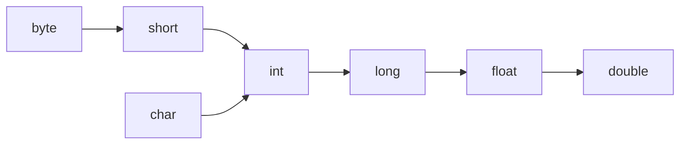

# E2.1 — Types and Expressions

## A first program

### Compact source file

Save this complete Java 25 program as `HelloCompact.java`:

```java
void main() {
    IO.println("Hello world!");
}
```

Run it directly with the JDK source launcher:

```bash
java HelloCompact.java
```

No class declaration, static modifier, command-line parameter, or preview flag is required. The compiler supplies an implicit class; the program still consists of a method belonging to a class. `IO` is the new `java.lang.IO` helper for simple line-oriented input/output.

### Explicit class and static main

The conventional form remains valid and useful for larger examples:

Save the following as `HelloWorld.java`:

```java
public class HelloWorld {
    public static void main(String[] args) {
        System.out.println("Hello world!");
    }
}
```

From the directory containing the file:

```bash
javac HelloWorld.java
java HelloWorld
```

* `javac` compiles the source into `HelloWorld.class`.
* `java` launches the program using the class name, without the `.class` suffix.
* `System.out.println` prints a line to standard output.

**Try:** change the message, save, compile, and run again. What happens if you save but do not recompile before running `java HelloWorld`?

## Programs, files and classes

A Java program can contain multiple packages and source files. An ordinary source file can declare multiple top-level types, such as classes, interfaces, enums, and records. A compact source file instead declares its class implicitly and cannot declare a package.

With the conventional file-based compilation used here, at most one top-level type in a file is `public`, and **the file name must match that public type's name**.


The explicit `HelloWorld` example has one named class and no package declaration. Larger examples use named packages to organize related types.

### Imports and the Java 25 source forms

Ordinary source files automatically import `java.lang` types, including `String`, `Math`, and `IO`. Compact source files additionally import the public top-level types of packages exported by `java.base`, making types such as `List` available without explicit imports.

Java 25 also supports **module import declarations** in ordinary files:

```java
import module java.base;

class NameLengths {
    void main() {
        List<String> names = List.of("Ada", "Grace");
        names.forEach(name -> IO.println(name.length()));
    }
}
```

`void main()` is also valid inside an explicit class. For an instance main, the launcher needs a non-private no-argument constructor; this class receives one automatically. A module import imports types, not static methods, and does not add a dependency or replace a module descriptor. Explicit type imports remain useful for clarity and resolving name conflicts.

## Primitive types

**Core:** distinguish integer, floating-point, character, and boolean values; use `int`, `long`, `double`, and `boolean` appropriately.

**Reference — sizes, ranges, and less frequently used types:**

| Type | Size (bits) | Range or meaning | Example |
|---|---|---|---|
| `byte` | 8 | −2^7 to 2^7 − 1 | `byte b = 100;` |
| `short` | 16 | −2^15 to 2^15 − 1 | `short s = 30_000;` |
| `int` | 32 | −2^31 to 2^31 − 1 | `int i = 100_000_000;` |
| `long` | 64 | −2^63 to 2^63 − 1 | `long l = 100_000_000_000_000L;` |
| `float` | 32 | IEEE 754 binary32 | `float f = 1.456f;` |
| `double` | 64 | IEEE 754 binary64 | `double d = 1.456789012345678;` |
| `char` | 16 | UTF-16 code unit, 0 to 65,535 | `char c = 'c';` |
| `boolean` | Not specified as a storage size here | `true` or `false` | `boolean b = true;` |

For floating-point types, distinguish:

| Type | Largest positive finite value | Smallest positive nonzero value |
|---|---|---|
| `float` | approximately 3.4 × 10^38 | approximately 1.4 × 10^−45 |
| `double` | approximately 1.8 × 10^308 | approximately 4.9 × 10^−324 |

> **Note:** the most negative finite value is `-Float.MAX_VALUE` or `-Double.MAX_VALUE`. `MIN_VALUE` means the smallest positive nonzero value for these two types, not the most negative value.

> **Note:** floating-point values also include signed zero, infinities, and `NaN`. A `char` is a UTF-16 code unit and does not necessarily represent an entire Unicode character.

### Literals

**Reference:** focus first on decimal numbers, strings, booleans, and `null`. Other notations can be consulted when encountered.

| Kind | Examples | Notes |
|---|---|---|
| Decimal integer | `42`, `30_000`, `42L` | `L` denotes `long` |
| Binary integer | `0b11011` | Prefix `0b` |
| Hexadecimal integer | `0x9A` | Prefix `0x` |
| Octal integer | `0275` | Leading `0`; avoid accidental octal notation |
| Floating-point | `3.14`, `1.456f`, `3.14e2` | Default is `double`; `f` denotes `float` |
| Character | `'A'`, `'\n'`, `'\u0041'` | Single quotes |
| String | `"John Doe"` | Double quotes; `String` is not primitive |
| Boolean | `true`, `false` | Not interchangeable with `0` and `1` |
| Null | `null` | No object is referenced |

### Constants

A `final` variable can be assigned only once. For a reference variable, the object itself may still be mutable.

```java
public class ConstantsDemo {
    private static final int MAX_ATTEMPTS = 3;

    public static void main(String[] args) {
        final int attempts = MAX_ATTEMPTS;
        // attempts++; // Does not compile
        System.out.println(attempts);
    }
}
```

Use named constants to explain meaningful values, not to give a name to every literal.

> **Note:** not every `final` variable is a compile-time constant; that distinction is not needed for the examples here.

## Working with numbers

### The Math library

`java.lang.Math` provides numeric operations and is available without an explicit import.

```java
public class MathDemo {
    public static void main(String[] args) {
        System.out.println(Math.sqrt(25)); // 5.0
        System.out.println(Math.max(10, 20)); // 20
        System.out.println(Math.log(-1)); // NaN
    }
}
```

Not every invalid numeric operation throws an exception. Check the API's documented behavior.

### Integer division

**Predict:** all four variables below are `double`. Do they all contain the same value?

```java
double average = 5 / 2;
double correct = 5 / 2.0;
double alsoCorrect = (double) 5 / 2;
double tooLate = (double) (5 / 2);
```

Print each value to test your prediction.

<details>
<summary>Check your prediction</summary>

The values are `2.0`, `2.5`, `2.5`, and `2.0`, respectively.

The operand types determine the division. Assigning the result to `double` does not restore a discarded fractional part.

</details>

Integer division truncates toward zero: `-5 / 2` is `-2`. Integer division by zero throws `ArithmeticException`; floating-point division by zero can produce infinity or `NaN`.

### Overflow and numeric promotion

```java
long wrong = 100_000 * 100_000;   // 1410065408: int overflow first
long correct = 100_000L * 100_000; // 10000000000
long tooLate = (long) (100_000 * 100_000); // Still wrong

byte a = 10;
byte b = 20;
int sum = a + b; // byte operands are promoted to int
```

Ordinary integer arithmetic does not automatically report overflow. When overflow must be detected, APIs such as `Math.multiplyExact` can help.

**Predict:** what does `Integer.MAX_VALUE + 1` produce? Does assigning it to `long` prevent overflow?

### Floating-point precision

```java
System.out.println(0.1 + 0.2);        // 0.30000000000000004
System.out.println(0.1 + 0.2 == 0.3); // false
```

Many decimal fractions cannot be represented exactly in binary floating-point.

For approximate computations, choose a comparison tolerance appropriate to the problem and scale.

> **Note:** exact decimal requirements may call for `BigDecimal` and an explicit rounding policy. We do not develop that API in this lesson.

### Random numbers

```java
import java.util.random.RandomGenerator;

public class RandomDemo {
    public static void main(String[] args) {
        RandomGenerator random = RandomGenerator.getDefault();
        int anyInt = random.nextInt();       // Any int value
        int below100 = random.nextInt(100);  // [0, 100)
        int between = random.nextInt(10, 20); // [10, 20)
        long below100Long = random.nextLong(100); // [0, 100)
        double fraction = random.nextDouble();   // [0.0, 1.0)
        double scaled = random.nextDouble(10.0, 20.0); // [10.0, 20.0)
        boolean flag = random.nextBoolean();
        System.out.println(between);
    }
}
```

The upper bound is exclusive. Do not assume an exact output for this example. Reproducible tests should control their inputs or generator.

> **Note:** security-sensitive randomness requires an appropriate API such as `SecureRandom`; the generator above is not a security recommendation.

## Operators

Operators combine operands to produce values. The table below is a **reference**, not a memorization exercise. Higher rows bind more tightly.

| Category | Operators |
|---|---|
| Postfix | `expr++ expr--` |
| Unary | `++expr --expr +expr -expr ~ !` |
| Multiplicative | `* / %` |
| Additive | `+ -` |
| Shift | `<< >> >>>` |
| Relational | `< > <= >= instanceof` |
| Equality | `== !=` |
| Bitwise AND | `&` |
| Bitwise XOR | `^` |
| Bitwise OR | `\|` |
| Logical AND | `&&` |
| Logical OR | `\|\|` |
| Conditional | `? :` |
| Assignment | `= += -= *= /= %= &= ^= \|= <<= >>= >>>=` |

### Grouping versus evaluation order

* **Precedence** and **associativity** determine expression grouping.
* Java evaluates operands from left to right, subject to conditional evaluation rules.
* Parentheses make intended grouping explicit; avoid expressions with several side effects.

```java
int result = 2 + 3 * 4;       // 14
int grouped = (2 + 3) * 4;    // 20
int leftGrouped = 10 - 3 - 2; // (10 - 3) - 2 = 5
```

### Short-circuit evaluation

`&&` evaluates its right operand only if the left operand is `true`. `||` evaluates its right operand only if the left operand is `false`.

```java
int count = 0;
int total = 10;
boolean acceptable = count != 0 && total / count > 2; // false; no division
```

**Review:** replacing `&&` with `&` here still compiles, but both operands are evaluated and integer division by zero fails. These operators are not interchangeable optimizations.

## Casting

### Implicit casting

The compiler permits **widening primitive conversions** without an explicit cast.

**Reference — main conversion paths:**



```java
int number = 10;
long larger = number;
double decimal = larger;
```

Widening is not synonymous with exactness. `int` to `float`, `long` to `float`, and `long` to `double` can lose precision.

```java
int original = 16_777_217;
float rounded = original;
System.out.println((int) rounded); // 16777216
```

### Explicit casting

A narrowing primitive conversion generally requires a cast and may lose information.

```java
double decimal = 2.9;
int truncated = (int) decimal; // 2, not rounded to nearest
int negative = (int) -2.9;    // -2
byte wrapped = (byte) 130;    // -126
char letter = (char) 65;      // 'A'
```

> **Note:** some representable integer constant expressions can be assigned to smaller types without a cast, such as `byte value = 100;`.

**A cast is not input validation.** It requests a conversion; it does not guarantee that the value fits the application's requirements.

## Resources

* https://dev.java/learn/language-basics/
* https://docs.oracle.com/en/java/javase/25/docs/api/index.html
* https://openjdk.org/jeps/512
* https://openjdk.org/jeps/511
