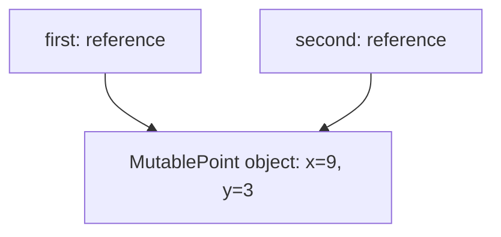
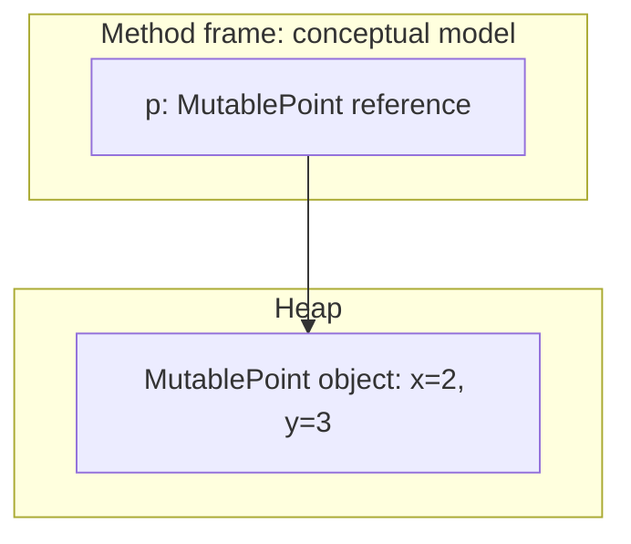
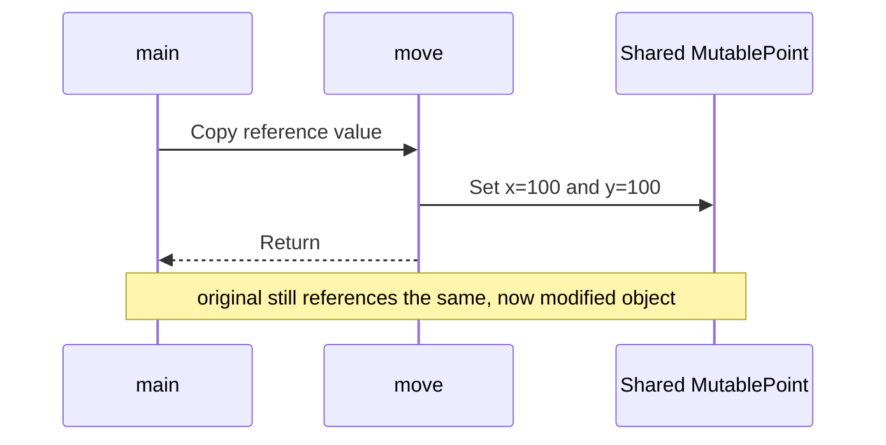
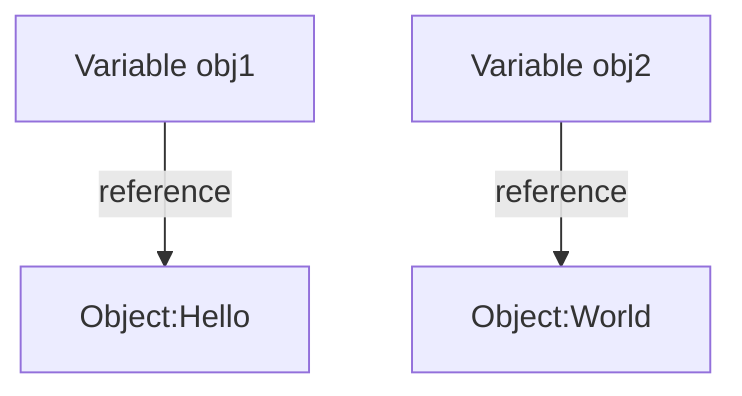
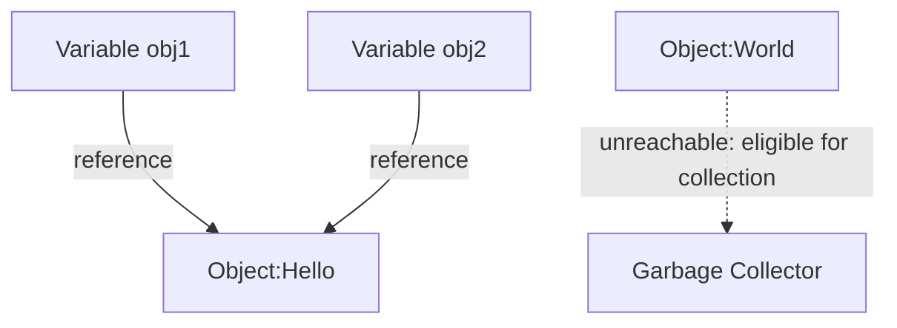

# E2.3 — Methods and References

## Methods

Behavior is organized into **methods** belonging to classes or interfaces, rather than standalone functions. In a compact source file, methods outside an explicit class body are members of the implicitly declared class, not free functions or top-level executable statements.

A method can receive parameters and return a value. `void` means that it does not return a value.

Replace the first `HelloWorld` example with:

```java
public class HelloWorld {
    public static void main(String[] args) {
        int result = multiplyByTwo(20);
        System.out.println(result); // 40
    }

    public static int multiplyByTwo(int number) {
        return 2 * number;
    }
}
```

* `int number` declares a parameter.
* `20` is the argument supplied by the caller.
* `return` supplies the result and ends that invocation.
* `static` allows this method to be called without creating a `HelloWorld` object.

The method name describes an operation, but not its complete contract: for large `int` inputs, multiplication can overflow. Integer arithmetic wraps around when the result exceeds the type's range; it does not automatically report an error.

## Reference variables

A primitive variable holds a primitive value. A reference variable holds a reference value identifying an object, or `null`.

For the following examples, save this teaching type as `MutablePoint.java`. Public mutable fields deliberately make state changes visible here; this is an execution-model example, not a recommendation for API design.

```java
public class MutablePoint {
    public int x;
    public int y;

    public MutablePoint(int x, int y) {
        this.x = x;
        this.y = y;
    }
}
```

**Predict before running:** inside a `main` method, what does the first `println` print? Draw how many objects are created.

```java
String message = "Hello world!";
MutablePoint first = new MutablePoint(2, 3);
MutablePoint second = first;

second.x = 9;
System.out.println(first.x);
System.out.println(message.length());
```

<details>
<summary>Check your prediction</summary>

The output is `9`, then `12`. `first` and `second` refer to one shared `MutablePoint` object; assigning the reference did not copy that object.



This is **aliasing**: two references identify the same object. Assigning a reference does not copy the object.

</details>

### References and memory

The JVM manages object allocation and reclamation. A useful introductory model places objects in the heap and local variables in method stack frames.



> **Note:** this is a conceptual model, not a promise about optimized physical memory layout. Reference fields can also be stored inside other objects.

Compared with C pointers, Java references do not support pointer arithmetic or explicit `free`. Garbage collection does not replace closing files or other external resources.

### Null and final references

```java
MutablePoint missing = null;
// System.out.println(missing.x); // Throws NullPointerException

final MutablePoint point = new MutablePoint(2, 3);
point.x = 10;                 // Allowed: mutate the object
// point = new MutablePoint(5, 7); // Does not compile: reassign final variable
```

**Predict:** after `MutablePoint a = new MutablePoint(1, 2); MutablePoint b = a; b = new MutablePoint(8, 9);`, what are `a.x` and `b.x`? Draw the references before running it.

## Passing parameters to methods

Java is **always pass-by-value**. Each argument value is copied into a separate parameter variable.

* For primitives, the primitive value is copied.
* For references, the reference value is copied—not the object.

### Changing primitive parameters

```java
public class PrimitiveParameters {
    public static void swap(int a, int b) {
        int temporary = a;
        a = b;
        b = temporary;
    }

    public static void main(String[] args) {
        int a = 2;
        int b = 3;
        swap(a, b);
        System.out.println(a + ", " + b); // 2, 3
    }
}
```

Only local copies are swapped. The caller's variables are unchanged.

### Reassigning a reference parameter

Compile this class alongside `MutablePoint.java`. **Before running it, predict the two printed values.**

```java
public class ReferenceParameters {
    public static void replace(MutablePoint point) {
        point = new MutablePoint(100, 100);
    }

    public static void move(MutablePoint point) {
        point.x = 100;
        point.y = 100;
    }

    public static void main(String[] args) {
        MutablePoint original = new MutablePoint(2, 3);
        replace(original);
        System.out.println(original.x);
        move(original);
        System.out.println(original.x);
    }
}
```

### Debugger activity: variable versus object

1. Set a breakpoint on `replace(original)` in `main` and start debugging.
2. Use **Step Into** to enter `replace`; observe `point` and the object it identifies.
3. Execute the assignment, then inspect `original` in the caller's stack frame. Do `point` and `original` still identify the same object?
4. Return to `main`, then step into `move` and inspect the fields before and after its assignments.
5. Explain which operation changed a local reference and which changed the shared object.

<details>
<summary>Check your prediction and explanation</summary>

The output is `2`, then `100`. `replace` changes only its parameter. `move` uses its copy of the reference to mutate the shared object.



</details>

### Swapping object state is not swapping caller references

This method swaps coordinates, not the reference values in the caller:

```java
public static void swapCoordinates(MutablePoint a, MutablePoint b) {
    int temporaryX = a.x;
    int temporaryY = a.y;
    a.x = b.x;
    a.y = b.y;
    b.x = temporaryX;
    b.y = temporaryY;
}
```

| Operation inside a method | Changes the caller's variable? | Can change a shared object? |
|---|---|---|
| `number = 100` | No | Not applicable |
| `point = new MutablePoint(100, 100)` | No | No mutation of the original object |
| `point.x = 100` | No | Yes |

**Review:** an assistant claims that `move` works because objects are passed by reference. Explain why the observed behavior is right but the explanation is wrong.

## Reference identity and reachability

For the next independent identity example, use this minimal teaching type:

```java
class Patient { }
```

### Operations on references
The equality operators `==` and `!=` compare reference identity, not object content. Java also provides operations such as `instanceof`; do not confuse identity comparison with all possible reference operations.

* More than one variable can refer to the same object.
* A reference value can be **null**, meaning it identifies no object. This is a value, not the same as an uninitialized local variable.

```java
public static void main(String[] args) {
    Patient p1 = new Patient();
    Patient p2 = p1;
    Patient p3 = null;
    
    if (p1 == p2) {
        // true
    }
    
    if (p1 == p3) {
        // false
    }
}
```


### Garbage collector
Garbage collectors reclaim memory from objects that are no longer reachable in the relevant reachability model. An object may be eligible for collection without being reclaimed immediately. Cycles alone do not keep unreachable objects alive.

```java
class Example {
    String name;

    Example(String name) {
        this.name = name;
    }
}

public class Main {
    public static void main(String[] args) {
        Example obj1 = new Example("Hello");
        Example obj2 = new Example("World"); // different object
    }
}
```



```java
class Example {
    String name;

    Example(String name) {
        this.name = name;
    }
}

public class Main {
    public static void main(String[] args) {
        Example obj1 = new Example("Hello");
        Example obj2 = new Example("World"); // different object
        
        obj2 = obj1;
    }
}
```



## Garbage collection — further details

**Reference — optional further reading.** The following material describes memory-management costs and implementation choices, not additional guarantees about collection timing. The core concept remains reachability: an object may become eligible for collection without being reclaimed immediately. Collection is not a substitute for explicitly closing resources: code that owns a file or connection must arrange its closure, typically with try-with-resources.

### Memory reclamation trade-offs

**Advantages:**

Memory reclamation is automatic: ordinary Java code does not manually free objects. Allocation still occurs through constructs such as `new`. Java avoids ordinary use-after-free errors, but **retaining unwanted reachable objects can still cause memory leaks**.

In the example below, removing the last strong reference can make the collection eligible for reclamation; it does not synchronously free memory.

```java
import java.util.ArrayList;
import java.util.List;

public class LargeCollectionExample {
    public static void main(String[] args) {
        // Create a large collection
        List<String> bigList = new ArrayList<>();
        for (int i = 0; i < 1_000_000; i++) {
            bigList.add("Item " + i);
        }
        
        // If no other references retain it, the list is eligible for GC.
        bigList = null;
    }
}
```

**Disadvantages:**

Collection has CPU, memory, and pause-time costs that depend on the workload, collector, and configuration. Neither manual allocation nor garbage collection is universally faster.

Developers have no direct control over when the garbage collector runs. As a result, CPU time may be spent on freeing unused objects at unpredictable moments, potentially impacting performance.

Some examples in which the issue is discussed:
- [9 Tips to Reduce Long Garbage Collection Pauses](https://blog.gceasy.io/reduce-long-garbage-collection-pauses/?utm_source=chatgpt.com) – Practical strategies to minimize GC pause times by tuning JVM settings and selecting appropriate GC algorithms.

- [How I Reduced GC Pause from 1s to 50ms in a High-Load Java Application](https://medium.com/@sibinraziya/how-i-reduced-gc-pause-from-1s-to-50ms-in-a-high-load-java-application-879613d5d8f4?utm_source=chatgpt.com) – A case study detailing the reduction of GC pauses in a high-throughput Java service.

- [Reducing Garbage Collection Pause Time](https://www.dynatrace.com/resources/ebooks/javabook/reduce-garbage-collection-pause-time/?utm_source=chatgpt.com) – Methods to reduce GC pause times, including parallel and concurrent garbage collection strategies.

### Garbage collectors in Java 25

**Reference — implementation and deployment choices.** G1 is the usual default on server-class HotSpot Java 25 configurations; defaults and collector availability depend on the JVM distribution and environment.

| GC               | Key characteristics                             |
| ---------------- | ----------------------------------------------- |
| **G1 (default)** | Parallel, low-latency, suitable for large heaps |
| ZGC              | Generational, concurrent, designed for low pause times |
| Shenandoah GC    | Low pause times, concurrent collection          |
| Parallel GC      | High throughput, longer pauses                  |
| Serial GC        | Single-threaded, for small or embedded apps     |

* **G1 GC** is designed for **server-side applications** with large heaps.
* It is **incremental and parallel**, aiming to reduce **stop-the-world (STW) pauses** compared to the older **Parallel GC**.
* Although G1 is the default, you can change it using JVM options:

```bash
java -XX:+UseZGC -jar MyApp.jar
java -XX:+UseShenandoahGC -jar MyApp.jar
```

These commands require an executable JAR and a JDK supporting the chosen collector. Tune using measured evidence, not a generated recommendation detached from the workload.

> **Note:** ZGC's non-generational mode was removed in JDK 24. For Java 25 use `-XX:+UseZGC`; do not copy older `ZGenerational` flags into a new configuration. Generational Shenandoah is a JDK 25 feature where the collector is available; its deployment modes remain an advanced, distribution-dependent choice. None of these collectors provides deterministic reclamation or resource closure.

### Garbage collection resources

* https://www.baeldung.com/jvm-garbage-collectors
* https://openjdk.org/jeps/490
* https://openjdk.org/jeps/521

## Review — methods, references, and reachability

Use this checklist to check your model of method execution and object state.

For a short program, whether written by you or proposed by an assistant:

1. Predict the outcome before running it.
2. Compile and read any diagnostics.
3. Run it and compare the result with your prediction.
4. Use a debugger to inspect variables when the result is surprising.
5. Check a boundary or failure case, not only the happy path.

**Exit questions:**

* Why can the `square` method overflow even when its argument has the correct type?
* What is copied when a reference is passed to a method?
* Why does `final` not prevent mutation through a reference?
* Why does assigning a new object to a parameter not replace the caller's variable?
* Which objects remain reachable after a method returns?

These models of execution are useful even when a tool writes most of the syntax.

* Is unused data actually unreachable, or still retained in a cache or static collection?
