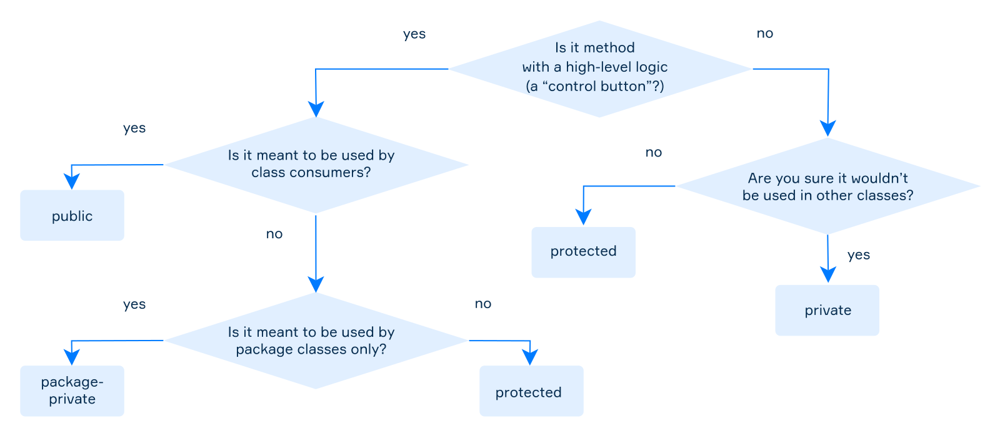

# E3.2 — Encapsulation and Invariants

## Members visibility

An **access modifier** is a keyword that specifies where a class member can be accessed.

For top-level classes, only `public` and package-private access are allowed. For members such as fields and methods, all four access levels are available.

The four access levels are:

* **private** — accessible only within the declaring class;
* **package-private** — accessible by classes in the same package. It is the implicit access level when no modifier is specified;
* **protected** — accessible by classes in the same package and by subclasses, including subclasses in other packages under specific access rules;
* **public** — accessible wherever the containing type is accessible.

**Reference — simplified member-access table.** The subclass column means a subclass in another package; the same-package rule still applies to subclasses in the declaring package. Nested classes and cross-package protected access have additional rules.

| Modifier        | Class | Package | Subclass | All |
| --------------- | ----- | ------- | -------- | --- |
| `public`        | Yes   | Yes     | Yes      | Yes |
| `protected`     | Yes   | Yes     | Yes      | No  |
| package-private | Yes   | Yes     | No       | No  |
| `private`       | Yes   | No      | No       | No  |



> **NOTE:** The table above describes member access. A top-level class cannot be declared `private` or `protected`; a top-level class can be `public` or package-private.

Access control improves:

* **Code clarity**: implementation details can be hidden while exposing only the operations that clients need.
* **Code safety**: direct access to internal state can be restricted, allowing the class to enforce its own invariants.
* **Maintainability**: the internal implementation can change without requiring users of the class to access its fields directly.

## Getters and Setters

A common technique for encapsulating fields is to provide **getters** and **setters**.

* A **getter** reads the value of a field.
* A **setter** changes the value of a field.

Getters and setters are usually `public`, but they do not have to be. Their visibility should depend on how the class is intended to be used.

Encapsulation does **not** mean that every field must have both a getter and a setter. A class can deliberately expose:

* a getter without a setter, making the state externally read-only;
* a setter without a getter, when write-only access is appropriate;
* neither, when the field should remain completely internal;
* both, when both reading and controlled modification are required.

Using methods instead of exposing fields directly gives the class control over how its state is accessed and modified.

For example:

```java
public class Car {
    private String licensePlate;
    private int price;
    private double hp;

    public Car(String licensePlate, int price, double hp) {
        this.licensePlate = licensePlate;
        this.price = price;
        this.hp = hp;
    }

    public String getLicensePlate() {
        return licensePlate;
    }

    public void setLicensePlate(String licensePlate) {
        this.licensePlate = licensePlate;
    }

    public int getPrice() {
        return price;
    }

    public void setPrice(int price) {
        this.price = price;
    }

    public double getHp() {
        return hp;
    }

    public void setHp(double hp) {
        this.hp = hp;
    }

    // ...
}
```

See [this interesting discussion](https://stackoverflow.com/questions/1568091/why-use-getters-and-setters-accessors) on the topic, in particular answer #2.

In the following example, we define a setter that implements actual validation.

```java
public final class Car {
    private String licensePlate;
    private int price;
    private final double hp;

    public Car(String licensePlate, int price, double hp) {
        this.licensePlate = validatedPlate(licensePlate);
        if (price < 0 || !Double.isFinite(hp) || hp < 0) {
            throw new IllegalArgumentException("Invalid price or horsepower");
        }
        this.price = price;
        this.hp = hp;
    }

    private static String validatedPlate(String plate) {
        // Teaching format: two ASCII capitals, three digits, two capitals.
        if (plate == null || !plate.matches("[A-Z]{2}[0-9]{3}[A-Z]{2}")) {
            throw new IllegalArgumentException("License plate invalid");
        }
        return plate;
    }

    public String getLicensePlate() {
        return licensePlate;
    }

    public void setLicensePlate(String licensePlate) {
        this.licensePlate = validatedPlate(licensePlate);
    }

    public int getPrice() {
        return price;
    }

    public void changePrice(int price) {
        if (price < 0) {
            throw new IllegalArgumentException("Negative price");
        }
        this.price = price;
    }
}
```

The setter does more than simply assign a value: it **enforces a rule** about which values are valid.

This is one of the main advantages of encapsulation. The class can guarantee that its state satisfies the rules defined by the class itself.

The constructor and later updates enforce the same plate rule through a private helper. Validation happens **before assignment**, so a rejected update leaves the old state intact. The format is a teaching policy, not a complete vehicle-registration validator. The price uses integer units with no currency or fractional-price model.

> **Note:** do not call overridable methods from constructors: subclass code can run before its fields are initialized. Private helpers avoid that dispatch. A real monetary model also needs a currency and a rounding policy.

**Review:** an assistant generates setters for every field. Which operations do clients actually need? Test valid creation, a negative price, a null plate, and a rejected plate update. Verify that the last operation preserves the previous plate.

## Testing object state

Use the JUnit practice project from [E2.8](<E2.8 — Unit Testing with JUnit.md>). Save the **validated, final version** of `Car` above as `src/main/java/com/example/Car.java`, adding `package com.example;` before the class. The earlier version with unrestricted setters is a separate example, not an additional class to copy.

Save this as `src/test/java/com/example/CarTest.java`:

```java
package com.example;

import org.junit.jupiter.api.Test;

import static org.junit.jupiter.api.Assertions.*;

class CarTest {
    @Test
    void constructorSetsObservableState() {
        Car car = new Car("AB123CD", 12_000, 90.0);

        assertEquals("AB123CD", car.getLicensePlate());
        assertEquals(12_000, car.getPrice());
    }

    @Test
    void priceCanReachZeroWithoutChangingThePlate() {
        Car car = new Car("AB123CD", 12_000, 90.0);

        car.changePrice(0);

        assertEquals(0, car.getPrice());
        assertEquals("AB123CD", car.getLicensePlate());
    }

    @Test
    void changingOneCarDoesNotChangeAnother() {
        Car first = new Car("AB123CD", 12_000, 90.0);
        Car second = new Car("EF456GH", 8_000, 75.0);

        first.setLicensePlate("XY789ZT");

        assertEquals("XY789ZT", first.getLicensePlate());
        assertEquals("EF456GH", second.getLicensePlate());
    }
}
```

Each test creates its own objects and observes behavior through the public API. Do not expose private fields just to test them. These tests check valid construction and state transitions; [E5.2](<E5.2 — Error Handling and Contracts.md>) adds rejection tests and checks that failed updates preserve the previous state.

## Resources

* https://dev.java/learn/classes-objects/
* https://openjdk.org/jeps/513
* https://www.baeldung.com/java-information-hiding-vs-encapsulation
* https://www.baeldung.com/java-oop
