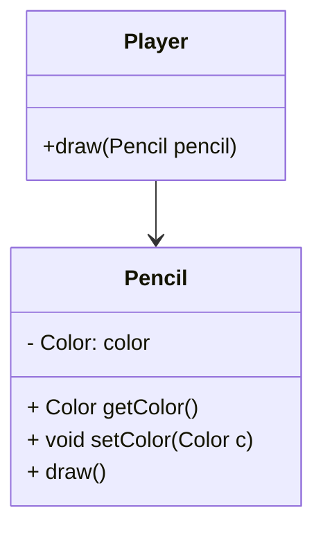
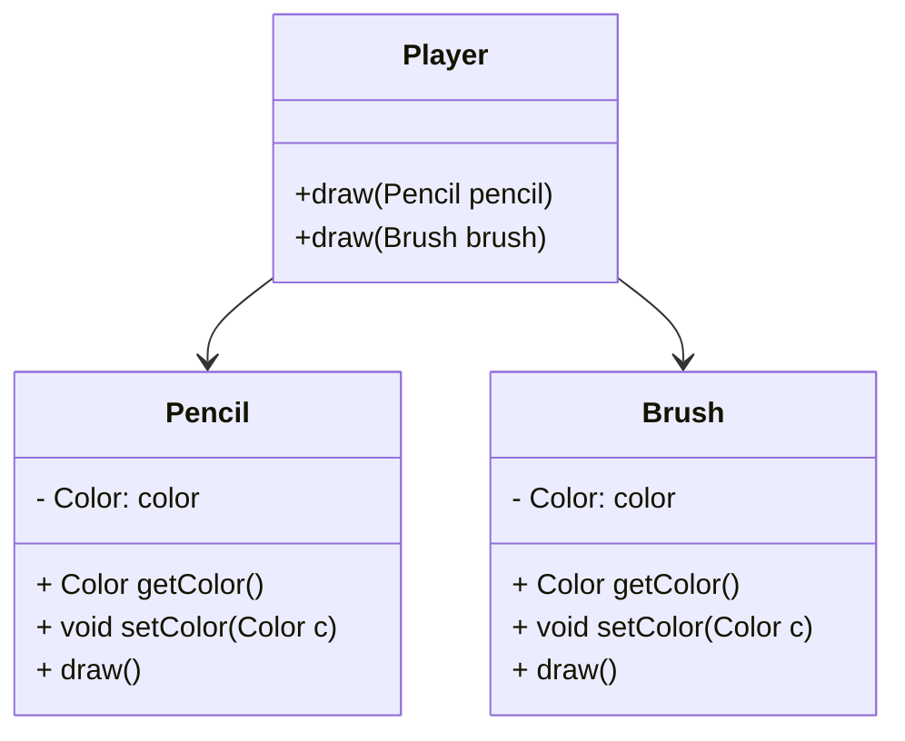
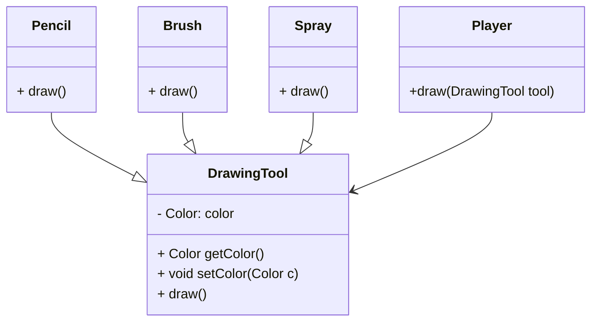
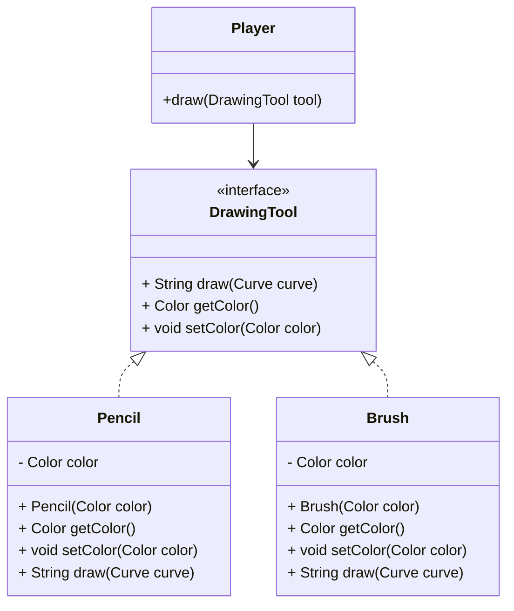
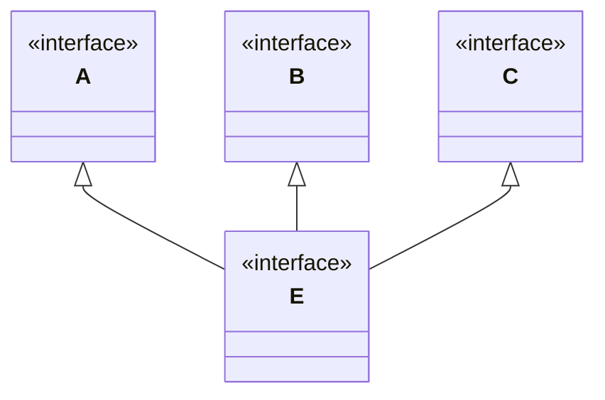
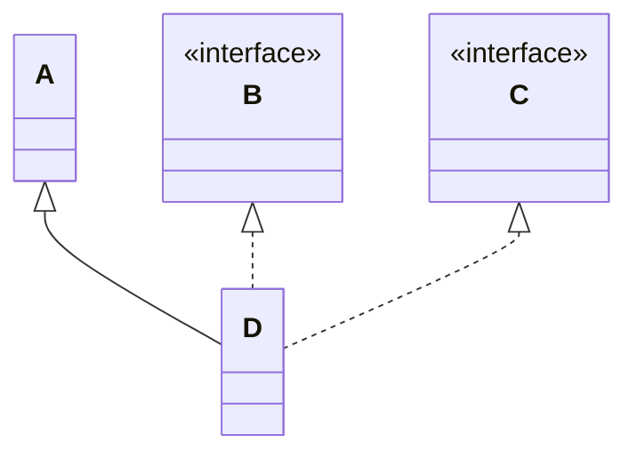
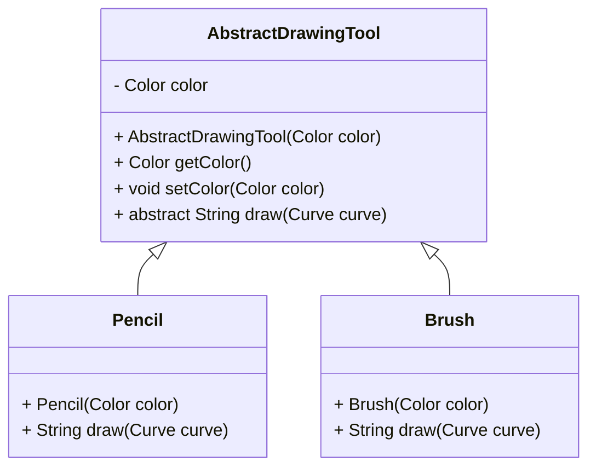
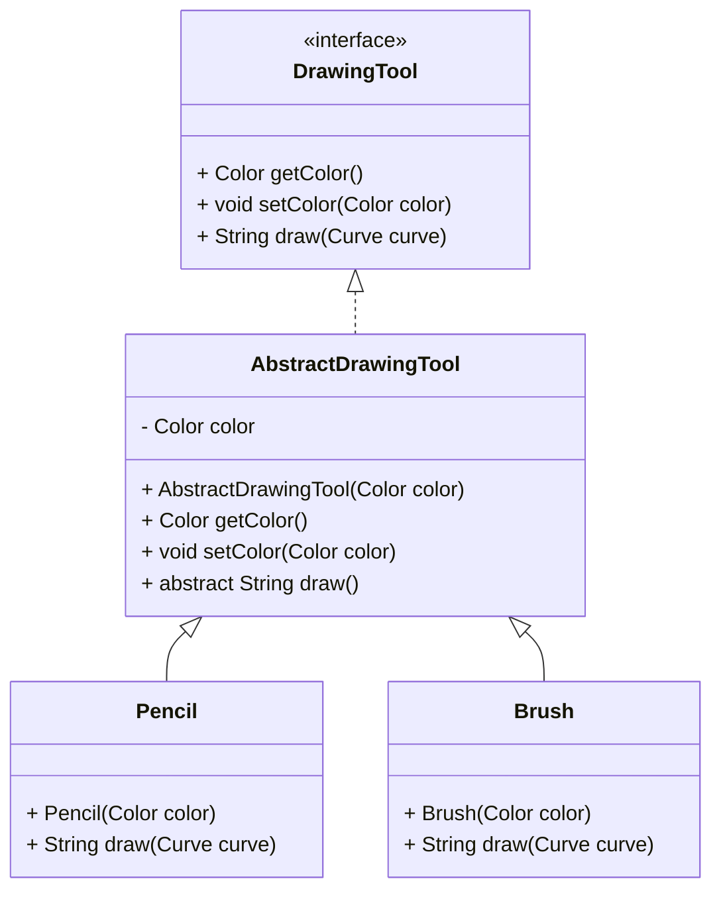
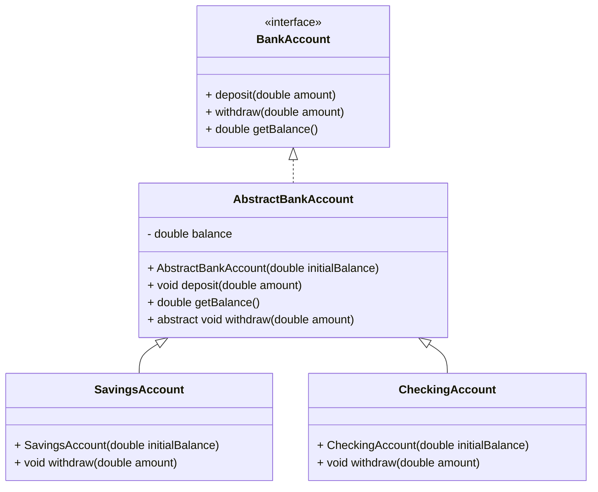
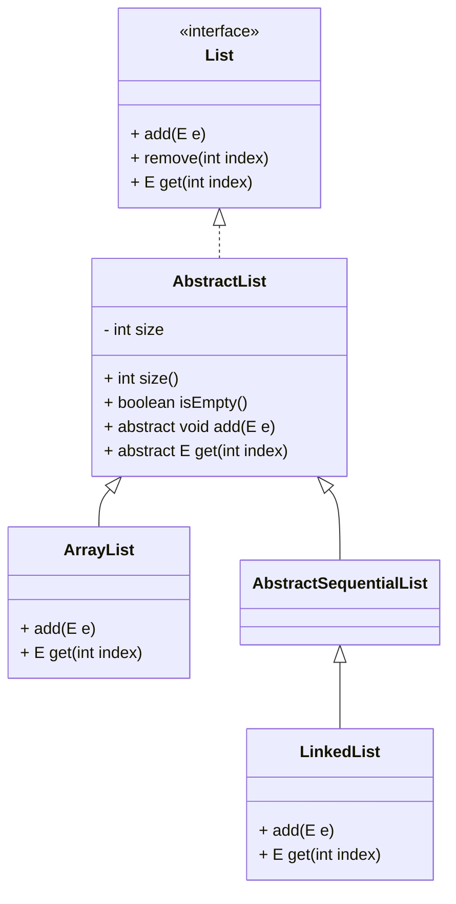

# Java Classes (Interfaces, abstract classes)

All examples target **Java 25 without preview features** and build on E3.1–E3.2.

* **Core:** express a capability with an interface, share implementation when justified, and keep clients independent of concrete tools.
* **Note:** interface evolution and design trade-offs.
* **Reference:** multiple-interface rules and hierarchy diagrams.

The drawing examples evolve through alternative implementations. Compile each version separately. Use `import java.awt.Color;` for color and this small prerequisite type:

```java
record Curve(String description) {
    public String draw() {
        return description;
    }
}
```

The examples describe drawing using strings; they do not implement graphical rendering.

## Motivation

We aim to develop a drawing game. As an initial proof of concept, we will focus exclusively on pencil-based drawing, allowing users to create sketches using a variety of colors.

* The **Pencil** class provide methods to draw and change its color.
* The **Player** class can use a Pencil to perform drawing operations.



We implement everything, and it works like a charm. However, we get our next task. On top of drawing with a Pencil, we must support drawing with a Brush, as well.

No problem, we introduce the Brush class and the Player.draw(Brush) method:




So far, so good. But then we face the next task: adding more drawing tools.

We could repeat the same process we did with the Pencil and Brush. However, we start wondering: how many other tools might we need to support? 

**Limitations of This Approach:**

* **No Common Abstraction**: `Pencil` and `Brush` have no shared abstraction, meaning **we cannot treat all tools generically**.
* **Tight Coupling**: Supporting a new unrelated tool requires another overload or another client edit. A subclass of an already supported tool does not necessarily require a new overload, but the API still names concrete tool families.
* **Concrete dependencies**: the player knows each supported family instead of only the operation it needs. This is about dependency structure, not the order in which instructions execute.


## Using abstraction

We decide that we’ll create an abstract DrawingTool class, which will be the superclass of the Pencil, Brush and all future classes.

Also, this way, we’ll need a single draw(DrawingTool) method in the Player class:



By using **abstractions**, OOP separates the *what* (abstract behavior) from the *how* (concrete implementations).

* We can express the **capabilities** of all tools without tying the application to a concrete implementation.
* New tools can be added without modifying existing code, improving **extensibility** and **maintainability**.
* The player depends on a stable contract. Runtime calls still have an order; abstraction changes what the client must know, not the need to execute operations.

## Interfaces
An interface is a **reference type distinct from a class**. It defines a contract that multiple classes can implement without sharing an implementation superclass.

* Interfaces cannot have constructors, as they cannot be instantiated.
* A method declared without a body, `private`, `static`, or `default` is implicitly `public abstract`.
* Interfaces can also declare default, static, and private methods with bodies, as shown below. Fields are implicitly `public static final`; there is no per-instance interface state.
* Other classes can **implement** an interface by providing concrete implementations for its abstract methods.



```java
interface DrawingTool {
    String draw(Curve curve);
    Color getColor();
    void setColor(Color color);
}
```

```java
class Pencil implements DrawingTool {
    Color color;
    
    public Pencil(Color color) {
        this.color = color;
    }
    
    public Color getColor() {
        return color;
    }
    
    public void setColor(Color color) {
        this.color = color;
    }
    
    public String draw(Curve curve) {
        return "Pencil drawing a " + curve.draw();
    }
}
```


```java
class Brush implements DrawingTool {
   Color color;

   public Brush(Color color) {
      this.color = color;
   }

   public Color getColor() {
      return color;
   }

   public void setColor(Color color) {
      this.color = color;
   }
   
    public String draw(Curve curve) {
        return "Brush drawing a " + curve.draw();
    }
}
```

### Key rules

**Reference — type relationships.**

An interface can extend one or more other interfaces using the keyword `extends`:

```java
interface A {
    void walk();
}

interface B {
    void run();
}

interface C { 
    void swim();
}

interface E extends A, B, C { 
    void talk();
}
```



A class can extend only one class and implement multiple interfaces:

```java
class A { }

interface B { }
interface C { }

class D extends A implements B, C { }
```



Multiple interfaces are often used in the standard library. A simplified excerpt of `String` shows some of its interfaces (not its complete Java 25 declaration):

```java
public final class String implements Serializable, Comparable<String>, CharSequence {
    // ...
}
```

### Methods with a body
#### Static methods

Interface fields are constants. Static methods provide utility behavior and are called on the declaring interface; they are not inherited as instance methods.

```java
interface DrawingTool {
    static final Color DEFAULT_COLOR = Color.BLACK;
    
    static boolean hasSameColor(DrawingTool a, DrawingTool b) {
        return a.getColor().equals(b.getColor());
    }
    // ...
}
```

To use a static method you just need to invoke it directly from an interface

```
DrawingTool.hasSameColor(pencil, brush);
```

The main purpose of interface static methods is to define utility functionality that is common for all classes implementing the interface. They help to avoid code duplication.

#### Default methods
A `default` method supplies an inheritable instance implementation in an interface. Static and private interface methods can also have bodies, but serve different roles.

Suppose many classes already implemented the `DrawingTool` interface. For example `pencil`, `pen`, `brush`, `fuzzybrush` etc. They all draw in different ways when `draw()` is called.

```java
interface DrawingTool {
    String draw(Curve curve);
    Color getColor();
    void setColor(Color color);
}
```

Then you decide that all tools should be always able to draw with a default color. That means:
* you need to add the `drawWithDefaultColor` method to the `DrawingTool` interface **and modify all implementing classes**
* **if implementing classes are a lot this could become very time-consuming!**. 

**The key motivation behind default methods in interfaces is supporting backward compatibility**. `default` methods provide a quicker solution in that you don't have to implement them in all classes.

```java
interface DrawingTool {
    static final Color DEFAULT_COLOR = Color.BLACK;
    
    String draw(Curve curve);
    Color getColor();
    void setColor(Color color);

    default String drawWithDefaultColor(Curve curve) {
        Color original = getColor();
        setColor(DEFAULT_COLOR);
        try {
            return draw(curve);
        } finally {
            setColor(original);
        }
    }
}
```


Although default methods are implemented, you cannot invoke them directly from an interface like `DrawingTool.drawWithDefaultColor()`. You still need to have an object of a class that implements the interface:

```
DrawingTool pencil = new Pencil(Color.RED);
pencil.drawWithDefaultColor(new Curve("line"));
```

The `finally` block restores color even if drawing fails. This temporarily mutates the tool and is **not a thread-safety guarantee**. A future API might accept color as an argument instead. Adding default methods can also create conflicts between interfaces: they are not an unconditional compatibility guarantee.

**Review:** an assistant omits `return` and restores the color only after a normal draw. Identify both the compilation problem and the failure-path bug. Exceptions and `finally` are developed in E5.1.

#### Private methods
Sometimes default methods are huge. To make it possible to decompose such methods, **Java allows declaring private methods inside an interface**:

```java
interface Feature {
    default void action() {
        String answer = subAction();
        System.out.println(answer);
    }

    private String subAction() {
        return "Default action";
    }
}
```


## Abstract classes

A common drawback of relying directly on interfaces is the potential for **code duplication** across multiple implementing classes. To address this issue, an **abstract class**—declared using the `abstract` keyword—can be used to represent a **generalized concept** that is meant to be **extended by subclasses** rather than instantiated directly, allowing shared behavior to be defined once and reused.

* It can define **both abstract methods** (without implementation) and **concrete methods** (with implementation).
* It can include **constructors**, which are typically used by its subclasses.
* You **cannot create instances** of an abstract class directly — it may contain methods that are not fully implemented.
* An abstract class can **extend another class**, including another abstract class.



```java
public abstract class AbstractDrawingTool {

    protected Color color;

    protected AbstractDrawingTool(Color color) {
        this.color = color;
    }

    public Color getColor() {
        return color;
    }

    public void setColor(Color color) {
        this.color = color;
    }

    public abstract String draw(Curve curve); // an abstract method
}
```

Since `AbstractDrawingTool` is an abstract class we cannot create instances of this class:

```java
AbstractDrawingTool pencil = new AbstractDrawingTool(Color.RED); // this throws a compile time error
```

The method `draw()` is declared abstract because, at this level of abstraction, its implementation is unknown. Concrete subclasses of the class `AbstractDrawingTool` should have an implementation of this method.

```java
class Pencil extends AbstractDrawingTool {

    // It can have additional fields as well

    public Pencil(Color color) {
        super(color);
    }

    @Override
    public String draw(Curve curve) {
        return "Pencil drawing a " + curve.draw();
    }
}
```


```java
class Brush extends AbstractDrawingTool {

    // It can have additional fields as well

    public Brush(Color color) {
        super(color);
    }

    @Override
    public String draw(Curve curve) {
        return "Brush drawing a " + curve.draw();
    }
}
```

## In practice

### Example 1

Interfaces and abstract classes can be combined to create a flexible and reusable class hierarchy.

* **Interface**: Defines the core behavior that all drawing tools must provide (e.g., a `draw` method).

* **Abstract Class**: Implements common state and behavior (like managing the tool’s color) and provides a foundation for concrete drawing tools.

* **Concrete Classes**: Specialize behavior for each type of tool (e.g., `Pencil` or `Brush`) and provide specific implementations of the `draw` method.



```java
interface DrawingTool {
    String draw(Curve curve);
    Color getColor();
    void setColor(Color color);
}
```


```java
abstract class AbstractDrawingTool implements DrawingTool {
    protected Color color;

    protected AbstractDrawingTool(Color color) {
        this.color = color;
    }

    public Color getColor() {
        return color;
    }

    public void setColor(Color color) {
        this.color = color;
    }

    public abstract String draw(Curve curve); // an abstract method
}
```

```java
class Pencil extends AbstractDrawingTool {

    // It can have additional fields as well

    public Pencil(Color color) {
        super(color);
    }

    @Override
    public String draw(Curve curve) {
        return "Pencil drawing a " + curve.draw();
    }
}
```

```java
class Brush extends AbstractDrawingTool {

    // It can have additional fields as well

    public Brush(Color color) {
        super(color);
    }

    @Override
    public String draw(Curve curve) {
        return "Brush drawing a " + curve.draw();
    }
}
```

### Example 2

**Note — transfer the same pattern to another domain.** The account example uses `double` only to focus on abstraction, not as a production money model. Assume a documented simplified currency unit; finite-value and amount validation follow below.

Here is another example of **mixing abstract classes and interfaces**, this time to model **two types of bank accounts**: a **SavingsAccount** and a **CheckingAccount**. The interface defines general bank operations, and the abstract class handles shared logic (e.g., balance management).



```java
interface BankAccount {
    void deposit(double amount);
    void withdraw(double amount);
    double getBalance();
}
```

```java
abstract class AbstractBankAccount implements BankAccount {
    protected double balance;

    public AbstractBankAccount(double initialBalance) {
        if (!Double.isFinite(initialBalance) || initialBalance < 0) {
            throw new IllegalArgumentException("Invalid initial balance");
        }
        this.balance = initialBalance;
    }

    @Override
    public void deposit(double amount) {
        if (!Double.isFinite(amount) || amount <= 0 || !Double.isFinite(balance + amount)) {
            throw new IllegalArgumentException("Invalid deposit");
        }
        balance += amount;
    }

    @Override
    public double getBalance() {
        return balance;
    }

    @Override
    public abstract void withdraw(double amount);
}
```

```java
class SavingsAccount extends AbstractBankAccount {

    public SavingsAccount(double initialBalance) {
        super(initialBalance);
    }

    @Override
    public void withdraw(double amount) {
        if (Double.isFinite(amount) && amount > 0 && balance >= amount) {
            balance -= amount;
        } else {
            throw new IllegalArgumentException("Insufficient funds in SavingsAccount");
        }
    }
}
```

```java
class CheckingAccount extends AbstractBankAccount {

    private static final double OVERDRAFT_LIMIT = 100.0;

    public CheckingAccount(double initialBalance) {
        super(initialBalance);
    }

    @Override
    public void withdraw(double amount) {
        if (Double.isFinite(amount) && amount > 0 && balance - amount >= -OVERDRAFT_LIMIT) {
            balance -= amount;
        } else {
            throw new IllegalArgumentException("Overdraft limit exceeded in CheckingAccount");
        }
    }
}
```

### Example 3

**Reference — simplified collection hierarchy.** `LinkedList` extends `AbstractSequentialList`, which itself extends `AbstractList`. The diagram shows that intermediate class explicitly; method lists are illustrative excerpts, not literal JDK declarations.

The **Java Collections Framework** is a classic example of how **interfaces and abstract classes are combined** to create a **flexible and extensible hierarchy**.

* **Interfaces** define *what* a collection can do (e.g., `add`, `remove`, `iterate`).
* **Abstract classes** provide *reusable logic* and *partial implementations* to reduce code duplication.
* **Concrete classes** specialize behavior for different use cases (e.g., lists vs. sets vs. queues).



## Summary

| Feature                  | **Interface**                             | **Abstract Class**                             | **Concrete Class**            |
| ------------------------ |-------------------------------------------|------------------------------------------------| ----------------------------- |
| **Purpose**              | Define *what* should be done              | Define *partial behavior* and common structure | Provide *full implementation* |
| **Implementation**       | Abstract methods plus default, static, and private method bodies | Can include both abstract and concrete methods | No remaining abstract methods |
| **Can be instantiated?** | ❌ No                                      | ❌ No                                           | ✅ Yes                         |
| **Constructors**         | ❌ Not allowed                             | ✅ Can define constructors                      | ✅ Can define and use constructors |
| **Fields**               | Only `public static final` constants      | Full use                                       | Full use                |
| **Use Case**             | Define capabilities or roles              | Share common behavior and enforce contracts    | Actual working implementation |


### Choosing the smallest useful abstraction

* Use an interface when clients need a stable capability across implementations.
* Use an abstract class when related implementations benefit from shared state or logic and the inheritance contract is deliberate.
* Use composition when a helper can provide reuse without a superclass dependency.

Do not add an interface and abstract class to every new class merely because a generator suggests the pattern.

## Read, predict, verify

**Activity:** write a `Player.draw(DrawingTool tool, Curve curve)` method that returns `tool.draw(curve)`. Supply a pencil and a brush without changing `Player`.

**Exit questions:** why must an implementation of a public interface method be public? Which state is shared by an interface constant, and which state belongs to each tool? What test verifies that a failing default-color draw restores the original color?

## Resources
- https://dev.java/learn/interfaces/
- https://www.baeldung.com/java-interface-vs-abstract-class
- https://www.baeldung.com/java-interface-default-method-vs-abstract-class
- https://www.baeldung.com/java-abstract-class
- https://www.baeldung.com/java-interfaces
