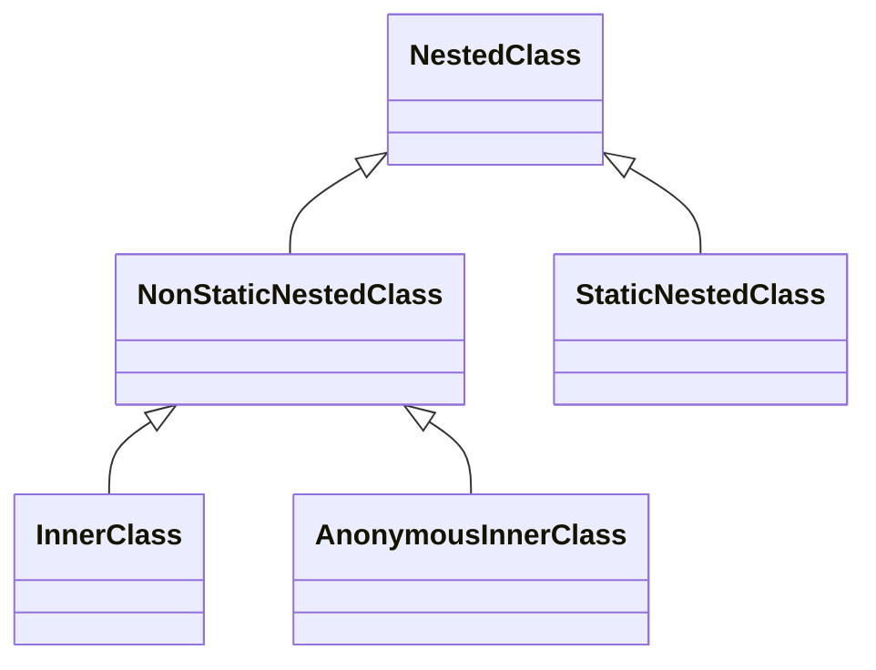
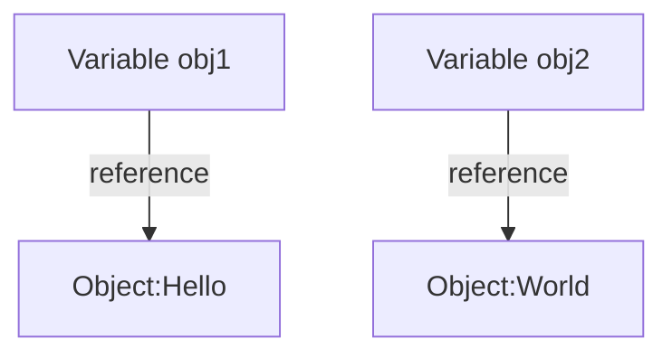
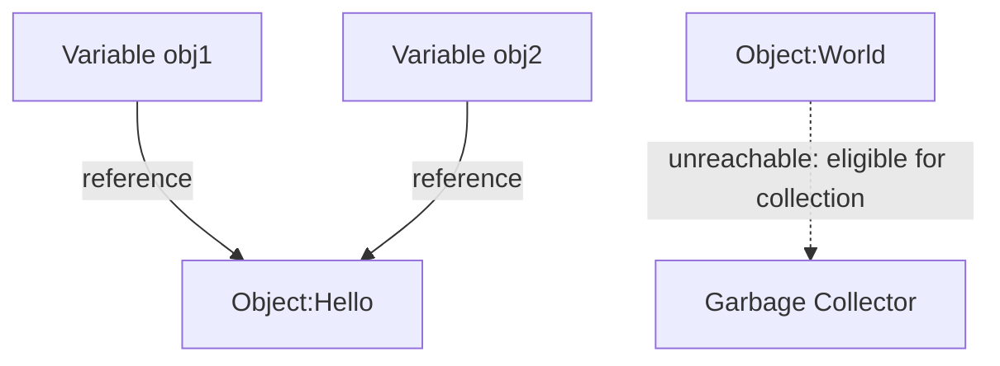

# Java Classes (Details)

All examples target **Java 25 without preview features** and build on E3.1–E3.3.

* **Core:** distinguish final references from immutable state, use records and enums, and reason about reachability.
* **Note:** nested-class forms and defensive-copy policies.
* **Reference:** garbage collectors and tuning options, not facts to memorize.

Compile alternative definitions of `Person`, `Cat`, and `Main` separately. Fragments belong inside the indicated class or `main`; import the standard types used by each example.

## Immutability

An object is **immutable** when its observable state cannot change after construction.

* `final` fields help prevent reassignment but do not freeze referenced arrays, lists, or other mutable objects.
* A changed value is represented by another object rather than by mutating the original.
* `String` is a familiar immutable type. Its operations return a result without modifying the original; they do not necessarily allocate a new object every time.

**The class `Patient` is not immutable because it is possible to change any field of an object.**

```java
public class Patient {
    // field to store the patient's name
    public String name;
    
    // other stuff
    
}
```

```
Patient patient = new Patient();

patient.name = "Mary";
patient.name = "Alice";
```

### Immutable Classes
Passing immutable data reduces accidental changes through shared references. **It does not establish validity by itself**: construction must enforce the domain rules.
* Classes to simply hold data, such as database results, or information from a service.

For a simple immutable value class:
* prevent subclasses from adding incompatible mutable behavior, for example using a final class;
* **private, final field** for each piece of data
* defensively copy mutable inputs and outputs where needed;
* **getter** for each field (**setters** are useless in this case)
* **public constructor** with a corresponding argument for each field
* **equals method** that returns true for objects of the same class when all fields match
* **hashCode method** that returns the same value when all fields match
* **toString method** that includes the name of the class and the name of each field and its corresponding value

Equality, hashing, accessors, and string representation make a value class convenient; they are not themselves requirements for immutability. Avoid printing sensitive state in generated `toString` methods.

For example, we can create an immutable *Person* data class with a name and address:

```java
import java.util.Objects;

public final class Person {
    private final String name;
    private final String address;

    public Person(String name, String address) {
        this.name = name;
        this.address = address;
    }

    public String getName() {
        return name;
    }
    
    public String getAddress() {
        return address;
    }

    @Override
    public int hashCode() {
        return Objects.hash(name, address);
    }

    @Override
    public boolean equals(Object obj) {
        if (this == obj) {
            return true;
        } else if (!(obj instanceof Person)) {
            return false;
        } else {
            Person other = (Person) obj;
            return Objects.equals(name, other.name)
              && Objects.equals(address, other.address);
        }
    }

    @Override
    public String toString() {
        return "Person [name=" + name + ", address=" + address + "]";
    }
}
```

### Records
Records are concise value-oriented data carriers with **final component fields**, not a guarantee of deep immutability. The compiler supplies a canonical constructor, component accessors, and implementations of `equals`, `hashCode`, and `toString` unless explicitly provided.

```java
public record Person (String name, String address) {}
```

The accessors are `name()` and `address()`, not `getName()` and `getAddress()`. The canonical constructor has the record's accessibility; it is public for this public record. Records are final and can implement interfaces, but cannot extend an application superclass.

### Defensive copies and compact constructors

**Predict:** if a record stores a caller's mutable list directly, can that caller change the record's observable contents?

```java
import java.util.List;
import java.util.Objects;

public record Team(String name, List<String> members) {
    public Team {
        Objects.requireNonNull(name);
        members = List.copyOf(members);
    }
}
```

The compact constructor validates and replaces the incoming list with an unmodifiable snapshot before fields are assigned. Here the elements are immutable strings, so this is sufficient for immutable list contents. If elements were mutable, a shallow snapshot would not freeze them.

**Review:** an assistant proposes `Collections.unmodifiableList(members)` instead. Test a later change through the caller's original list. A read-only view and an independent snapshot are different contracts.

> **Note:** array record components still use array identity in generated equality, not automatic element-wise comparison. Choose representations and custom methods deliberately when value equality must include array contents.

### Record patterns

**Note — reading modern Java 25 code:** record patterns deconstruct a record into its components. This feature has been final since Java 21; it does not require preview flags in Java 25.

```java
record Coordinates(int x, int y) {}

class DescribeCoordinates {
    static String describe(Object value) {
        return switch (value) {
            case Coordinates(int x, int y) -> "(" + x + ", " + y + ")";
            case null -> "No coordinates";
            default -> "Another type";
        };
    }
}
```

Here `int x` matches an `int` record component. This is not the preview feature that generalizes primitive patterns to other type-testing contexts. A record pattern reads components; it does not make their objects immutable.

### Enums
An **enum** declares a finite set of named instances. It improves type checking and makes a closed vocabulary explicit. It does not automatically validate transitions between states, and enum references can still be null.

```java
public class Pizza {
    public enum PizzaStatus {
        NOT_ASSIGNED,
        ORDERED,
        READY,
        DELIVERED
    }
    private PizzaStatus status = PizzaStatus.NOT_ASSIGNED;
    
    public boolean isDeliverable() {
        return status == PizzaStatus.READY;
    }
}
```

## Nested classes
You can call a class **nested** when it is declared inside another class.

**Reference:** static nested classes do not require an enclosing instance; non-static member inner classes do. Local and anonymous classes provide additional forms. The following diagram groups concepts; it is not an inheritance hierarchy of Java runtime types.




### Anonymous Inner Classes

Let's assume we have the following interface with two methods:

```java
interface SpeakingEntity {

    void sayHello();

    void sayBye();
}
```

Here, two anonymous classes are defined to represent an English-speaking person and a cat, respectively.

The expression creates an instance of an **anonymous implementing class**, not an instance of the interface itself:

```java
SpeakingEntity englishSpeakingPerson = new SpeakingEntity() {

    @Override
    public void sayHello() {
        System.out.println("Hello!");
    }

    @Override
    public void sayBye() {
        System.out.println("Bye!");
    }
};
```

```java
SpeakingEntity cat = new SpeakingEntity() {

    @Override
    public void sayHello() {
        System.out.println("Meow!");
    }

    @Override
    public void sayBye() {
        System.out.println("Meow!");
    }
};
```

Now, we can invoke overridden methods:

```
englishSpeakingPerson.sayHello();
cat.sayBye();
```

### Inner Classes

**Note — use an inner class when its association with an enclosing instance is meaningful.** Otherwise a static nested class may avoid an unnecessary enclosing reference.

In this example, the `Bow` class will be a non-static inner class of the `Cat` class. The `Bow` class will have access to the instance variables of the `Cat` class, such as the `color` and `size` of the bow.

```java
class Cat {
    private String name = "Whiskers";  // Instance variable of the Cat class
    private String color = "Red";      // Instance variable for Bow color
    
    // Non-static inner class Bow
    class Bow {
        void tieBow() {
            // Accessing outer class's instance fields
            System.out.println(name + " wears a " + color + " bow.");
        }
    }

    void createBow() {
        // Creating and using the Bow instance
        Bow bow = new Bow();
        bow.tieBow();  // Calling the method in the Bow class
    }
}

public class Main {
    public static void main(String[] args) {
        // Creating an instance of the Cat class
        Cat cat = new Cat();
        cat.createBow();  // Using the inner Bow class
    }
}
```

- The `Bow` class is a non-static inner class of `Cat`. It can access the `name` and `color` instance variables of `Cat`.
- The `createBow()` method in the `Cat` class creates an instance of `Bow` and calls the `tieBow()` method to display a message.
- The `main()` method creates an instance of `Cat` and invokes `createBow()` to use the inner `Bow` class.

### Static Nested Classes

Now make `Bow` a **static nested class**. It has no implicit `Cat` instance, so it needs an explicit `Cat` reference to access instance members. It can directly access the enclosing class's static members.

```java
class Cat {
    private static String type = "Persian";  // Static field in Cat class
    
    // Static nested class Bow
    static class Bow {
        void tieBow() {
            // Accessing outer class's static field
            System.out.println("The cat is a " + type + " and wears a bow.");
        }
    }
}

public class Main {
    public static void main(String[] args) {
        // Creating an instance of the static Bow class without an instance of Cat
        Cat.Bow bow = new Cat.Bow();
        bow.tieBow();  // Calling the method in the static Bow class
    }
}
```

- `Bow` is a static nested class of `Cat`. It directly accesses `type` without an enclosing instance.
- The `main()` method in `Main` creates an instance of the `Bow` class directly using `Cat.Bow`, without needing an instance of `Cat`.
- The `tieBow()` method of `Bow` is called to display a message about the cat type and the bow.

## Garbage collection

### Operations on references
The equality operators `==` and `!=` compare reference identity, not object content. Java also provides operations such as `instanceof`; do not confuse identity comparison with all possible reference operations.

* More than one variable can refer to the same object.
* A reference value can be **null**, meaning it identifies no object. This is a value, not the same as an uninitialized local variable.

```java
public static void main(String[] args) {
    Patient p1 = new Patient();
    Patient p2 = p1;
    Patient p3 = null;
    
    if (p1 == p2) {
        // true
    }
    
    if (p1 == p3) {
        // false
    }
}
```


### Garbage collector
Garbage collectors reclaim memory from objects that are no longer reachable in the relevant reachability model. An object may be eligible for collection without being reclaimed immediately. Cycles alone do not keep unreachable objects alive.

```java
class Example {
    String name;

    Example(String name) {
        this.name = name;
    }
}

public class Main {
    public static void main(String[] args) {
        Example obj1 = new Example("Hello");
        Example obj2 = new Example("World"); // different object
    }
}
```



```java
class Example {
    String name;

    Example(String name) {
        this.name = name;
    }
}

public class Main {
    public static void main(String[] args) {
        Example obj1 = new Example("Hello");
        Example obj2 = new Example("World"); // different object
        
        obj2 = obj1;
    }
}
```



**Advantages:**

Memory reclamation is automatic: ordinary Java code does not manually free objects. Allocation still occurs through constructs such as `new`. Java avoids ordinary use-after-free errors, but **retaining unwanted reachable objects can still cause memory leaks**.

In the example below, removing the last strong reference can make the collection eligible for reclamation; it does not synchronously free memory.

```java
import java.util.ArrayList;
import java.util.List;

public class LargeCollectionExample {
    public static void main(String[] args) {
        // Create a large collection
        List<String> bigList = new ArrayList<>();
        for (int i = 0; i < 1_000_000; i++) {
            bigList.add("Item " + i);
        }
        
        // If no other references retain it, the list is eligible for GC.
        bigList = null;
    }
}
```

**Disadvantages:**

Collection has CPU, memory, and pause-time costs that depend on the workload, collector, and configuration. Neither manual allocation nor garbage collection is universally faster.

Developers have no direct control over when the garbage collector runs. As a result, CPU time may be spent on freeing unused objects at unpredictable moments, potentially impacting performance.

Some examples in which the issue is discussed:
- [9 Tips to Reduce Long Garbage Collection Pauses](https://blog.gceasy.io/reduce-long-garbage-collection-pauses/?utm_source=chatgpt.com) – Practical strategies to minimize GC pause times by tuning JVM settings and selecting appropriate GC algorithms.

- [How I Reduced GC Pause from 1s to 50ms in a High-Load Java Application](https://medium.com/@sibinraziya/how-i-reduced-gc-pause-from-1s-to-50ms-in-a-high-load-java-application-879613d5d8f4?utm_source=chatgpt.com) – A case study detailing the reduction of GC pauses in a high-throughput Java service.

- [Reducing Garbage Collection Pause Time](https://www.dynatrace.com/resources/ebooks/javabook/reduce-garbage-collection-pause-time/?utm_source=chatgpt.com) – Methods to reduce GC pause times, including parallel and concurrent garbage collection strategies.


### Garbage collectors in Java 25

**Reference — implementation and deployment choices.** G1 is the usual default on server-class HotSpot Java 25 configurations; defaults and collector availability depend on the JVM distribution and environment.

| GC               | Key characteristics                             |
| ---------------- | ----------------------------------------------- |
| **G1 (default)** | Parallel, low-latency, suitable for large heaps |
| ZGC              | Generational, concurrent, designed for low pause times |
| Shenandoah GC    | Low pause times, concurrent collection          |
| Parallel GC      | High throughput, longer pauses                  |
| Serial GC        | Single-threaded, for small or embedded apps     |


* **G1 GC** is designed for **server-side applications** with large heaps.
* It is **incremental and parallel**, aiming to reduce **stop-the-world (STW) pauses** compared to the older **Parallel GC**.
* Although G1 is the default, you can change it using JVM options:

```bash
java -XX:+UseZGC -jar MyApp.jar
java -XX:+UseShenandoahGC -jar MyApp.jar
```

These commands require an executable JAR and a JDK supporting the chosen collector. Tune using measured evidence, not a generated recommendation detached from the workload.

> **Note:** ZGC's non-generational mode was removed in JDK 24. For Java 25 use `-XX:+UseZGC`; do not copy older `ZGenerational` flags into a new configuration. Generational Shenandoah is a JDK 25 feature where the collector is available; its deployment modes remain an advanced, distribution-dependent choice. None of these collectors provides deterministic reclamation or resource closure.

## Read, predict, verify

* Can external aliases mutate supposedly immutable state?
* Is the class a value carrier, an object with identity, or a stateful service?
* Does a nested object need an enclosing instance?
* Is unused data actually unreachable, or still retained in a cache or static collection?

**Exit activity:** create a team from an `ArrayList`, modify that original list, then try modifying `team.members()`. Explain separately why the input copy and the unmodifiable output matter. Garbage collection is not a substitute for closing resources; E5.1 develops that distinction.

## Resources
* https://www.baeldung.com/jvm-garbage-collectors
* https://www.baeldung.com/java-record-keyword
* https://www.baeldung.com/a-guide-to-java-enums
* https://openjdk.org/jeps/490
* https://openjdk.org/jeps/521
