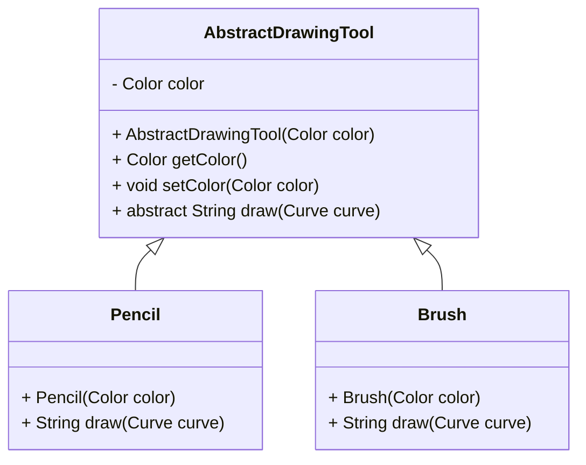
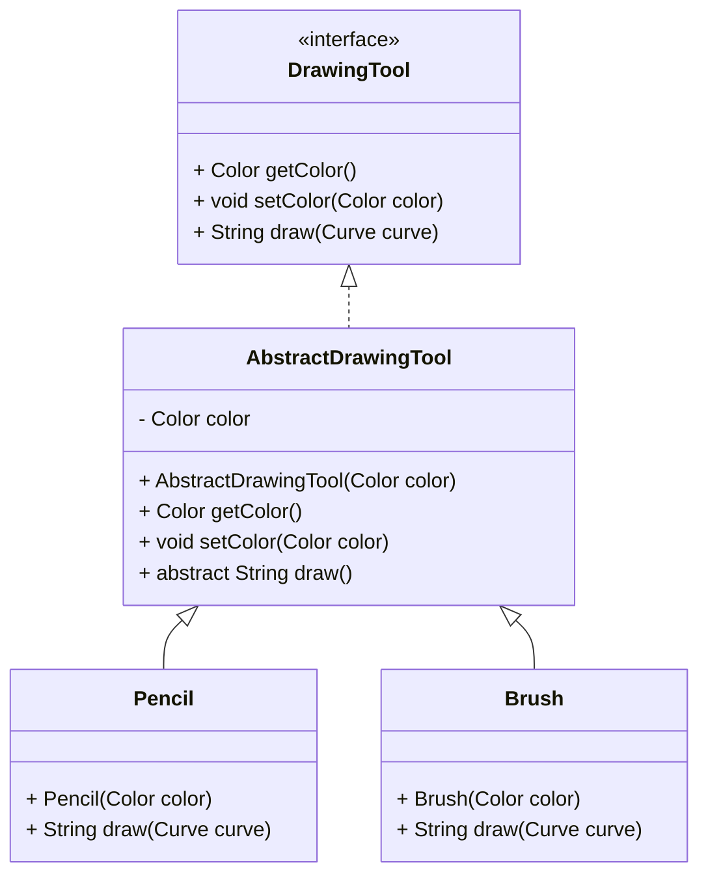
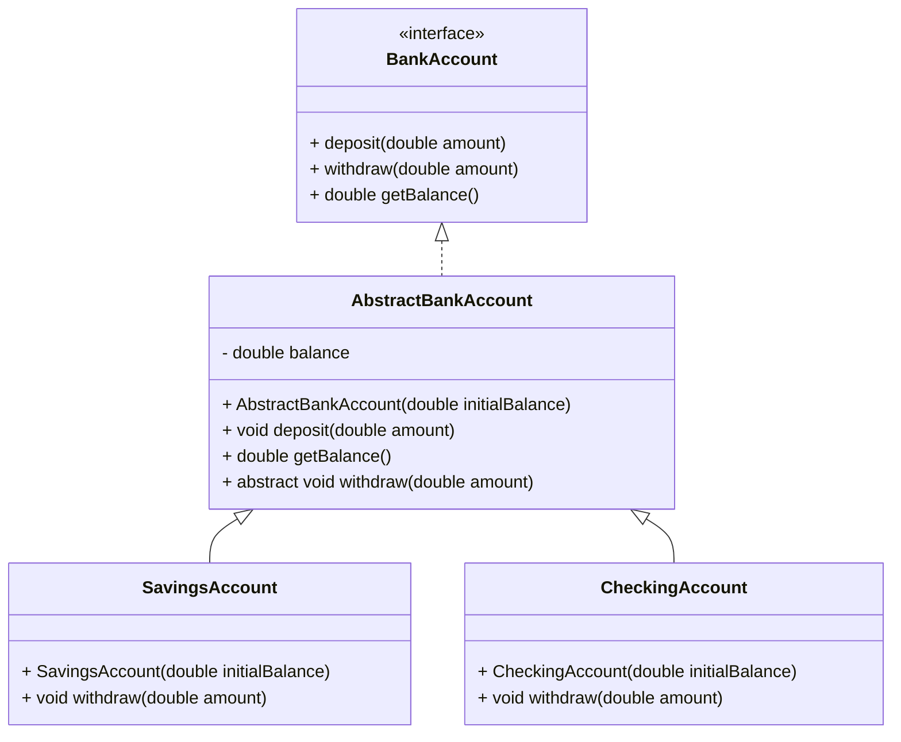
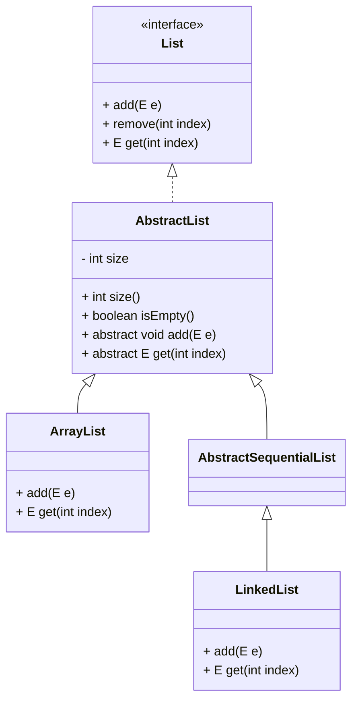

# E3.5 — Abstract Classes and Composition

The drawing examples use `import java.awt.Color;` and the following supporting type. Compile alternative drawing-tool definitions separately.

```java
record Curve(String description) {
    public String draw() {
        return description;
    }
}
```

## Abstract classes

An **abstract class**, declared using the `abstract` keyword, can share state and implementation across related classes while leaving some operations to subclasses. An interface does not inherently require duplicated code: default methods or a collaborator can also provide reuse. Choose a superclass only when the inheritance relationship and its contract are appropriate, not merely because two methods look similar.

* It can define **both abstract methods** (without implementation) and **concrete methods** (with implementation).
* It can include **constructors**, which are typically used by its subclasses.
* You **cannot create instances** of an abstract class directly — it may contain methods that are not fully implemented.
* An abstract class can **extend another class**, including another abstract class.



```java
public abstract class AbstractDrawingTool {

    protected Color color;

    protected AbstractDrawingTool(Color color) {
        this.color = color;
    }

    public Color getColor() {
        return color;
    }

    public void setColor(Color color) {
        this.color = color;
    }

    public abstract String draw(Curve curve); // an abstract method
}
```

Since `AbstractDrawingTool` is an abstract class we cannot create instances of this class:

```java
AbstractDrawingTool pencil = new AbstractDrawingTool(Color.RED); // this throws a compile time error
```

The method `draw()` is declared abstract because, at this level of abstraction, its implementation is unknown. Concrete subclasses of the class `AbstractDrawingTool` should have an implementation of this method.

```java
class Pencil extends AbstractDrawingTool {

    // It can have additional fields as well

    public Pencil(Color color) {
        super(color);
    }

    @Override
    public String draw(Curve curve) {
        return "Pencil drawing a " + curve.draw();
    }
}
```


```java
class Brush extends AbstractDrawingTool {

    // It can have additional fields as well

    public Brush(Color color) {
        super(color);
    }

    @Override
    public String draw(Curve curve) {
        return "Brush drawing a " + curve.draw();
    }
}
```

## In practice

### Example 1

Interfaces and abstract classes can be combined to create a flexible and reusable class hierarchy.

* **Interface**: Defines the core behavior that all drawing tools must provide (e.g., a `draw` method).

* **Abstract Class**: Implements common state and behavior (like managing the tool’s color) and provides a foundation for concrete drawing tools.

* **Concrete Classes**: Specialize behavior for each type of tool (e.g., `Pencil` or `Brush`) and provide specific implementations of the `draw` method.



```java
interface DrawingTool {
    String draw(Curve curve);
    Color getColor();
    void setColor(Color color);
}
```


```java
abstract class AbstractDrawingTool implements DrawingTool {
    protected Color color;

    protected AbstractDrawingTool(Color color) {
        this.color = color;
    }

    public Color getColor() {
        return color;
    }

    public void setColor(Color color) {
        this.color = color;
    }

    public abstract String draw(Curve curve); // an abstract method
}
```

```java
class Pencil extends AbstractDrawingTool {

    // It can have additional fields as well

    public Pencil(Color color) {
        super(color);
    }

    @Override
    public String draw(Curve curve) {
        return "Pencil drawing a " + curve.draw();
    }
}
```

```java
class Brush extends AbstractDrawingTool {

    // It can have additional fields as well

    public Brush(Color color) {
        super(color);
    }

    @Override
    public String draw(Curve curve) {
        return "Brush drawing a " + curve.draw();
    }
}
```

### Example 2

**Note — transfer the same pattern to another domain.** The account example uses `double` only to focus on abstraction, not as a production money model. Assume a documented simplified currency unit; finite-value and amount validation follow below.

Here is another example of **mixing abstract classes and interfaces**, this time to model **two types of bank accounts**: a **SavingsAccount** and a **CheckingAccount**. The interface defines general bank operations, and the abstract class handles shared logic (e.g., balance management).



```java
interface BankAccount {
    void deposit(double amount);
    void withdraw(double amount);
    double getBalance();
}
```

```java
abstract class AbstractBankAccount implements BankAccount {
    protected double balance;

    public AbstractBankAccount(double initialBalance) {
        if (!Double.isFinite(initialBalance) || initialBalance < 0) {
            throw new IllegalArgumentException("Invalid initial balance");
        }
        this.balance = initialBalance;
    }

    @Override
    public void deposit(double amount) {
        if (!Double.isFinite(amount) || amount <= 0 || !Double.isFinite(balance + amount)) {
            throw new IllegalArgumentException("Invalid deposit");
        }
        balance += amount;
    }

    @Override
    public double getBalance() {
        return balance;
    }

    @Override
    public abstract void withdraw(double amount);
}
```

```java
class SavingsAccount extends AbstractBankAccount {

    public SavingsAccount(double initialBalance) {
        super(initialBalance);
    }

    @Override
    public void withdraw(double amount) {
        if (Double.isFinite(amount) && amount > 0 && balance >= amount) {
            balance -= amount;
        } else {
            throw new IllegalArgumentException("Insufficient funds in SavingsAccount");
        }
    }
}
```

```java
class CheckingAccount extends AbstractBankAccount {

    private static final double OVERDRAFT_LIMIT = 100.0;

    public CheckingAccount(double initialBalance) {
        super(initialBalance);
    }

    @Override
    public void withdraw(double amount) {
        if (Double.isFinite(amount) && amount > 0 && balance - amount >= -OVERDRAFT_LIMIT) {
            balance -= amount;
        } else {
            throw new IllegalArgumentException("Overdraft limit exceeded in CheckingAccount");
        }
    }
}
```

### Example 3

**Reference — simplified collection hierarchy.** `LinkedList` extends `AbstractSequentialList`, which itself extends `AbstractList`. The diagram shows that intermediate class explicitly; method lists are illustrative excerpts, not literal JDK declarations.

The **Java Collections Framework** is a classic example of how **interfaces and abstract classes are combined** to create a **flexible and extensible hierarchy**.

* **Interfaces** define *what* a collection can do (e.g., `add`, `remove`, `iterate`).
* **Abstract classes** provide *reusable logic* and *partial implementations* to reduce code duplication.
* **Concrete classes** specialize behavior for different use cases (e.g., lists vs. sets vs. queues).



## Summary

| Feature                  | **Interface**                             | **Abstract Class**                             | **Concrete Class**            |
| ------------------------ |-------------------------------------------|------------------------------------------------| ----------------------------- |
| **Purpose**              | Define *what* should be done              | Define *partial behavior* and common structure | Provide *full implementation* |
| **Implementation**       | Abstract methods plus default, static, and private method bodies | Can include both abstract and concrete methods | No remaining abstract methods |
| **Can be instantiated?** | ❌ No                                      | ❌ No                                           | ✅ Yes                         |
| **Constructors**         | ❌ Not allowed                             | ✅ Can define constructors                      | ✅ Can define and use constructors |
| **Fields**               | Only `public static final` constants      | Full use                                       | Full use                |
| **Use Case**             | Define capabilities or roles              | Share common behavior and enforce contracts    | Actual working implementation |


### Choosing the smallest useful abstraction

* Use an interface when clients need a stable capability across implementations.
* Use an abstract class when related implementations benefit from shared state or logic and the inheritance contract is deliberate.
* Use composition when a helper can provide reuse without a superclass dependency.

Do not add an interface and abstract class to every new class merely because a generator suggests the pattern.

## Read, predict, verify

**Activity:** write a `Player.draw(DrawingTool tool, Curve curve)` method that returns `tool.draw(curve)`. Supply a pencil and a brush without changing `Player`.

**Exit questions:** why must an implementation of a public interface method be public? Which state is shared by an interface constant, and which state belongs to each tool? What test verifies that a failing default-color draw restores the original color?

## Resources
- https://dev.java/learn/interfaces/
- https://www.baeldung.com/java-interface-vs-abstract-class
- https://www.baeldung.com/java-interface-default-method-vs-abstract-class
- https://www.baeldung.com/java-abstract-class
- https://www.baeldung.com/java-interfaces
