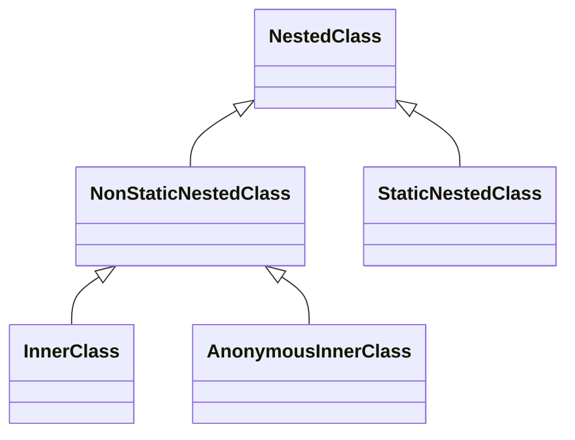

# E3.9 — Nested Classes

## Nested classes
You can call a class **nested** when it is declared inside another class.

**Reference:** static nested classes do not require an enclosing instance; non-static member inner classes do. Local and anonymous classes provide additional forms. The following diagram groups concepts; it is not an inheritance hierarchy of Java runtime types.




### Anonymous Inner Classes

Let's assume we have the following interface with two methods:

```java
interface SpeakingEntity {

    void sayHello();

    void sayBye();
}
```

Here, two anonymous classes are defined to represent an English-speaking person and a cat, respectively.

The expression creates an instance of an **anonymous implementing class**, not an instance of the interface itself:

```java
SpeakingEntity englishSpeakingPerson = new SpeakingEntity() {

    @Override
    public void sayHello() {
        System.out.println("Hello!");
    }

    @Override
    public void sayBye() {
        System.out.println("Bye!");
    }
};
```

```java
SpeakingEntity cat = new SpeakingEntity() {

    @Override
    public void sayHello() {
        System.out.println("Meow!");
    }

    @Override
    public void sayBye() {
        System.out.println("Meow!");
    }
};
```

Now, we can invoke overridden methods:

```
englishSpeakingPerson.sayHello();
cat.sayBye();
```

### Inner Classes

**Note — use an inner class when its association with an enclosing instance is meaningful.** Otherwise a static nested class may avoid an unnecessary enclosing reference.

In this example, the `Bow` class will be a non-static inner class of the `Cat` class. The `Bow` class will have access to the instance variables of the `Cat` class, such as the `color` and `size` of the bow.

```java
class Cat {
    private String name = "Whiskers";  // Instance variable of the Cat class
    private String color = "Red";      // Instance variable for Bow color
    
    // Non-static inner class Bow
    class Bow {
        void tieBow() {
            // Accessing outer class's instance fields
            System.out.println(name + " wears a " + color + " bow.");
        }
    }

    void createBow() {
        // Creating and using the Bow instance
        Bow bow = new Bow();
        bow.tieBow();  // Calling the method in the Bow class
    }
}

public class Main {
    public static void main(String[] args) {
        // Creating an instance of the Cat class
        Cat cat = new Cat();
        cat.createBow();  // Using the inner Bow class
    }
}
```

- The `Bow` class is a non-static inner class of `Cat`. It can access the `name` and `color` instance variables of `Cat`.
- The `createBow()` method in the `Cat` class creates an instance of `Bow` and calls the `tieBow()` method to display a message.
- The `main()` method creates an instance of `Cat` and invokes `createBow()` to use the inner `Bow` class.

### Static Nested Classes

Now make `Bow` a **static nested class**. It has no implicit `Cat` instance, so it needs an explicit `Cat` reference to access instance members. It can directly access the enclosing class's static members.

```java
class Cat {
    private static String type = "Persian";  // Static field in Cat class
    
    // Static nested class Bow
    static class Bow {
        void tieBow() {
            // Accessing outer class's static field
            System.out.println("The cat is a " + type + " and wears a bow.");
        }
    }
}

public class Main {
    public static void main(String[] args) {
        // Creating an instance of the static Bow class without an instance of Cat
        Cat.Bow bow = new Cat.Bow();
        bow.tieBow();  // Calling the method in the static Bow class
    }
}
```

- `Bow` is a static nested class of `Cat`. It directly accesses `type` without an enclosing instance.
- The `main()` method in `Main` creates an instance of the `Bow` class directly using `Cat.Bow`, without needing an instance of `Cat`.
- The `tieBow()` method of `Bow` is called to display a message about the cat type and the bow.

## Resources
