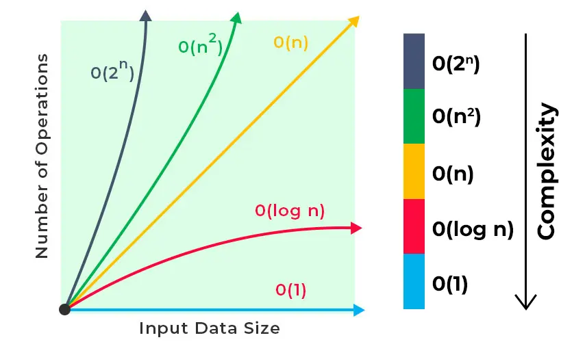
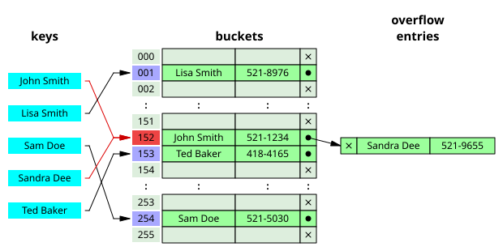
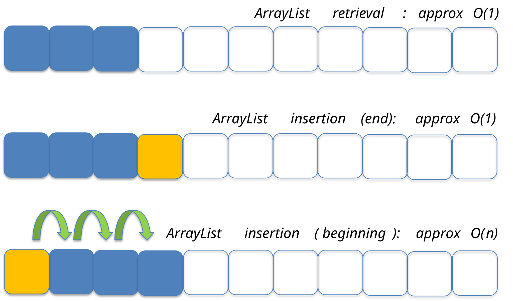
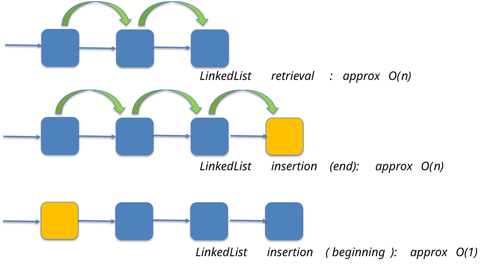

# E4.1 — Collections Lists and Iterators

Examples use `java.util` types; add the required imports. Put statements inside `main` and method fragments inside a class. Simplified interface excerpts show selected signatures, not replacement library types. Alternative definitions of `Person` are compiled separately.

The **Java Collections Framework (JCF)** is a unified architecture for representing and manipulating collections of objects.

It provides:

* **interfaces** defining common collection abstractions and operations
* **abstract classes** providing partial implementations and reusable code
* **concrete classes** implementing the collection interfaces
* **algorithms** for manipulating collections, mainly provided by `java.util.Collections`


### Complexity

**Reference — compare relevant operations, not just collection names.**



When choosing a data structure, it is important to consider the complexity of the operations that will be performed most frequently.

Typical complexities include:

* **O(1)** — constant time
* **O(log n)** — logarithmic time
* **O(n)** — linear time
* **O(n log n)** — typically associated with efficient comparison-based sorting algorithms

The actual performance of a collection also depends on factors such as memory layout, cache locality, resizing, hashing, and the particular implementation.

---

### Key technologies

#### Dynamic array

The main limitation of a regular array is that its size is fixed at the time of allocation.

In other words, if an array is allocated with size `n`, it cannot accommodate the `(n+1)`-th element without creating a new array.

One possible workaround is to allocate a large array in advance, but this can lead to **significant memory waste**.

This limitation is addressed by the concept of a [dynamic array](https://en.wikipedia.org/wiki/Dynamic_array).

A dynamic array maintains:

* a backing array
* a current **size**, representing the number of stored elements
* a **capacity**, representing the number of elements that can currently fit in the backing array

When the capacity is exceeded, a new, larger array is allocated and the existing elements are copied over.

Resizing itself takes **O(n)** time, but with a suitable growth strategy, appending elements is **amortized O(1)**.

Dynamic arrays provide:

* efficient random access: **O(1)**
* efficient iteration
* amortized **O(1)** append operations
* occasional **O(n)** resizing operations


#### Linked list

A [linked list](https://en.wikipedia.org/wiki/Linked_list) is a linear collection of elements whose order is determined by **links** between nodes rather than by contiguous memory locations.

A linked list consists of a sequence of **nodes**, where each node typically contains:

* the stored element
* a reference to the next node
* and, in a doubly linked list, a reference to the previous node

A linked list does not provide efficient random access. To access the element at position `i`, the list generally has to traverse the preceding nodes.

Therefore:

* access by index is **O(n)**
* searching is generally **O(n)**
* insertion/removal can be **O(1)** when the relevant node/position is already known
* finding an arbitrary position by index is **O(n)**

Linked lists can also have **poorer cache locality** than arrays because their nodes are separate objects that may be located in different memory areas.

More advanced variants include:

* **doubly linked lists**
* **circular linked lists**


#### Binary tree

A [tree](https://en.wikipedia.org/wiki/Self-balancing_binary_search_tree) is a hierarchical data structure composed of **nodes** connected by **edges**.

A tree has a **root node** at the top. Nodes can have **child nodes**, forming branches, while nodes without children are called **leaves**.

A **binary tree** is a tree in which each node has at most two children.

A **binary search tree (BST)** maintains an ordering relationship between the elements. In a balanced BST, the height remains approximately logarithmic in the number of elements.

**Self-balancing binary search trees**, such as:

* **AVL trees**
* **Red-Black trees**

maintain a bounded tree height and provide **O(log n)** worst-case search, insertion, and deletion.

Trees are widely used in applications such as:

* file systems
* databases
* search algorithms
* indexing structures
* hierarchical data representation


#### Hash table

A [hash table](https://en.wikipedia.org/wiki/Hash_table) is a data structure that implements an **associative array**, mapping **keys** to **values**.

A hash table uses a **hash function** to transform a key into a hash value. The hash value is then used to determine an appropriate location, or **bucket**, in an internal table.

During a lookup operation:

1. the key is hashed
2. the hash value is used to identify candidate bucket(s)
3. the stored key is compared with the requested key
4. the associated value is returned if the key is found

Hash tables typically provide **O(1) average-case** insertion, deletion, and lookup, although the exact complexity depends on the implementation and the distribution of hash values.

Poor hashing or excessive collisions can degrade performance.



---

### Interfaces and implementations


---

## Iterable and Iterator Interfaces

The **`Iterable<T>`** interface (`java.lang.Iterable`) represents an object whose elements can be traversed by obtaining an `Iterator<T>`.

Objects implementing `Iterable` can be used in **enhanced `for` loops**:

```java
public interface Iterable<T> {
    Iterator<T> iterator();
}
```

For example:

```java
List<Object> l = new ArrayList<>();

for (Object o : l) {
    // do something
}
```

For an `Iterable`, enhanced `for` uses iterator-based traversal. Arrays also support enhanced `for`, but are not `Iterable` and use a different translation.

The **`Iterator`** interface encapsulates the traversal of a collection in a separate object.

```java
public interface Iterator<T> {
    boolean hasNext();
    T next();
    void remove();
}
```

For example:

```java
ArrayList<Object> l = new ArrayList<>();

for (Iterator<Object> i = l.iterator(); i.hasNext();) {
    Object o = i.next();
    // do something
}
```

The `remove()` method allows an iterator to remove the last element returned by `next()`, when the underlying collection supports this operation.


See more: [Design Patterns: Iterator - Refactoring.guru](https://refactoring.guru/design-patterns/iterator)

> **Note:** `Iterable` is not the root interface of the Java Collections Framework. `Collection` is the main root interface for collections, while `Iterable` is a more general interface for objects that can be iterated over.

---

## Collection Interface

The **`Collection`** interface represents a group of objects, known as its elements.

Some collections:

* allow duplicate elements
* do not allow duplicates
* preserve a defined order
* do not guarantee a particular iteration order

The `Collection` interface is useful when code should work with a collection without depending on a specific implementation.

### Collection main methods

**Reference — the generic forms of the main methods are:**

* `int **size**()`
* `boolean **isEmpty**()`
* `boolean **contains**(Object element)`
* `boolean **containsAll**(Collection<?> c)`
* `boolean **add**(E element)`
* `boolean **addAll**(Collection<? extends E> c)`
* `boolean **remove**(Object element)`
* `boolean **removeAll**(Collection<?> c)`
* `void **clear**()`
* `Object[] **toArray**()`
* `<T> T[] **toArray**(T[] a)`
* `Iterator<E> **iterator**()`

---

## List Interface

A **`List`** is an ordered collection in which:

* duplicate elements are allowed
* **insertion order is preserved**
* elements can be accessed **by position**
* elements can be inserted or removed at arbitrary positions


### List main methods

* `E **get**(int index)`
* `E **set**(int index, E element)`
* `E **remove**(int index)`
* `void **add**(int index, E element)`
* `boolean **addAll**(int index, Collection<? extends E> c)`
* `int **indexOf**(Object o)`
* `int **lastIndexOf**(Object o)`
* `List<E> **subList**(int fromIndex, int toIndex)`

### List implementations

Two general-purpose `List` implementations are **`ArrayList`** and **`LinkedList`**.

In most situations, `ArrayList` is the preferred general-purpose implementation because it provides:

* constant-time positional access
* efficient iteration
* good cache locality
* efficient bulk element movement when elements have to be shifted

`LinkedList` can be useful when elements are frequently inserted or removed through an iterator or when its `Deque` operations are required. However, indexed access is linear, and its node-based representation generally has worse memory locality and higher per-element overhead than `ArrayList`.

**ArrayList** implements **List**

* `get(index)` → **O(1)**
* `add(obj)` at the end → **amortized O(1)**
* `add(index, obj)` → **O(n)** in the general case



**LinkedList** implements **List, Deque**

* `get(index)` → **O(n)**
* `add(obj)` at the end → **O(1)**
* `add(index, obj)` → **O(n)** because locating the position is linear

Once the relevant node is already known, insertion/removal can be performed in **O(1)**.



### List initialization

Declaring an interface type keeps clients independent of one implementation. A replacement may require only one construction change **if** its ordering, null, mutation, and performance behavior meets the client's requirements:

```java
/* plain, simple, long */
List<Integer> l = new ArrayList<>();
l.add(14);
l.add(73);
l.add(18);

/* more compact version (mutable) */
List<Integer> fromArray = new ArrayList<>(Arrays.asList(14, 73, 18));
List<Integer> fromValues = new ArrayList<>(List.of(14, 73, 18));

/* more compact version (unmodifiable) */
List<Integer> readOnly = List.of(14, 73, 18);
```

`List.of(...)` returns an **unmodifiable** list. In particular, operations such as `add`, `remove`, and `set` are not supported.

### Mutability and ownership

Unmodifiable collections can still contain mutable objects. An unmodifiable **view** can also reflect changes made through its backing collection.

```java
List<String> source = new ArrayList<>(List.of("Ada"));
List<String> view = Collections.unmodifiableList(source);
List<String> snapshot = List.copyOf(source);
source.add("Grace");
IO.println(view);
IO.println(snapshot);
```

**Predict both outputs before running.**

<details>
<summary>Check your prediction</summary>

The view prints `[Ada, Grace]`; the snapshot prints `[Ada]`. Neither permits mutation through its own API, but only the snapshot is independent of subsequent source-list structure changes. Neither deep-copies elements.

</details>

> **Note:** `List.of`, `Set.of`, and `Map.of` reject nulls. Their `copyOf` counterparts also reject null entries/elements. `Arrays.asList` is a fixed-size array-backed view, not an immutable snapshot.

### Sequenced collections in Java 25

**Note — modern API vocabulary:** `SequencedCollection`, `SequencedSet`, and `SequencedMap`, introduced in Java 21 and available in Java 25, describe collections with a defined encounter order. Operations include access at both ends and `reversed()` views. `List` extends `SequencedCollection`; `LinkedHashSet` and `LinkedHashMap` support the corresponding sequenced interfaces.

```java
List<String> names = new ArrayList<>(List.of("Ada", "Grace"));
IO.println(names.getFirst()); // Ada
IO.println(names.reversed()); // [Grace, Ada]
names.reversed().set(0, "Barbara");
IO.println(names); // [Ada, Barbara]: reversed is a view
```

Do not assume every implementation supports every optional mutation. A general `HashSet` or `HashMap` does not promise encounter order.

---

## Manipulating Collections

### Using Iterators

A collection should generally **not be structurally modified directly while it is being traversed by an iterator or enhanced `for` loop**.

For many standard collections, modifying the collection directly during iteration causes a `ConcurrentModificationException` on a subsequent iterator operation.

For example:

```java
public static void main(String[] args) {

    List<Double> l =
        new LinkedList<>(List.of(10.8, 11.1, 13.2, 30.2));

    int count = 0;

    for (double i : l) {
        if (count == 1) {
            l.remove(count);
        }

        if (count == 2) {
            l.add(22.3);
        }

        count++;
    }

    // Typically results in ConcurrentModificationException
}
```

The important distinction is that **the iterator itself should be used when the operation is supported by the iterator**.

The `Iterator` interface provides forward traversal and supports removal of the last element returned by `next()`:

* `boolean **hasNext**()`
* `E **next**()`
* `void **remove**()`

```java
public static void main(String[] args) {

    // With Iterator, remove all elements with a value of 11.1
    List<Double> l =
        new LinkedList<>(List.of(10.8, 11.1, 13.2, 30.2));

    for (Iterator<Double> i = l.iterator(); i.hasNext();) {
        double value = i.next();

        if (value == 11.1) {
            i.remove();
        }
    }

    IO.println(l);
    // [10.8, 13.2, 30.2]
}
```

> `ConcurrentModificationException` is part of the **fail-fast behavior** of many collection iterators. It should not be treated as a synchronization mechanism or as a guaranteed result for every collection implementation.

For straightforward conditional removal, `l.removeIf(value -> value == 11.1)` expresses the same exact-value predicate on the mutable list. The exact floating-point literal comparison here is a teaching choice, not a general tolerance policy.

The `ListIterator` interface extends `Iterator` and provides traversal in **both directions**, as well as modification operations:

* `boolean **hasNext**()`
* `boolean **hasPrevious**()`
* `E **next**()`
* `E **previous**()`
* `void **add**(E e)`
* `void **set**(E e)`
* `void **remove**()`
* `int **nextIndex**()`
* `int **previousIndex**()`

```java
public static void main(String[] args) {

    // With ListIterator, replace all elements
    // with value 11.1 with their double
    List<Double> l =
        new LinkedList<>(List.of(10.8, 11.1, 13.2, 30.2));

    for (ListIterator<Double> i = l.listIterator(); i.hasNext();) {
        double value = i.next();

        if (value == 11.1) {
            i.set(value * 2);
        }
    }

    IO.println(l);
    // [10.8, 22.2, 13.2, 30.2]
}
```

Using `set()` is the simplest way to replace the last element returned by `next()`.

---

## Resources

* https://docs.oracle.com/en/java/javase/25/docs/api/java.base/java/util/SequencedCollection.html
* https://www.baeldung.com/java-collections
* https://www.baeldung.com/java-hashmap
* https://dev.java/learn/api/collections-framework/arraylist-vs-linkedlist/
