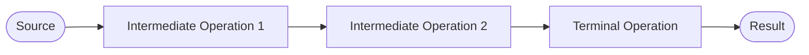

# Java Functional Programming (Streams)

All examples target **Java 25 without preview features** and build on E4, E6, and E7.1.

* **Core:** read lazy pipelines, choose transformations and terminal operations, and preserve ordering and mutation contracts.
* **Note:** resource-backed streams and parallel execution.
* **Reference:** collector families and their result types.

Import types from `java.util` and `java.util.stream` as needed. Statement fragments belong inside `main`; helper methods belong inside a class. Later `Account` definitions extend the earlier example: compile those alternative versions separately. Assume non-null source elements unless stated otherwise.

## The basic concept of streams
The **Stream API** supports declarative pipelines for processing values. It lets us express transformations without spelling out each traversal step. Parallel execution is available, but correctness and useful speedup require additional reasoning; neither follows automatically from using streams.

A **stream** conveys elements from a **source** (a collection, a generator function, a file, an I/O channel, another stream) and then processes the elements by using a sequence of predefined operations combined into a pipeline.

There are three stages of working with a stream:

1.  Obtaining the stream from a source.
2.  Performing intermediate operations with the stream to process data.
3.  Performing a terminal operation to produce a result.



## Loops vs streams
All classes associated with streams are located in the `java.util.stream` package. There are several common stream classes: `Stream<T>`, `IntStream`, `LongStream` and `DoubleStream`. While the generic stream works with reference types, others work with the corresponding primitive types. 

Let's suppose we have a list of numbers, and we'd like to count the numbers that are greater than `5`. A "traditional" way to do it is to write a loop like the following:

```java
import java.util.ArrayList;

public static void main(String[] args) {
    List<Integer> numbers = new ArrayList<>(List.of(1, 4, 7, 6, 2, 9, 7, 8));
    
    long count = 0;
    for (int number : numbers) {
        if (number > 5) {
            count++;
        }
    }
    System.out.println(count); // 5
}
```

Using the Stream API, it becomes:

```java
long count = numbers.stream()
        .filter(number -> number > 5)
        .count(); // 5
```

Here we get a stream from the `numbers` list, then filter its elements by using a predicate lambda expression, and then count the numbers that satisfy the condition.

This pipeline separates the selection rule from traversal. Whether it is easier to read depends on the task; a loop remains appropriate when it expresses the algorithm more clearly. For example, we can skip the first four input values:

```java
long count = numbers.stream()
        .skip(4)  // skip 1, 4, 7, 6
        .filter(number -> number > 5)
        .count();  // 3
```

## Creating streams
The most common way to create a stream is to take it from a collection. Any collection has the `stream()` method for this purpose.

```java
List<Integer> famousNumbers = List.of(0, 1, 1, 2, 3, 5, 8, 13, 21, 34, 55);
Stream<Integer> numbersStream = famousNumbers.stream();

Set<String> usefulConcepts = Set.of("functions", "lazy", "immutability");
Stream<String> conceptsStream = usefulConcepts.stream();
```

It is also possible to obtain a stream from an array:

```java
Stream<Double> doubleStream = Arrays.stream(new Double[]{ 1.01, 1d, 0.99, 1.02, 1d, 0.99 });
```

or directly from some values:

```java
Stream<String> persons = Stream.of("John", "Demetra", "Cleopatra");
```

or concatenate other streams together:

```java
Stream<String> stream1 = Stream.of(/* some values */);
Stream<String> stream2 = Stream.of(/* some values */);
Stream<String> resultStream = Stream.concat(stream1, stream2);
```

## Stream operations
All stream operations are divided into two groups:

* **Intermediate operations** are not evaluated immediately when invoking. They simply return new streams to call the next operations on them (**lazy**).
* **Terminal operations** initiate the traversal needed to produce a result or perform an action. A pipeline is consumed at most once; short-circuiting and optimizations can avoid processing some elements or stages.

Once a terminal operation has been evaluated, it is **not permitted** to reuse the stream again.

More precisely, stream reuse is prohibited and **may** be detected with `IllegalStateException`; do not rely on detection in every situation. Create a new stream from the source for another traversal. A stream is a computation, not a reusable container.

### Read a lazy pipeline

**Predict:** when is the filter below evaluated?

```java
Stream<Integer> selected = Stream.of(1, 2, 3)
        .filter(value -> {
            System.out.println("Checking " + value);
            return value > 1;
        });
System.out.println("Pipeline created");
System.out.println(selected.findFirst().orElse(-1));
```

<details>
<summary>Check your prediction</summary>

The output is `Pipeline created`, then `Checking 1`, `Checking 2`, and `2`. This sequential short-circuiting traversal stops when it finds a match; not every source element needs to be examined.

</details>

### Intermediate operations
* `filter` returns a new stream that includes the elements that match a **predicate**;
* `map` returns a new stream that consists of the elements that were obtained by applying a **function** (i.e. transforming each element).
* `peek` returns the same stream of elements but allows observing the current elements with a **consumer**;
* `sorted` returns a new stream that includes elements sorted according to the natural order or a given **comparator**;
* `limit` returns a new stream that consists of the first `n` elements of this stream;
* `skip` returns a new stream without the first `n` elements of this stream;
* `distinct` returns a new stream consisting of only unique elements according to the results of `equals`;

### Terminal operations
* `count` returns the number of elements in the stream as a `long` value;
* `max` / `min` returns an `Optional` maximum/minimum element of the stream according to the given comparator;
* `reduce` combines values from the stream into a single value (an aggregate value);
* `findFirst` / `findAny` returns the first / any element of the stream as an `Optional`;
* `anyMatch` returns `true` if at least one element matches a predicate (see also: `allMatch`, `noneMatch`);
* `forEach` takes a **consumer** and applies it to each element of the stream (for example, printing it);
* `collect` performs a mutable reduction; the result may be a collection, map, string, or another aggregate;
* `toList` returns an unmodifiable list in encounter order, when one exists;
* `toArray` returns an array of the values in the stream.

> **NOTE**: Some terminal operations (findAny, findFirst, max, min, etc.) return an `Optional` because the stream can be empty.


## Intermediate operations, in detail

### The filter method
The `filter` method returns a new stream consisting only of those elements that match the given predicate.

We'd like to create a new list consisting of prime numbers that belong to the range from 11 to 23 (inclusively).

```java
List<Integer> primeNumbers = List.of(2, 3, 5, 7, 11, 13, 17, 19, 23, 29, 31);

List<Integer> filteredPrimeNumbers = primeNumbers.stream() 
        .filter(n -> n >= 11 && n <= 23)
        .toList();
```

Sometimes, two or more filters are used together. We'd like to count how many programming languages start with an upper letter ignoring all the empty strings.

```java
List<String> programmingLanguages = Arrays.asList("Java", "", "scala", "Kotlin", "", "clojure");

long count = programmingLanguages.stream()
        .filter(lang -> lang.length() > 0) 
        .filter(lang -> Character.isUpperCase(lang.charAt(0)))
        .count();
```

These two filter operations can be replaced with a single operation that takes a complex predicate (less readable):

```java
List<String> programmingLanguages = Arrays.asList("Java", "", "scala", "Kotlin", "", "clojure");

long count = programmingLanguages.stream()
        .filter(lang -> lang.length() > 0 && Character.isUpperCase(lang.charAt(0)))
        .count();
```

### The map method
`map` is a method of the `Stream` interface that takes a function as a parameter.

Let's divide each number by 2. For that, we can *map* each element of the stream to the element divided by 2 and *collect* it in the new list:

```java
List<Double> numbers = List.of(6.28, 5.42, 84.0, 26.0);

List<Double> famousNumbers = numbers.stream()
        .map(number -> number / 2) 
        .collect(Collectors.toList());
```

**Using map for extracting properties**

`map` is often used to get a stream of properties from а stream of objects. For example, given a class `Job`, we can get the list of job titles from a given list of jobs by using the `map` method:

```java
public class Job {
    private String title;
    private String description;
    private double salary;

    public Job(String title, String description, double salary) {
        this.title = title;
        this.description = description;
        this.salary = salary;
    }

    public String getTitle() {
        return title;
    }
}
```

```java
List<String> titles = jobs.stream()
        // synthetic form of .map(job -> job.getTitle())
        .map(Job::getTitle)   
        .collect(Collectors.toList()); 
```

### The flatMap method
The method `stream()` of a `List<List<String>>` returns a `Stream<List<String>>`. In that case, we often need to *flatten* a stream of collections to a stream of elements from these collections.

Flattening refers to merging elements of a list of lists into a single list. For example, if we flatten a list of lists `[["a", "b"], ["c"], ["d", "e"]]`, we will get the list `["a", "b", "c", "d", "e"]`.

The `flatMap` method applies a function to transform each stream element into a new stream and concatenates these streams together. 

Let's consider an example with Java books. Each book has a title, a publishing year, and a list of authors:

```java
record Book(String title, int year, List<String> authors) {
    public Book {
        authors = List.copyOf(authors);
    }

    public List<String> getAuthors() {
        return authors;
    }
}
```

```java
List<Book> javaBooks = List.of(
        new Book("Java EE 7 Essentials", 2013, List.of("Arun Gupta")),
        new Book("Algorithms", 2011, List.of("Robert Sedgewick", "Kevin Wayne")),
        new Book("Clean code", 2014, List.of("Robert Martin"))
);
```

Now we can obtain a list of all authors from the list of Java books by using `flatMap` method:

```java
List<String> authors = javaBooks.stream()
        .flatMap(book -> book.getAuthors().stream())
        .collect(Collectors.toList());
```

The resulting list is:

```
["Arun Gupta", "Robert Sedgewick", "Kevin Wayne", "Robert Martin"]
```

### The peek method
**Note — diagnostics, not required business actions.** `peek` observes elements as they are consumed. A terminal operation may short-circuit, and an implementation may elide traversal when its result is already known. Therefore, a `peek` action is not guaranteed to run for every source element.

```java
List<Integer> primeNumbers = List.of(2, 3, 5, 7, 11, 13, 17, 19, 23, 29, 31);

List<Integer> primeNumbersCopy = primeNumbers.stream()
        // synthetic form of .peek(number -> System.out.println(number))
        .peek(System.out::println)
        .collect(Collectors.toList());
```

### Gatherers available in Java 25

**Note — an optional extension after map and flatMap.** `Stream.gather` supports intermediate transformations such as grouping consecutive elements into windows. Gatherers became final in Java 24 and are stable in Java 25.

```java
List<List<Integer>> batches = Stream.of(1, 2, 3, 4, 5)
        .gather(java.util.stream.Gatherers.windowFixed(2))
        .toList();
System.out.println(batches); // [[1, 2], [3, 4], [5]]
```

The final incomplete batch is retained. A gatherer is an **intermediate** operation, unlike a collector used by terminal `collect`. Custom gatherer implementations are reference material, not required for the introductory pipeline exercises.

**Predict:** what changes if `limit(2)` appears after `gather` instead of before it? Are you limiting input elements or output batches?


## Terminal operations, in detail

### The collect method
`collect` is a terminal operation that can accept an object of the Collector type. The `Collectors` class contains static methods that return the Collector and implement functionality for accumulating stream elements.

### Choosing a list result

**Core:** select the mutability contract deliberately:

```java
List<Integer> readOnly = Stream.of(1, 2, 3).toList();
List<Integer> mutable = Stream.of(1, 2, 3)
        .collect(Collectors.toCollection(ArrayList::new));
mutable.add(4);
```

`Stream.toList()` is unmodifiable, not deeply immutable. `Collectors.toList()` does **not** promise a particular list type or mutability; use `toCollection` when a mutable `ArrayList` is required.

#### Accumulating into collections
Let's consider the `Account` class below:

```java
public class Account {
    private long balance;
    private String number;
    
    public Account(long balance, String number) {
        this.balance = balance;
        this.number = number;
    }

    public long getBalance() {
        return balance;
    }

    public String getNumber() {
        return number;
    }

    @Override
    public String toString() {
        return "Account{balance=" + balance + ", number='" + number + "'}";
    }
}
```

We can accumulate stream elements:

```java
public static void main(String[] args) {

    List<Account> accounts = new ArrayList<>(List.of(
            new Account(1000, "IT001"),
            new Account(2500, "IT002"), 
            new Account(500, "IT003"), 
            new Account(800, "IT001")));
    
    // toList
    List<String> numbersList = accounts.stream()
            .map(Account::getNumber)
            .collect(Collectors.toList());

    System.out.println("List: " + numbersList);

    // toSet
    Set<String> numbersSet = accounts.stream()
            .map(Account::getNumber)
            .collect(Collectors.toSet());

    System.out.println("Set: " + numbersSet);
}
```

#### Accumulating single values
The `collect()` method is able to accumulate stream elements into a single value. Here you can see some Collectors methods that produce a single value:

* summingInt, summingLong, summingDouble;
* averagingInt, averagingLong, averagingDouble;
* maxBy, minBy;
* counting.


```java
long summary = accounts.stream()
// synthetic form of .summingLong(account -> account.getBalance())
.collect(Collectors.summingLong(Account::getBalance));
```

```java
double average = accounts.stream()
.collect(Collectors.averagingLong(Account::getBalance));
```

#### Partitioning
Imagine that we want to divide a collection of accounts into two groups: accounts whose balance is greater than or equal to 10000, and accounts with a balance lower than 10000. 

The partitioning operation is presented by the `Collectors.partitioningBy`  method that accepts a predicate. It splits input elements into a `Map` of two lists: one list contains elements for which the predicate is true, and the other contains elements for which it is false. The keys of the  `Map`  has the  `Boolean`  type.

To illustrate the idea, let's create the following list of accounts:

```java
List<Account> accounts = List.of(
        new Account(3333L, "530012"),
        new Account(15000L, "771843"),
        new Account(0L, "681891")
);
```

And partition them into two lists by a `balance >= 10000`  predicate:

```java
Map<Boolean, List<Account>> accountsByBalance = accounts.stream()
        .collect(Collectors.partitioningBy(account -> account.getBalance() >= 10000));
```

The `accountsByBalance` map contains the following entries:

```text
{
    false=[Account{balance=3333, number='530012'}, Account{balance=0, number='681891'}],
    true=[Account{balance=15000, number='771843'}]
}
```

#### Grouping
Instead of splitting data into two groups based on a predicate, the grouping operation can produce any number of groups based on a  *classification function*  that maps elements to some key.

The grouping operation is presented by the `Collectors.groupingBy` method that accepts a classification function. The collector `groupingBy` also produces a  `Map`. The keys of the `Map` are values produced by applying the classification function to the input elements. The corresponding values of the `Map` are lists containing elements mapped by the classification function.

Let's create the `Status` enum and add field `status` to the  `Account`  class:

```java
enum Status {
    ACTIVE,
    BLOCKED,
    REMOVED
}

public class Account {
    private long balance;
    private String number;
    private Status status;

    public Account(long balance, String number, Status status) {
        this.balance = balance;
        this.number = number;
        this.status = java.util.Objects.requireNonNull(status);
    }

    public long getBalance() {
        return balance;
    }

    public String getNumber() {
        return number;
    }

    public Status getStatus() {
        return status;
    }

    @Override
    public String toString() {
        return "Account{balance=" + balance + ", number='" + number + "'}";
    }
}
```

Also, let's update the list of accounts:

```java
List<Account> accounts = List.of(
        new Account(3333L, "530012", Status.REMOVED),
        new Account(15000L, "771843", Status.ACTIVE),
        new Account(0L, "681891", Status.BLOCKED)
);
```

Now, we can divide all account into groups by its `status`:

```java
Map<Status, List<Account>> accountsByStatus = accounts.stream()
        .collect(Collectors.groupingBy(Account::getStatus));
```

The `accountsByStatus` map contains the following entries:

```text
{
    BLOCKED=[Account{balance=0, number='681891'}],
    REMOVED=[Account{balance=3333, number='530012'}],
    ACTIVE=[Account{balance=15000, number='771843'}]
}
```

#### Downstream collectors
In addition to a predicate or a classification function, `partitioningBy` and  `groupingBy` collectors can accept a  **downstream**  collector. Such a collector is applied to the results of another collector. 

Let's create the following list of accounts:

```java
List<Account> accounts = List.of(
        new Account(3333L, "530012", Status.ACTIVE),
        new Account(15000L, "771843", Status.BLOCKED),
        new Account(15000L, "234465", Status.ACTIVE),
        new Account(8800L, "110011", Status.ACTIVE),
        new Account(45000L, "462181", Status.BLOCKED),
        new Account(0L, "681891", Status.REMOVED)
);
```

And calculate the total balances of `blocked`, `active`, and `removed`  accounts using a downstream collector:

```java
Map<Status, Long> sumByStatuses = accounts.stream()
        .collect(Collectors.groupingBy(
                Account::getStatus,
                Collectors.summingLong(Account::getBalance))
         );
```

The code above groups accounts by the `status` field and applies a downstream  `summingLong`  collector to the `List` values created by the `groupingBy`  operator. The resulting map contains the following entries:

```text
{ REMOVED=0, ACTIVE=27133, BLOCKED=60000 }
```

The downstream collector accumulates per group; it does not require building an intermediate list for each key. Printed map and set order is not guaranteed by these default collectors. The displayed entries describe contents, not a required iteration order.

> **Note:** `Collectors.toMap` without a merge function rejects duplicate keys. Decide whether duplicates are invalid, should be combined, or should replace a value before choosing a merge function. Do not silence the failure by arbitrarily keeping one result.

### Numeric streams and reduction

```java
long total = java.util.stream.LongStream.of(10, 20, 30).sum();
int sum = Stream.of(1, 2, 3).reduce(0, Integer::sum);
System.out.println(total); // 60
System.out.println(sum);   // 6
```

For reduction, choose an identity and an associative operation compatible with it. Subtraction is not associative, and floating-point addition is not exactly associative. Parallel grouping can change floating-point rounding results. Primitive streams also avoid boxing for their numeric operations.

## Filtering students, the easy way!
We need to select a group of students with a specific features, accumulate them into a List, and also print a string representation of those selected.

Use this teaching representation with finite grade averages:

```java
record Student(String name, String lastname, double average) {
    public String getName() { return name; }
    public String getLastname() { return lastname; }
    public double getAverage() { return average; }
}
```

```java
public static void main(String[] args) {
    List<Student> students = new ArrayList<>(List.of(
            new Student("John", "Doe", 24),
            new Student("Dimebag", "Darrell", 25),
            new Student("Eric", "Baret", 28),
            new Student("Tyler", "Durden", 20),
            new Student("Jack", "Napier", 22),
            new Student("Diana", "Krall", 27),
            new Student("Rosa", "Luxemburg", 30)));

    List<Student> selectedStudents = students.stream()
            .filter(s -> s.getAverage() >= 26 && s.getAverage() <= 30)
            .toList();

    selectedStudents.forEach(s -> System.out.printf(java.util.Locale.ROOT,
            "%s_%s_%f%n", s.getLastname(), s.getName(), s.getAverage()));
}
```

Printing is a required action here, so it happens explicitly after selection rather than being hidden inside `peek`. The result list is unmodifiable; choose `toCollection(ArrayList::new)` if callers need to modify it.

### Source interference and parallelism

**Core:** lambdas should be non-interfering with the stream source and usually stateless. Do not modify the source list from inside its pipeline or append parallel results into an ordinary shared `ArrayList`.

**Review:** an assistant replaces `stream()` with `parallelStream()` and collects results using `forEach(result::add)`. Identify the shared mutable state and use a suitable collection operation instead. `forEach` does not preserve encounter order in parallel execution; `forEachOrdered` addresses order, not arbitrary shared-state safety.

> **Note:** parallel streams are not a default speed optimization. Consider input size, splitting cost, blocking operations, ordering, the shared execution pool, and measured performance. A sequential pipeline is often the clearest starting point.

### Streams backed by resources

**Note — ownership from E5.1 still applies:**

```java
public static long countNonBlankLines(java.nio.file.Path path) throws java.io.IOException {
    try (Stream<String> lines = java.nio.file.Files.lines(path)) {
        return lines.filter(line -> !line.isBlank()).count();
    }
}
```

Close an owned file-backed stream even when short-circuiting. Streams from ordinary in-memory collections do not own an external resource. Deferred reading can also fail during traversal, for example with `UncheckedIOException` from `Files.lines`.

## Read, predict, verify

* What is the source, element type at each stage, and terminal result type?
* Does operation order matter? Compare `skip(4).filter(...)` with `filter(...).skip(4)`.
* Is the result mutable, a view, or an independent container holding shared elements?
* What happens with empty input, duplicates, and an absent match?

**Exit activity:** review a pipeline using `peek` to save records and `count` as its terminal operation. Explain why required persistence cannot depend on the peek action, then separate computation from the explicit side effect. Test outcomes, not one observed traversal trace.

## References
* https://dev.java/learn/api/streams/
* https://docs.oracle.com/en/java/javase/25/docs/api/java.base/java/util/stream/Stream.html
* https://docs.oracle.com/en/java/javase/25/docs/api/java.base/java/util/stream/Gatherers.html
* https://www.baeldung.com/java-streams
* https://www.baeldung.com/java-8-streams-introduction
