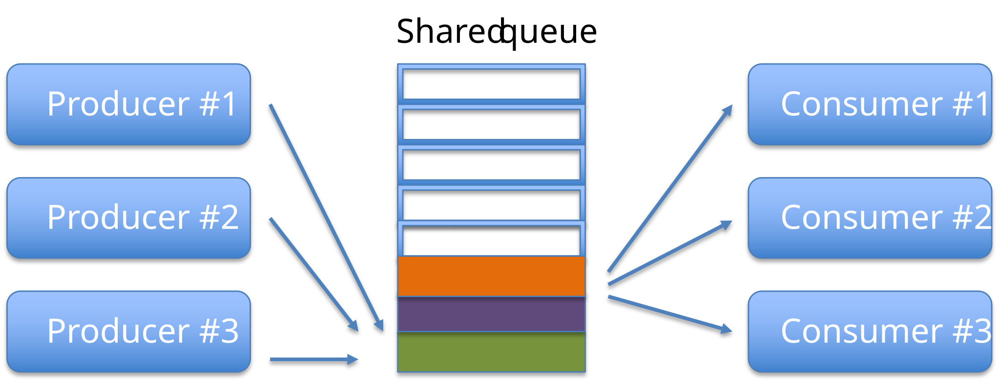
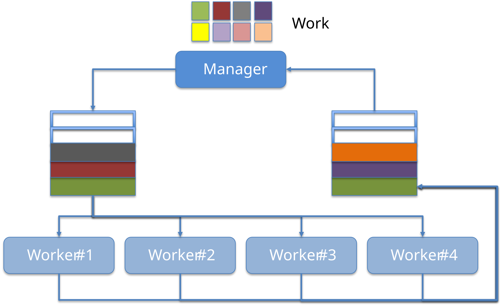
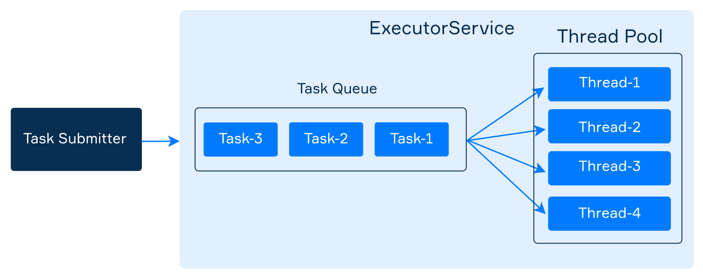

# Java Multi-Threading

All examples target **Java 25 without preview features** and build on E3–E7: shared state, exceptions, collections, lambdas, and resource ownership.

* **Core:** understand tasks and shared state, distinguish atomicity from visibility, and manage completion, cancellation, and executor lifetime.
* **Note:** platform versus virtual threads and workload-dependent choices.
* **Reference:** OS details, thread states, manual wait/notify, and scheduling APIs.

Examples use `java.util`, `java.util.concurrent`, `java.util.concurrent.atomic`, and `java.util.random` types; add the imports required by each block. Fragments belong in a class or method as indicated. Deliberately unsafe examples demonstrate a bug, not recommended application patterns. Console ordering is unspecified unless an explicit coordination rule establishes it.

## OS perspective

**Reference — background for the Java execution model.**

### Process
An OS process is an executing program with its own address space and associated resources. Processes normally use IPC to communicate, including pipes, sockets, and explicitly shared memory; separate address spaces do not mean shared memory is impossible.

`ProcessBuilder` launches an external program and returns a `Process` handle. The Java API does not promise a particular fork/exec implementation strategy.

```
// Linux-specific command; surrounding method declares IOException and InterruptedException.
Process process = new ProcessBuilder("/bin/ls", "-al", "/")
        .redirectErrorStream(true).start();
try (BufferedReader in = new BufferedReader(new InputStreamReader(process.getInputStream()))) {
    String line;
    while ((line = in.readLine()) != null) {
        System.out.println(line);
    }
}
System.out.println(process.waitFor()); // Wait for exit before retrieving its status.
```

### Thread
Threads are frequently called lightweight processes. Like processes, **each thread has its own stack, program counter, and local variables**. However, **threads within the same process share the same address space and, consequently, can share variables and objects**.

Sharing variables is a simple and fast way threads use for communicating but **frequently causes bugs unseen in single-thread programs**

### JVM and OS
The OS scheduler shares CPU execution among runnable platform threads. **Concurrency** means work can overlap in time; **parallelism** means work actually executes simultaneously on multiple processing units. No fixed scheduling time slice should be assumed by the application.

Platform threads are typically backed by OS threads. Java 25 also supports **virtual threads**, a stable feature since Java 21, scheduled by the JVM onto carrier platform threads. Both use the `Thread` API; the same shared-state correctness rules apply.

## Why Threads?
There are many reasons to use threads in your Java programs. If you use Android, Swing, JavaFX, Servlets, RMI you may already be using threads without realizing it. The main reasons for using threads:

* **keep UIs responsive while performing background operations**
* **take advantage of multiprocessor systems**

### Case study
Imagine a stockbroker application with three key functionalities:
* Download stock prices from a remote REST service and store them in a local database
* Use the data contained in the database to make short-term price predictions
* Provide a JavaFX GUI for the user

**In a single-threaded process actions execute one after another on a single thread**. An action happens only when the previous one is completed.
* If the download takes 10 minutes, should the user enjoy an unresponsive UI for 10 minutes?
* If price analysis takes additional 10 minutes the result may come too late. Prices could already have changed significantly!

**In a multithreaded process actions execute on different threads**:
* the download can execute in background (i.e. in another thread)
* the analysis, too, can execute in background (i.e. possibly in multiple threads) 
* the user can enjoy a responsive UI while waiting for notifications (buy/sell signals)

### Summarizing
**The good of multi-threading**

* Enable parallelism
* Lighter than processes for both
  * Creation(i.e., fork())
  * Communication (i.e., r/w pipes …)

**The bad of multi-threading**

* Hard for most programmers
* Even for experts, development is often painful
* Shared mutable state couples components unless concurrency responsibilities are encapsulated deliberately.

**The Amdahl's law**

**Reference — a bound on speedup, not a promise of performance.**

In computer architecture, [Amdahl's law](https://en.wikipedia.org/wiki/Amdahl%27s_law) is a formula which gives the theoretical speedup of the execution of a task that can be expected from a system whose resources are improved. It states that *the overall performance improvement gained by optimizing a single part of a system is limited by the fraction of time that the improved part is actually used*.


## Threads in Java
Every Java program has at least one thread, which is called the _main thread_, created automatically by the JVM process to execute statements inside the _main method_. All Java programs have some other default threads as well (for example, a separate thread for the garbage collector).

Throughout the stages of development of the Java language, the approach to multithreading has changed towards the use of high-level abstractions (i.e., Executors, Tasks, etc...). However, understanding the fundamentals remains very important for a good developer.

Any thread has a name, an identifier, a priority, and some other characteristics that can be obtained through its methods. The example below demonstrates how to obtain the characteristics of the _main thread_:

```java
public class MainThreadDemo {
    public static void main(String[] args) {
        Thread t = Thread.currentThread(); // main thread

        System.out.println("Name: " + t.getName());
        System.out.println("ID: " + t.threadId());
        System.out.println("Alive: " + t.isAlive());
        System.out.println("Priority: " + t.getPriority());
        System.out.println("Daemon: " + t.isDaemon());

        t.setName("my-thread");
        System.out.println("New name: " + t.getName());
    }
}
```

```text
Name: main
ID: 1
Alive: true
Priority: 5
Daemon: false
New name: my-thread
```

This is illustrative output; do not assert a fixed thread ID. `threadId()` is the modern API; `getId()` has been deprecated since Java 19.

### Creating threads
Java has two primary ways to create a new thread:
* by extending the _Thread_ class and overriding its _run_ method; 
* by implementing the _Runnable_ interface and passing the implementation to the constructor of the _Thread_ class.

```java
class HelloThread extends Thread {

    @Override
    public void run() {
        String helloMsg = String.format("Hello, i'm %s", getName());
        System.out.println(helloMsg);
    }
}
```

```java
class HelloRunnable implements Runnable {

    @Override
    public void run() {
        String helloMsg = String.format("Hello, i'm %s", Thread.currentThread().getName());
        System.out.println(helloMsg);
    }
}
```

```java
Thread t1 = new HelloThread(); // a subclass of Thread

Thread t2 = new Thread(new HelloRunnable()); // passing runnable
```

Both versions supply a `run` implementation. Prefer expressing the **task** as a `Runnable` and choosing its execution mechanism separately, rather than subclassing `Thread` just to attach work. The task form fits lambdas:

```java
Thread t3 = new Thread(() -> {
    System.out.println(String.format("Hello, i'm %s", Thread.currentThread().getName()));
});
```

### Starting threads
`start()` schedules a new thread to execute `run()`. It does not wait for completion; the new thread may execute before or after `start()` returns. Calling `run()` directly is only an ordinary call on the current thread.

Let's suppose that inside the _main method_ you create a _HelloThread_ object named _t_ and start it.

```
Thread t = new HelloThread(); // an object representing a thread
t.start();
```

Eventually, it prints something like:

```text
Hello, i'm Thread-0
```

The picture illustrates one possible schedule. It does not establish a guaranteed delay or ordering between the caller and the new thread.


If you try to start a thread more than once, the _start_ method throws _IllegalThreadStateException_.

### Execution order
Despite the fact that within a single thread all statements are executed sequentially, **it is impossible to determine the relative order of statements between multiple threads without additional measures (discussed later)**.

Consider the following code:

```java
public class StartingMultipleThreads {

    public static void main(String[] args) {
        Thread t1 = new HelloThread();
        Thread t2 = new HelloThread();

        t1.start();
        t2.start();

        System.out.println("Finished");
    }
}
```

The order of displaying messages may be different. Here is one of them:

```text
Hello, i'm Thread-1
Finished
Hello, i'm Thread-0
```

It is even possible that all threads print their text after the _main thread_ prints _"Finished"_:

```text
Finished
Hello, i'm Thread-0
Hello, i'm Thread-1
```

**Summarizing**:
* It is not guaranteed that threads will start running in the same order in which their start() methods have been called.
* It is not guaranteed that a thread keeps executing until it's done (it is not guaranteed that its loop completes before another thread begins)
* Completion and fairness are not generally guaranteed: tasks can loop forever, deadlock, block indefinitely, or fail.

**Predict:** if `t1.start()` is replaced with `t1.run()`, which thread executes that task? Add `Thread.currentThread().getName()` to verify the distinction.

### Terminating threads
Threads do not form an automatic lifetime tree. A thread can continue after the thread that created it has finished.

* The JVM ordinarily remains alive while started **non-daemon** threads remain alive.
* Once no non-daemon threads remain, shutdown can begin; daemon threads do not keep the JVM alive.
* Use `join` or task-result APIs to wait for required work, not assumptions about a “parent” thread.
* Interruption is a **cooperative request**, not forced termination.

```java
public class StartStopThread extends Thread {
    public StartStopThread(String name) {
        super(name);
    }

    @Override
    public void run() {
        System.out.println(getName() + " started");
        while (!isInterrupted()) {
            System.out.println(getName());
        }
        System.out.println(getName() + " terminated");
    }

    public static void main(String[] args) throws InterruptedException {
        StartStopThread a = new StartStopThread("Homer");
        StartStopThread b = new StartStopThread("Marge");

        /* start children threads */
        a.start();
        b.start();

        /* wait 10 millis */
        Thread.sleep(10L);

        /* gracefully terminate children threads */
        a.interrupt();
        b.interrupt();

        /* wait for children before exit */
        a.join();
        b.join();
    }
}
```

The sleep here only lets the demo run briefly; it does not synchronize shared state. Printing in a tight loop is deliberately simple, not a workload or performance model.

`isInterrupted()` observes a thread's flag without clearing it. Static `Thread.interrupted()` checks and clears the current thread's flag. Interruptible methods such as `sleep`, `wait`, and blocking-queue operations can throw `InterruptedException` and clear the flag; propagate it, terminate, or restore the flag when handling it at a task boundary.

## Thread states


**Reference:** the image is a conceptual scheduling diagram. Java's `Thread.State` exposes these six states instead:

| State | Meaning |
|---|---|
| `NEW` | Not yet started |
| `RUNNABLE` | Executing in the JVM or eligible to execute; can include some OS waits |
| `BLOCKED` | Waiting to acquire an intrinsic monitor |
| `WAITING` | Indefinite wait, e.g. untimed `wait` or `join` |
| `TIMED_WAITING` | Timed wait, including `sleep` |
| `TERMINATED` | Execution completed |

Java has no separate `RUNNING` or `SLEEPING` enum state. A state snapshot is diagnostic information, not a synchronization protocol.

### Leaving the running state
Common operations that affect progress include:

* **sleep()**: pauses subject to interruption and timer/scheduler accuracy; does not release monitors.
* **yield()**: offers a hint that the scheduler may ignore; no correctness guarantee.
* **join()**: waits for the target thread to terminate, or until an optional timeout/interruption.
* **wait()**: releases the specified monitor while waiting, then reacquires it before returning.

There are additional ways for leaving the running state which are not under the control of the programmer:

* End of `run()` produces `TERMINATED`.
* OS descheduling does not create a separate Java `Thread.State` value.
* I/O blocking is not the same as Java's monitor-specific `BLOCKED` state.

### Thread.sleep()
The static method _Thread.sleep()_ causes the currently executing thread to suspend execution for the specified number of milliseconds. This is an efficient means of making processor time available for the other threads or processes running on the same node.

```
System.out.println("Started");

Thread.sleep(2000L); // suspend current thread for 2000 millis

System.out.println("Finished");
```

### Thread.yield()
**Reference:** `yield()` is only a scheduler hint. It is not a replacement for a blocking queue, a lock, or waiting on a condition. Do not use it to “fix” a race or implement an idle consumer.


### Thread.join()
The _Thread.join()_ method forces the current thread to wait for the completion of the thread for which the method _join_ was called. In the following example, the string **"Do something else"** will not be printed until the thread terminates.

```
Thread thread = ...
thread.start(); // start thread

System.out.println("Do something useful");

thread.join();  // waiting for thread to die

System.out.println("Do something else");
```

There is an overloaded version of this method which takes a waiting time in milliseconds and is used to avoid waiting for too long.

```
// waits at most two seconds
thread.join(2000L);
```

A timed join can return while the target is still alive. Decide how to handle that outcome rather than assuming completion.


## Thread Interference
Threads can share reachable objects. They can also communicate through message-passing abstractions such as blocking queues; shared address space does not force every client to coordinate low-level shared variables itself.

****

When you write your code in different threads that work with the same data concurrently, many things might go wrong.
Imagine two people (represented by two threads) each one having an ATM card linked to the same account:

```java
class Account {
    private int balance;

    public Account(int balance) {
        this.balance = balance;
    }
    
    public int getBalance() {
        return balance;
    }

    public void withdraw(int amount) {
        balance -= amount;
    }
}
```

Each person (i.e., thread) does these steps:
1. Check if the balance is greater than 0 
2. Choose an amount to withdraw comprised between 0 and balance 
3. Withdraw the chosen amount

```java
public void run() {
    RandomGenerator rnd = RandomGenerator.getDefault();
    while (!interrupted()) {
        if (account.getBalance() <= 0) {
            break;
        }

        int amount = rnd.nextInt(account.getBalance() + 1);

        account.withdraw(amount);

        Thread.yield();
    }
}
```

**What happens if the scheduler suspends one thread between step 2 and step 3 and the other one gets executed?**

1. **Homer enters the status RUNNING**
2. Homer checks that the account is not empty and contains 125$!
3. Homer chooses to withdraw 100$
4. **Homer leaves the status RUNNING**
5. **Marge enters the status RUNNING**
6. Marge checks that the account is not empty and contains 125$!
7. Marge chooses to withdraw 120$
8. Marge withdraws 120$
9. **Marge leaves the status RUNNING**
10. **Homer enters the status RUNNING**
11. Homer subtracts 100 from 5: this implementation can produce a negative balance. The code does not enforce a partial-withdrawal policy.


The intentionally unsafe loop can also fail while choosing a random amount if a racing balance read becomes negative. Repeated balance reads are not a consistent snapshot, and a run with no visible failure does not establish safety.

### Critical sections
**A critical section accesses shared state that must be protected from conflicting concurrent operations.** Mutual exclusion prevents cooperating threads from entering the protected region simultaneously. It does not stop OS preemption while a thread holds the lock.

The balance check and withdrawal must form one coordinated operation. Synchronizing each getter and setter separately would not make the whole check-then-act sequence atomic.

### Atomicity, visibility, and ordering

* **Atomicity:** an operation is indivisible relative to relevant concurrent operations.
* **Visibility:** a thread observes writes made by another thread under the memory model's guarantees.
* **Ordering:** a happens-before relationship establishes constraints on how writes can be observed.

Examples of happens-before edges include actions before `start()` to the started thread, a thread's actions to a successful `join`, and monitor unlock to a subsequent lock of that same monitor. Publishing an object reference without an appropriate protocol is not automatically safe.

### Natively Atomic Operations in Java

An individually atomic access does **not** by itself provide visibility for other data or make a compound algorithm race-free.

1. **Reads and writes of primitive types**

  * Reads/writes of `byte`, `short`, `int`, `char`, `float`, `boolean`, and references are atomic.
  * The specification permits non-atomic reads/writes of non-volatile `long` and `double`; volatile reads/writes of those types are atomic.
  * Example:

    ```java
    int count = 10; // atomic write
    int c = count;  // atomic read
    ```

### Not Natively Atomic

These operations are **not atomic** on their own:

* Compound operations: `x++`, `x = x + 1`, `x += 5`
* Any operation involving multiple steps
  
```java
public class RaceConditionWrong {
  static int times = 10000;
  static int count = 0; // shared variable

  public static void main(String[] args) throws InterruptedException {
    Thread t1 = new Thread(() -> {
      for (int i = 0; i < times; i++) {
        count++;
      }
    });

    Thread t2 = new Thread(() -> {
      for (int i = 0; i < times; i++) {
        count++;
      }
    });

    t1.start();
    t2.start();

    t1.join();
    t2.join();

    System.out.println("Final count: " + count); // Expected: 20000, Actual: often less
  }
}
```

For compound atomic operations, use classes in `java.util.concurrent.atomic`, such as `AtomicInteger`.

`volatile` can support a visibility protocol, such as a stop flag, but **does not make `count++` atomic**. Use an atomic increment or a common lock. Atomic variables also do not automatically coordinate invariants spanning several variables.

```java
public class RaceConditionAtomic {
    static int times = 10000;
    static AtomicInteger atomicInteger = new AtomicInteger(0);

    public static void main(String[] args) throws InterruptedException {
        Thread t1 = new Thread(() -> {
            for (int i = 0; i < times; i++) {
                atomicInteger.incrementAndGet();
            }
        });

        Thread t2 = new Thread(() -> {
            for (int i = 0; i < times; i++) {
                atomicInteger.incrementAndGet();
            }
        });

        t1.start();
        t2.start();

        t1.join();
        t2.join();

        System.out.println("Final count: " + atomicInteger.get()); // Always prints 20000
    }
}
```
## The _synchronized_ keyword
Developers cannot rely on an uninterrupted time slice. Correctness comes from a coordination protocol, not scheduling luck or `yield()`.

`synchronized` acquires an object's intrinsic monitor for a method or a block. Only one thread holds that monitor at a time, and unlocking/locking it provides visibility. All accesses relevant to the shared invariant must participate in the same protocol; an object is not globally protected just because one method is synchronized.

More specifically, every object in Java has ONE built-in lock. **Entering a synchronized non-static method means getting the lock of the object**. If one thread gets the lock, all other threads have to wait to enter ALL the synchronized methods until the lock is released (the first thread exits the synchronized method).

The monitor is reentrant: the owning thread can acquire it again. A static synchronized method locks the declaring `Class` object, not an arbitrary instance.

```java
public synchronized void doStuff() { 
    System.out.println("synchronized");
}

/* is equivalent to… */

public void doStuff() { 
    synchronized(this) {
        System.out.println("synchronized");
    }  
}
```

### Locking granularity

First, repair the earlier balance operation by keeping the invariant inside the shared object:

```java
public final class SafeAccount {
    private long balance;

    public SafeAccount(long initialBalance) {
        if (initialBalance < 0) {
            throw new IllegalArgumentException("Negative balance");
        }
        balance = initialBalance;
    }

    public synchronized boolean tryWithdraw(long amount) {
        if (amount <= 0) {
            throw new IllegalArgumentException("Amount must be positive");
        }
        if (amount > balance) {
            return false;
        }
        balance -= amount;
        return true;
    }

    public synchronized long getBalance() {
        return balance;
    }
}
```

The check and update share one lock, and all balance access follows that protocol. For a starting balance of 125, concurrent requests for 100 and 120 cannot both succeed. Which one succeeds is not predetermined. This example uses integer units and does not model currency conversion or an actual ATM transaction.

### Which operations share the lock?

Each call to `A()` sleeps while holding the instance monitor, preventing another thread from entering `A()` or `B()` on that same instance until the monitor is released. **All synchronized instance methods of that object share its monitor.** `C()` does not acquire it.

```java
class Actor extends Thread {
    Runnable runnable;

    public Actor(Runnable runnable) {
        super();
        this.runnable = runnable;
    }

    @Override
    public void run() {
        while (!isInterrupted()) {
            runnable.run();
        }
    }
}
```

```java
class SharedResource {
    public synchronized void A() {
        System.out.println(Thread.currentThread().getName() + " A()");
        try {
            Thread.sleep(100L);
        } catch (InterruptedException e) {
            Thread.currentThread().interrupt();
        }
    }

    public synchronized void B() {
        System.out.println(Thread.currentThread().getName() + " B()");
    }

    public void C() {
        System.out.println(Thread.currentThread().getName() + " C()");
    }
}
```

```java
public class LockingGranularity {
    public static void main(String[] args) throws InterruptedException {
        SharedResource resource = new SharedResource();
        Actor a = new Actor(resource::A);
        Actor b = new Actor(resource::B);
        Actor c = new Actor(resource::C);

        a.start();
        b.start();
        c.start();

        Thread.sleep(10);

        a.interrupt();
        b.interrupt();
        c.interrupt();

        a.join();
        b.join();
        c.join();
    }
}
```

**Whenever an object lock has been acquired by one thread, other threads can still access the class's non-synchronized methods**. Methods that don't access critical data don’t need to be synchronized.

**Details**:
* Threads going to sleep don't release locks!
* A thread can acquire more than one lock. For example, a thread can enter a synchronized method, then immediately invoke a synchronized method on another object (deadlock prone!)

### The dining philosophers

**Reference — deadlock and progress.** A consistent global lock-acquisition order is one way to avoid circular waiting. Thread safety is not only about correct final values: tasks must also be able to make progress.

In computer science, the [dining philosophers problem](https://en.wikipedia.org/wiki/Dining_philosophers_problem) is an example problem often used in concurrent algorithm design to illustrate synchronization issues and techniques for resolving them.

It was originally formulated in 1965 by Edsger Dijkstra as a student exam exercise, presented in terms of computers competing for access to tape drive peripherals. Soon after, Tony Hoare gave the problem its present form.


### Synchronization using thread-safe objects

Two coordination styles are illustrated below. The polling implementations explain locking but are **not recommended producer/consumer designs**: spinning, exceptions for empty queues, and unbounded growth waste resources.

1. Use the _synchronized_ modifier within the _run()_ method of each thread to lock the shared object.

```java
static class ProducerSafe extends Thread {
    final Deque<Integer> integerDeque;

    public ProducerSafe(Deque<Integer> integerDeque) {
        super();
        this.integerDeque = integerDeque;
    }

    @Override
    public void run() {
        int i = 0;
        while (!isInterrupted()) {
            synchronized (integerDeque) {
                integerDeque.addFirst(i++);
            }
        }
    }
}
```

```java
static class ConsumerSafe extends Thread {
    final Deque<Integer> integerDeque;

    public ConsumerSafe(Deque<Integer> integerDeque) {
        super();
        this.integerDeque = integerDeque;
    }

    @Override
    public void run() {
        while (!isInterrupted()) {
            try {
                synchronized (integerDeque) {
                    integerDeque.removeLast();
                }
            } catch (NoSuchElementException e) {
                Thread.yield();
            }
        }
    }
}
```

2. Encapsulate synchronization in the shared abstraction, or use a suitable concurrent collection.

A thread-safe class preserves its documented contract under concurrent use. Its implementation need not use intrinsic locks: concurrent collections can use other coordination mechanisms. Individual thread-safe operations do not automatically make a multi-operation client sequence atomic.

* Interface List: [Vector](https://www.baeldung.com/java-arraylist-vs-vector)
* Interface Queue: [LinkedBlockingQueue](https://www.baeldung.com/java-queue-linkedblocking-concurrentlinked), ArrayBlockingQueue, ConcurrentLinkedQueue
* Interface Map: [ConcurrentMap](https://www.baeldung.com/java-concurrent-map)

```java
// Safe only when supplied a suitable thread-safe deque; unsafe with LinkedList.
static class ProducerWithoutExternalLock extends Thread {
    final Deque<Integer> integerDeque;

    public ProducerWithoutExternalLock(Deque<Integer> integerDeque) {
        super();
        this.integerDeque = integerDeque;
    }

    @Override
    public void run() {
        int i = 0;
        while (!isInterrupted()) {
            integerDeque.addFirst(i++);
        }
    }
}
```

```java
static class ConsumerWithoutExternalLock extends Thread {
    final Deque<Integer> integerDeque;

    public ConsumerWithoutExternalLock(Deque<Integer> integerDeque) {
        super();
        this.integerDeque = integerDeque;
    }

    @Override
    public void run() {
        while (!isInterrupted()) {
            try {
                integerDeque.removeLast();
            } catch (NoSuchElementException e) {
                Thread.yield();
            }
        }
    }
}
```

### Synchronization using Object methods

**Reference — understand existing low-level code. Prefer blocking collections for routine producer/consumer coordination.**

Threads might be able to acquire exclusive access a shared resource but still be unable to progress. For example, a producer with a full queue, or a consumer with an empty queue. 

To avoid waste of computational resources we can use the _wait()_ and _notify()_ methods (which are inherited from Object).

`wait()` requires ownership of that same object's monitor, whether acquired through a block or a synchronized method. It releases that monitor, waits, and reacquires it before returning. It does not release unrelated locks the thread holds.

`notify` and `notifyAll` also require ownership of that monitor. Notification does not transfer the lock immediately or promise that a condition is now true. Always recheck the condition in a **while loop**: other threads can change it, and spurious wakeups are permitted.

```java
static class ProducerSafeWaitNotify extends Thread {
    final Deque<Integer> integerDeque;
    final int maxDequeSize = 10;

    public ProducerSafeWaitNotify(Deque<Integer> integerDeque) {
        super();
        this.integerDeque = integerDeque;
    }

    @Override
    public void run() {
        int i = 0;
        while (!isInterrupted()) {
            synchronized (integerDeque) {
                try {
                    while (integerDeque.size() >= maxDequeSize) {
                        integerDeque.wait();
                    }
                    integerDeque.addFirst(i++);
                    integerDeque.notifyAll();
                } catch (InterruptedException e) {
                    Thread.currentThread().interrupt();
                    return;
                }
            }
        }
    }
}
```

```java
static class ConsumerSafeWaitNotify extends Thread {
    final Deque<Integer> integerDeque;

    public ConsumerSafeWaitNotify(Deque<Integer> integerDeque) {
        super();
        this.integerDeque = integerDeque;
    }

    @Override
    public void run() {
        while (!isInterrupted()) {
            synchronized (integerDeque) {
                try {
                    while (integerDeque.isEmpty()) {
                        integerDeque.wait();
                    }
                    System.out.println(integerDeque.removeLast());
                    integerDeque.notifyAll();
                } catch (InterruptedException e) {
                    Thread.currentThread().interrupt();
                    return;
                }
            }
        }
    }
}
```

## Multi-thread design patterns
Two useful patterns are producer/consumer and manager/workers. They do not exhaust concurrent-program design, but give concrete ways to separate work and coordination:

**The producer/consumer pattern**, where the producer thread pushes elements into a shared object and the consumer thread fetches (consumes) them. See [this producer/consumer example](https://github.com/nbicocchi/learn-java-javafx/tree/main/code/threads-producer-consumer) for further details.



**The manager/workers pattern**, where a manager decomposes a complex task into subtasks, and assigns them to worker threads. See [this manager/workers example](https://github.com/nbicocchi/learn-java-javafx/tree/main/code/threads-manager-workers) for further details.



## ExecutorService
`ExecutorService` separates **tasks** from execution and lifecycle management. Many implementations use a worker pool and task queue; not every executor has a reusable pool, as the virtual-thread-per-task executor illustrates later.



The executor manages execution mechanics, but the application still owns its lifetime, observes task failures, and controls demand and shared resources.

### Creating executors

All types of executors are located in the _java.util.concurrent_ package. This package also contains a convenient utility class _Executors_ for creating different types of _ExecutorService_.


**Reference — choose according to workload and resource limits:**

**An executor with a single thread** - The simplest executor has only a single thread in the pool. It may be enough for async execution of rarely submitted and small tasks.

```java
ExecutorService executor = Executors.newSingleThreadExecutor();
```

**An executor with a fixed pool** - It can execute multiple tasks concurrently and speed up your program by performing somewhat parallel computations. If one of the threads dies, the executor creates a new one. We will later consider how to determine the required number of threads.

```java
ExecutorService executor = Executors.newFixedThreadPool(4);
```

**An executor with a growing pool** - There is also an executor that automatically increases the number of threads as it needed and reuse previously constructed threads.

```java
ExecutorService executor = Executors.newCachedThreadPool();
```

This can suit some short-lived asynchronous workloads, but thread creation can grow excessively under load. Choose a pool and admission policy from the workload and resource constraints rather than treating either factory as a universal default.

`newFixedThreadPool` limits worker threads but uses an **unbounded task queue**. `newCachedThreadPool` can create very many platform threads. Neither is automatic overload protection. Production systems may need bounded queues, rejection policies, timeouts, and limits on external resources.

**An executor that schedules a task** - If you need to perform the same task periodically or only once after the given delay, use the following executor:

```java
ScheduledExecutorService executor = Executors.newSingleThreadScheduledExecutor();
```

The method _scheduleAtFixedRate_ submits a periodic _Runnable_ task that becomes enabled first after the given _initDelay_, and subsequently with the given _period_.

Scheduled time is not a guarantee of exact execution time. If a periodic invocation throws an uncaught exception, subsequent executions are suppressed; retain and observe the returned future when that failure matters.

```
ScheduledExecutorService executor = Executors.newSingleThreadScheduledExecutor();
executor.scheduleAtFixedRate(() ->
        System.out.println(LocalTime.now() + ": Hello!"), 1000, 1000, TimeUnit.MILLISECONDS);
```

This kind of executor also has a method named _schedule_ that starts a task only once after the given delay and another method _scheduleWithFixedDelay_ that starts the task with a fixed wait after the previous one is completed.


### Submitting tasks
An executor has the _submit_ method that accepts a _Runnable_ task to be executed. Since _Runnable_ is a functional interface, it is possible to use a lambda expression as a task.

As an example, here we submit a task that prints _"Hello!"_ to the standard output.

```
executor.submit(() -> System.out.println("Hello!"));
```

`submit` returns a future without waiting for completion. Depending on the executor, work is queued or assigned to a new task thread. Rejected submissions can fail immediately. Exceptions from a submitted task are captured in its future; ignoring that future can hide a failure.


### Stopping executors
Pool workers can remain alive waiting for work after a task finishes. Non-daemon platform workers can keep the JVM alive, so close executors you own. Virtual threads are daemon threads and have different JVM-lifetime behavior, but required work must still be awaited.

There are two methods for stopping executors:

1. `shutdown()` initiates orderly shutdown: it rejects new submissions and lets previously submitted tasks complete. It **does not wait**. Use `awaitTermination` to wait with a limit and handle timeout or interruption.

```java
public static void main(String[] args) throws InterruptedException {
    ExecutorService executor = Executors.newFixedThreadPool(4);
    
    // submitting tasks
    
    executor.shutdown();
    
    boolean terminated = executor.awaitTermination(60, TimeUnit.MILLISECONDS);
    
    if (terminated) {
        System.out.println("The executor was successfully stopped");
    } else {
        System.out.println("Timeout elapsed before termination");
    }
}

```

2. `shutdownNow()` attempts to interrupt active tasks, stops processing waiting tasks, and returns tasks that had not started. It does **not** guarantee that running work stops or that the executor has terminated.

### Scope-based executor ownership in Java 25

```java
import java.util.concurrent.Executors;

public class ScopedExecutor {
    public static void main(String[] args) throws Exception {
        try (var executor = Executors.newFixedThreadPool(2)) {
            var result = executor.submit(() -> 21 * 2);
            System.out.println(result.get()); // 42; task failures are observed here
        }
    }
}
```

`ExecutorService` has been `AutoCloseable` since Java 19. In Java 25, `close()` initiates orderly shutdown and waits for termination; it is **not a bounded-time shutdown policy**. A task that never finishes can prevent scope exit. At an application boundary, replace the broad demonstration `throws Exception` with an explicit failure policy.

### Bounded producer/consumer coordination

Use blocking operations instead of polling an empty queue:

```java
import java.util.List;
import java.util.ArrayList;
import java.util.concurrent.ArrayBlockingQueue;
import java.util.concurrent.Executors;

public class BlockingQueueDemo {
    public static void main(String[] args) throws Exception {
        var queue = new ArrayBlockingQueue<Integer>(2);
        try (var executor = Executors.newFixedThreadPool(2)) {
            var producer = executor.submit(() -> {
                for (int value = 1; value <= 3; value++) {
                    queue.put(value);
                }
                return null;
            });
            var consumer = executor.submit(() -> {
                List<Integer> received = new ArrayList<>();
                for (int i = 0; i < 3; i++) {
                    received.add(queue.take());
                }
                return received;
            });
            try {
                producer.get();
                System.out.println(consumer.get()); // [1, 2, 3]
            } finally {
                producer.cancel(true);
                consumer.cancel(true);
            }
        }
    }
}
```

The capacity bounds the buffer, and `put`/`take` wait interruptibly when needed. Both tasks agree on exactly three messages; general pipelines need an explicit completion and failure protocol. Two workers are necessary here: a single worker could block producing before the consumer ever starts. The finally block requests cancellation if the main thread fails while waiting.

### An example: names of threads and tasks
In the following example, we create one executor with a pool consisting of four threads. We submit ten tasks to it and then analyze the results. Each task prints the name of the actual thread executing it, as well as the name of the task.

```java
import java.util.concurrent.ExecutorService;
import java.util.concurrent.Executors;

public class ExecutorDemo {
    private final static int POOL_SIZE = 4;
    private final static int NUMBER_OF_TASKS = 10;

    public static void main(String[] args) {
        ExecutorService executor = Executors.newFixedThreadPool(POOL_SIZE);

        for (int i = 0; i < NUMBER_OF_TASKS; i++) {
            int taskNumber = i;
            executor.submit(() -> {
                String taskName = "task-" + taskNumber;
                String threadName = Thread.currentThread().getName();
                System.out.printf("%s executes %s\n", threadName, taskName);
            });
        }

        executor.shutdown();
    }
}
```

If you launch this program many times, you will get a different output. Below is one of the possible outputs:

```text
pool-1-thread-1 executes task-0
pool-1-thread-2 executes task-1
pool-1-thread-4 executes task-3
pool-1-thread-3 executes task-2
pool-1-thread-3 executes task-7
pool-1-thread-3 executes task-8
pool-1-thread-3 executes task-9
pool-1-thread-1 executes task-6
pool-1-thread-4 executes task-5
pool-1-thread-2 executes task-4
```

This run illustrates worker reuse. Which worker handles each task, and whether every worker performs visible work, are not contractual guarantees.

For CPU-bound work, available processors can be a starting point for measurement, not a universal sizing formula. I/O waits, resource limits, container configuration, and competing workloads also matter.

```java
int poolSize = Runtime.getRuntime().availableProcessors();
ExecutorService executor = Executors.newFixedThreadPool(poolSize);
```

## Callable and Future
Sometimes you need not only to execute a task in an executor but also to return a result of this task to the calling code. Java supports another class of tasks named _Callable_ that returns the result. 

```java
@FunctionalInterface
public interface Callable<V> {
    V call() throws Exception;
}
```

_Callable_ is a generic interface where the type parameter _V_ determines the type of the result. Since it is a **functional interface**, we can use it together with lambda expressions. Here is a _Callable_ that emulates a long-running task and returns a number that was "calculated".

```java
Callable<Integer> generator = () -> {
    TimeUnit.SECONDS.sleep(5);
    return 700000;
};
```

### Submitting a Callable and obtaining a Future
When we submit a _Callable_ to an executor service, it cannot return a result directly since the _submit_ method does not wait until the task completes. Instead, an executor returns a special object called _Future_ that wraps the actual result that may not even exist yet. This object represents the result of an asynchronous computation (task).

```java
ExecutorService executor = Executors.newSingleThreadExecutor();

Future<Integer> future = executor.submit(() -> {
    TimeUnit.SECONDS.sleep(5);
    return 700000;
});
```

`isDone()` reports that the future reached a terminal state, including successful completion, failure, or cancellation. It does not mean that a successful result is available. Immediately after submission either true or false is possible.

```
System.out.println(future.isDone()); // most likely it is false
```

### Getting the actual result of a task
`get()` waits for completion and either returns the result or reports failure. `ExecutionException` wraps a task failure, `InterruptedException` reports interrupted waiting, and `CancellationException` reports cancellation. A successful `get` also provides the task-to-caller memory visibility guarantee.

```java
int result = future.get();
```

To prevent this, waiting too much time, there is also an overloaded version of _get_ with a waiting timeout. In this case, the calling thread waits for 10 seconds most for the computation to complete. If the timeout ends, the method throws a _TimeoutException_.

```java
int result = future.get(10, TimeUnit.SECONDS); // it blocks the current thread
```

### Cancelling a task
The _Future_ class provides an instance method named _cancel_ that attempts to cancel the execution of a task. An attempt will fail if:
* the task has already completed
* the task has already been canceled
* the task could not be canceled for some other reason

If cancellation succeeds before execution, the task should not run. If execution has already begun, cancelling the future does not undo side effects or prove that task code has stopped.

The boolean controls whether an attempt to interrupt a running task is permitted. `cancel(false)` can mark a running future cancelled without interrupting its task; it is not a reliable “cancel only if queued” test.

```
future1.cancel(true);  // try to cancel even if the task is executing now
future2.cancel(false); // do not interrupt a task that is already executing
```

With `cancel(true)`, termination remains cooperative and can be delayed by non-interruptible operations or ignored interrupts. No general forced-stop guarantee is provided.

If someone invokes _future.get()_ at a successfully canceled task, the method throws an unchecked _CancellationException_. If you do not want to deal with it, you may check whether a task was canceled by invoking _isCancelled()_.

State checks can race with completion or cancellation. Code that requires the result should handle the actual outcome from `get`, not assume a preceding check makes failure impossible. A timeout from timed `get` does not automatically cancel the task.

### Virtual threads in Java 25

**Note — modern execution choice, same correctness rules:**

```java
import java.util.concurrent.Executors;

public class VirtualThreadDemo {
    public static void main(String[] args) throws Exception {
        try (var executor = Executors.newVirtualThreadPerTaskExecutor()) {
            var result = executor.submit(() -> {
                Thread.sleep(10); // Stand-in for blocking work, not synchronization
                return "virtual=" + Thread.currentThread().isVirtual();
            });
            System.out.println(result.get()); // virtual=true
        }
    }
}
```

Virtual threads can make large numbers of blocking tasks practical. They do not make CPU computation intrinsically faster, remove races, or eliminate limits on database connections and remote services. Do not pool virtual threads just to reuse them; limit scarce resources explicitly.

> **Note:** JDK 24 removed monitor-related virtual-thread pinning (JEP 491). In Java 25, blocking in a `synchronized` method or block is no longer by itself a reason to replace the monitor with `ReentrantLock`. Contention still serializes access, and native/foreign calls or class initialization can still involve pinning. Choose lock APIs for required semantics, not outdated blanket advice. The old `jdk.tracePinnedThreads` property no longer has an effect; use current JFR diagnostics when investigating pinning.

### Scoped values in Java 25

**Note — bounded context propagation, not shared mutable state.** `ScopedValue` is a stable Java 25 API for making a context binding available during a dynamically bounded call. It is useful for some read-only request-context uses of `ThreadLocal`, not a replacement for ordinary method parameters everywhere.

```java
public class RequestContextDemo {
    private static final ScopedValue<String> REQUEST_ID = ScopedValue.newInstance();

    private static void handle() {
        System.out.println(REQUEST_ID.get());
    }

    public static void main(String[] args) {
        ScopedValue.where(REQUEST_ID, "request-42").run(RequestContextDemo::handle);
        System.out.println(REQUEST_ID.isBound()); // false: binding ended with run
    }
}
```

The output is `request-42`, then `false`. The binding has a bounded lifetime, but a mutable object stored in it would still need its own concurrency policy. Binding does not automatically propagate into arbitrary threads or tasks submitted to an executor; this example deliberately stays on one thread.

**Reference — stable versus preview:** virtual threads and scoped values are stable in Java 25. `StructuredTaskScope` belongs to the fifth preview of structured concurrency (JEP 505), not the stable executor API. The try-with-resources executor examples above do not use structured concurrency. Preview APIs require an explicit opt-in and version-specific code; none of this lesson's examples require `--enable-preview`.

## Read, predict, verify

* Which state is shared, and what invariant spans multiple operations?
* Which common lock, atomic operation, queue, or happens-before edge establishes correctness?
* Who waits for completion, observes failures, and closes the executor?
* What does interruption, cancellation, or a timeout mean for ongoing side effects?

**Activity:** compare the racing increment, atomic increment, and a version using only `volatile int`. Predict which operations are atomic. Run them repeatedly, but do not mistake a correct observed total for proof that a race is absent.

**Exit review:** an assistant “fixes” a concurrency bug by inserting `sleep`, `yield`, or `parallelStream()`. Identify the missing coordination rule and test termination, failure reporting, and cancellation as well as the happy-path result.

## Resources
* https://dev.java/learn/new-features/virtual-threads/
* https://docs.oracle.com/en/java/javase/25/docs/api/java.base/java/util/concurrent/ExecutorService.html
* https://docs.oracle.com/en/java/javase/25/docs/api/java.base/java/lang/Thread.html
* https://openjdk.org/jeps/491
* https://openjdk.org/jeps/506
* https://openjdk.org/jeps/505
* https://www.baeldung.com/java-arraylist-vs-vector
* https://www.baeldung.com/java-queue-linkedblocking-concurrentlinked
* https://www.baeldung.com/java-concurrent-map
* https://www.baeldung.com/java-executor-service-tutorial
* https://www.baeldung.com/java-runnable-callable
* https://www.baeldung.com/java-completablefuture
