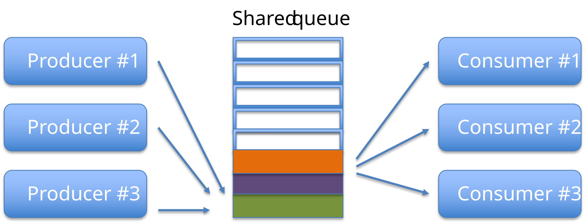
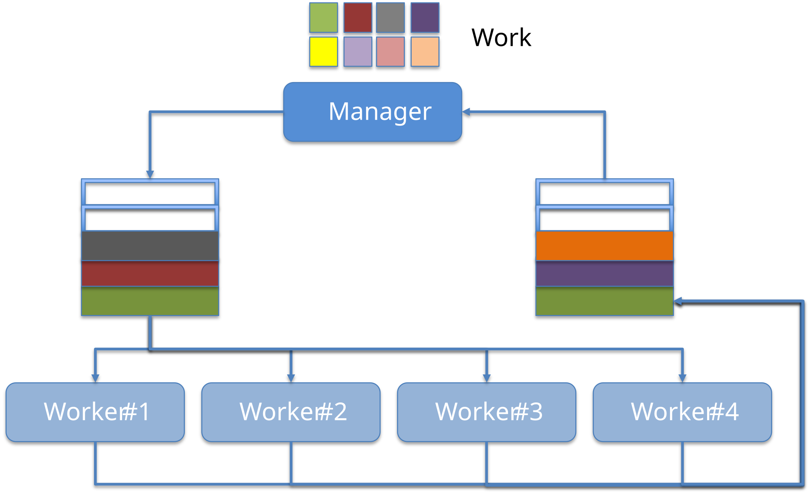

# E8.3 — Thread Coordination

### The dining philosophers

**Reference — deadlock and progress.** A consistent global lock-acquisition order is one way to avoid circular waiting. Thread safety is not only about correct final values: tasks must also be able to make progress.

In computer science, the [dining philosophers problem](https://en.wikipedia.org/wiki/Dining_philosophers_problem) is an example problem often used in concurrent algorithm design to illustrate synchronization issues and techniques for resolving them.

It was originally formulated in 1965 by Edsger Dijkstra as a student exam exercise, presented in terms of computers competing for access to tape drive peripherals. Soon after, Tony Hoare gave the problem its present form.


### Synchronization using thread-safe objects

Two coordination styles are illustrated below. The polling implementations explain locking but are **not recommended producer/consumer designs**: spinning, exceptions for empty queues, and unbounded growth waste resources.

1. Use the _synchronized_ modifier within the _run()_ method of each thread to lock the shared object.

```java
static class ProducerSafe extends Thread {
    final Deque<Integer> integerDeque;

    public ProducerSafe(Deque<Integer> integerDeque) {
        super();
        this.integerDeque = integerDeque;
    }

    @Override
    public void run() {
        int i = 0;
        while (!isInterrupted()) {
            synchronized (integerDeque) {
                integerDeque.addFirst(i++);
            }
        }
    }
}
```

```java
static class ConsumerSafe extends Thread {
    final Deque<Integer> integerDeque;

    public ConsumerSafe(Deque<Integer> integerDeque) {
        super();
        this.integerDeque = integerDeque;
    }

    @Override
    public void run() {
        while (!isInterrupted()) {
            try {
                synchronized (integerDeque) {
                    integerDeque.removeLast();
                }
            } catch (NoSuchElementException e) {
                Thread.yield();
            }
        }
    }
}
```

2. Encapsulate synchronization in the shared abstraction, or use a suitable concurrent collection.

A thread-safe class preserves its documented contract under concurrent use. Its implementation need not use intrinsic locks: concurrent collections can use other coordination mechanisms. Individual thread-safe operations do not automatically make a multi-operation client sequence atomic.

* Interface List: [Vector](https://www.baeldung.com/java-arraylist-vs-vector)
* Interface Queue: [LinkedBlockingQueue](https://www.baeldung.com/java-queue-linkedblocking-concurrentlinked), ArrayBlockingQueue, ConcurrentLinkedQueue
* Interface Map: [ConcurrentMap](https://www.baeldung.com/java-concurrent-map)

```java
// Safe only when supplied a suitable thread-safe deque; unsafe with LinkedList.
static class ProducerWithoutExternalLock extends Thread {
    final Deque<Integer> integerDeque;

    public ProducerWithoutExternalLock(Deque<Integer> integerDeque) {
        super();
        this.integerDeque = integerDeque;
    }

    @Override
    public void run() {
        int i = 0;
        while (!isInterrupted()) {
            integerDeque.addFirst(i++);
        }
    }
}
```

```java
static class ConsumerWithoutExternalLock extends Thread {
    final Deque<Integer> integerDeque;

    public ConsumerWithoutExternalLock(Deque<Integer> integerDeque) {
        super();
        this.integerDeque = integerDeque;
    }

    @Override
    public void run() {
        while (!isInterrupted()) {
            try {
                integerDeque.removeLast();
            } catch (NoSuchElementException e) {
                Thread.yield();
            }
        }
    }
}
```

### Synchronization using Object methods

**Reference — understand existing low-level code. Prefer blocking collections for routine producer/consumer coordination.**

Threads might be able to acquire exclusive access a shared resource but still be unable to progress. For example, a producer with a full queue, or a consumer with an empty queue. 

To avoid waste of computational resources we can use the _wait()_ and _notify()_ methods (which are inherited from Object).

`wait()` requires ownership of that same object's monitor, whether acquired through a block or a synchronized method. It releases that monitor, waits, and reacquires it before returning. It does not release unrelated locks the thread holds.

`notify` and `notifyAll` also require ownership of that monitor. Notification does not transfer the lock immediately or promise that a condition is now true. Always recheck the condition in a **while loop**: other threads can change it, and spurious wakeups are permitted.

```java
static class ProducerSafeWaitNotify extends Thread {
    final Deque<Integer> integerDeque;
    final int maxDequeSize = 10;

    public ProducerSafeWaitNotify(Deque<Integer> integerDeque) {
        super();
        this.integerDeque = integerDeque;
    }

    @Override
    public void run() {
        int i = 0;
        while (!isInterrupted()) {
            synchronized (integerDeque) {
                try {
                    while (integerDeque.size() >= maxDequeSize) {
                        integerDeque.wait();
                    }
                    integerDeque.addFirst(i++);
                    integerDeque.notifyAll();
                } catch (InterruptedException e) {
                    Thread.currentThread().interrupt();
                    return;
                }
            }
        }
    }
}
```

```java
static class ConsumerSafeWaitNotify extends Thread {
    final Deque<Integer> integerDeque;

    public ConsumerSafeWaitNotify(Deque<Integer> integerDeque) {
        super();
        this.integerDeque = integerDeque;
    }

    @Override
    public void run() {
        while (!isInterrupted()) {
            synchronized (integerDeque) {
                try {
                    while (integerDeque.isEmpty()) {
                        integerDeque.wait();
                    }
                    IO.println(integerDeque.removeLast());
                    integerDeque.notifyAll();
                } catch (InterruptedException e) {
                    Thread.currentThread().interrupt();
                    return;
                }
            }
        }
    }
}
```

## Multi-thread design patterns
Two useful patterns are producer/consumer and manager/workers. They do not exhaust concurrent-program design, but give concrete ways to separate work and coordination:

**The producer/consumer pattern**, where the producer thread pushes elements into a shared object and the consumer thread fetches (consumes) them. See [this producer/consumer example](https://github.com/nbicocchi/learn-java-javafx/tree/main/code/threads-producer-consumer) for further details.



**The manager/workers pattern**, where a manager decomposes a complex task into subtasks, and assigns them to worker threads. See [this manager/workers example](https://github.com/nbicocchi/learn-java-javafx/tree/main/code/threads-manager-workers) for further details.



### Bounded producer/consumer coordination

Use blocking operations instead of polling an empty queue:

```java
import java.util.List;
import java.util.ArrayList;
import java.util.concurrent.ArrayBlockingQueue;
import java.util.concurrent.Executors;

public class BlockingQueueDemo {
    public static void main(String[] args) throws Exception {
        var queue = new ArrayBlockingQueue<Integer>(2);
        try (var executor = Executors.newFixedThreadPool(2)) {
            var producer = executor.submit(() -> {
                for (int value = 1; value <= 3; value++) {
                    queue.put(value);
                }
                return null;
            });
            var consumer = executor.submit(() -> {
                List<Integer> received = new ArrayList<>();
                for (int i = 0; i < 3; i++) {
                    received.add(queue.take());
                }
                return received;
            });
            try {
                producer.get();
                IO.println(consumer.get()); // [1, 2, 3]
            } finally {
                producer.cancel(true);
                consumer.cancel(true);
            }
        }
    }
}
```

The capacity bounds the buffer, and `put`/`take` wait interruptibly when needed. Both tasks agree on exactly three messages; general pipelines need an explicit completion and failure protocol. Two workers are necessary here: a single worker could block producing before the consumer ever starts. The finally block requests cancellation if the main thread fails while waiting.

## Resources
