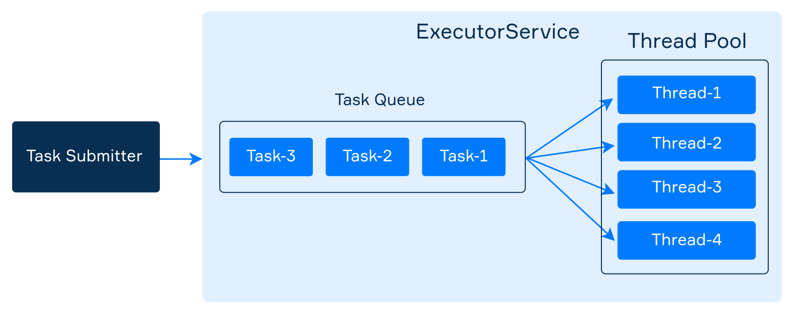

# E8.4 — Executors Tasks and Futures

## ExecutorService
`ExecutorService` separates **tasks** from execution and lifecycle management. Many implementations use a worker pool and task queue; not every executor has a reusable pool, as the virtual-thread-per-task executor illustrates later.



The executor manages execution mechanics, but the application still owns its lifetime, observes task failures, and controls demand and shared resources.

### Creating executors

All types of executors are located in the _java.util.concurrent_ package. This package also contains a convenient utility class _Executors_ for creating different types of _ExecutorService_.


**Reference — choose according to workload and resource limits:**

**An executor with a single thread** - The simplest executor has only a single thread in the pool. It may be enough for async execution of rarely submitted and small tasks.

```java
ExecutorService executor = Executors.newSingleThreadExecutor();
```

**An executor with a fixed pool** - It can execute multiple tasks concurrently and may speed up suitable workloads. A worker that terminates due to failure is replaced if needed to execute subsequent tasks. Choose the pool size based on available CPU capacity, blocking behavior, and external resource limits; measure under a representative workload.

```java
ExecutorService executor = Executors.newFixedThreadPool(4);
```

**An executor with a growing pool** - There is also an executor that automatically increases the number of threads as it needed and reuse previously constructed threads.

```java
ExecutorService executor = Executors.newCachedThreadPool();
```

This can suit some short-lived asynchronous workloads, but thread creation can grow excessively under load. Choose a pool and admission policy from the workload and resource constraints rather than treating either factory as a universal default.

`newFixedThreadPool` limits worker threads but uses an **unbounded task queue**. `newCachedThreadPool` can create very many platform threads. Neither is automatic overload protection. Production systems may need bounded queues, rejection policies, timeouts, and limits on external resources.

**An executor that schedules a task** - If you need to perform the same task periodically or only once after the given delay, use the following executor:

```java
ScheduledExecutorService executor = Executors.newSingleThreadScheduledExecutor();
```

The method _scheduleAtFixedRate_ submits a periodic _Runnable_ task that becomes enabled first after the given _initDelay_, and subsequently with the given _period_.

Scheduled time is not a guarantee of exact execution time. If a periodic invocation throws an uncaught exception, subsequent executions are suppressed; retain and observe the returned future when that failure matters.

```
ScheduledExecutorService executor = Executors.newSingleThreadScheduledExecutor();
executor.scheduleAtFixedRate(() ->
        System.out.println(LocalTime.now() + ": Hello!"), 1000, 1000, TimeUnit.MILLISECONDS);
```

This kind of executor also has a method named _schedule_ that starts a task only once after the given delay and another method _scheduleWithFixedDelay_ that starts the task with a fixed wait after the previous one is completed.


### Submitting tasks
An executor has the _submit_ method that accepts a _Runnable_ task to be executed. Since _Runnable_ is a functional interface, it is possible to use a lambda expression as a task.

As an example, here we submit a task that prints _"Hello!"_ to the standard output.

```
executor.submit(() -> System.out.println("Hello!"));
```

`submit` returns a future without waiting for completion. Depending on the executor, work is queued or assigned to a new task thread. Rejected submissions can fail immediately. Exceptions from a submitted task are captured in its future; ignoring that future can hide a failure.


### Stopping executors
Pool workers can remain alive waiting for work after a task finishes. Non-daemon platform workers can keep the JVM alive, so close executors you own. Virtual threads are daemon threads and have different JVM-lifetime behavior, but required work must still be awaited.

There are two methods for stopping executors:

1. `shutdown()` initiates orderly shutdown: it rejects new submissions and lets previously submitted tasks complete. It **does not wait**. Use `awaitTermination` to wait with a limit and handle timeout or interruption.

```java
public static void main(String[] args) throws InterruptedException {
    ExecutorService executor = Executors.newFixedThreadPool(4);
    
    // submitting tasks
    
    executor.shutdown();
    
    boolean terminated = executor.awaitTermination(60, TimeUnit.MILLISECONDS);
    
    if (terminated) {
        System.out.println("The executor was successfully stopped");
    } else {
        System.out.println("Timeout elapsed before termination");
    }
}

```

2. `shutdownNow()` attempts to interrupt active tasks, stops processing waiting tasks, and returns tasks that had not started. It does **not** guarantee that running work stops or that the executor has terminated.

### Scope-based executor ownership in Java 25

```java
import java.util.concurrent.Executors;

public class ScopedExecutor {
    public static void main(String[] args) throws Exception {
        try (var executor = Executors.newFixedThreadPool(2)) {
            var result = executor.submit(() -> 21 * 2);
            System.out.println(result.get()); // 42; task failures are observed here
        }
    }
}
```

`ExecutorService` has been `AutoCloseable` since Java 19. In Java 25, `close()` initiates orderly shutdown and waits for termination; it is **not a bounded-time shutdown policy**. A task that never finishes can prevent scope exit. At an application boundary, replace the broad demonstration `throws Exception` with an explicit failure policy.

### An example: names of threads and tasks
In the following example, we create one executor with a pool consisting of four threads. We submit ten tasks to it and then analyze the results. Each task prints the name of the actual thread executing it, as well as the name of the task.

```java
import java.util.concurrent.ExecutorService;
import java.util.concurrent.Executors;

public class ExecutorDemo {
    private final static int POOL_SIZE = 4;
    private final static int NUMBER_OF_TASKS = 10;

    public static void main(String[] args) {
        ExecutorService executor = Executors.newFixedThreadPool(POOL_SIZE);

        for (int i = 0; i < NUMBER_OF_TASKS; i++) {
            int taskNumber = i;
            executor.submit(() -> {
                String taskName = "task-" + taskNumber;
                String threadName = Thread.currentThread().getName();
                System.out.printf("%s executes %s\n", threadName, taskName);
            });
        }

        executor.shutdown();
    }
}
```

If you launch this program many times, you will get a different output. Below is one of the possible outputs:

```text
pool-1-thread-1 executes task-0
pool-1-thread-2 executes task-1
pool-1-thread-4 executes task-3
pool-1-thread-3 executes task-2
pool-1-thread-3 executes task-7
pool-1-thread-3 executes task-8
pool-1-thread-3 executes task-9
pool-1-thread-1 executes task-6
pool-1-thread-4 executes task-5
pool-1-thread-2 executes task-4
```

This run illustrates worker reuse. Which worker handles each task, and whether every worker performs visible work, are not contractual guarantees.

For CPU-bound work, available processors can be a starting point for measurement, not a universal sizing formula. I/O waits, resource limits, container configuration, and competing workloads also matter.

```java
int poolSize = Runtime.getRuntime().availableProcessors();
ExecutorService executor = Executors.newFixedThreadPool(poolSize);
```

## Callable and Future
Sometimes you need not only to execute a task in an executor but also to return a result of this task to the calling code. Java supports another class of tasks named _Callable_ that returns the result. 

```java
@FunctionalInterface
public interface Callable<V> {
    V call() throws Exception;
}
```

_Callable_ is a generic interface where the type parameter _V_ determines the type of the result. Since it is a **functional interface**, we can use it together with lambda expressions. Here is a _Callable_ that emulates a long-running task and returns a number that was "calculated".

```java
Callable<Integer> generator = () -> {
    TimeUnit.SECONDS.sleep(5);
    return 700000;
};
```

### Submitting a Callable and obtaining a Future
When we submit a _Callable_ to an executor service, it cannot return a result directly since the _submit_ method does not wait until the task completes. Instead, an executor returns a special object called _Future_ that wraps the actual result that may not even exist yet. This object represents the result of an asynchronous computation (task).

```java
ExecutorService executor = Executors.newSingleThreadExecutor();

Future<Integer> future = executor.submit(() -> {
    TimeUnit.SECONDS.sleep(5);
    return 700000;
});
```

`isDone()` reports that the future reached a terminal state, including successful completion, failure, or cancellation. It does not mean that a successful result is available. Immediately after submission either true or false is possible.

```
System.out.println(future.isDone()); // most likely it is false
```

### Getting the actual result of a task
`get()` waits for completion and either returns the result or reports failure. `ExecutionException` wraps a task failure, `InterruptedException` reports interrupted waiting, and `CancellationException` reports cancellation. A successful `get` also provides the task-to-caller memory visibility guarantee.

```java
int result = future.get();
```

To prevent this, waiting too much time, there is also an overloaded version of _get_ with a waiting timeout. In this case, the calling thread waits for 10 seconds most for the computation to complete. If the timeout ends, the method throws a _TimeoutException_.

```java
int result = future.get(10, TimeUnit.SECONDS); // it blocks the current thread
```

### Cancelling a task
The _Future_ class provides an instance method named _cancel_ that attempts to cancel the execution of a task. An attempt will fail if:
* the task has already completed
* the task has already been canceled
* the task could not be canceled for some other reason

If cancellation succeeds before execution, the task should not run. If execution has already begun, cancelling the future does not undo side effects or prove that task code has stopped.

The boolean controls whether an attempt to interrupt a running task is permitted. `cancel(false)` can mark a running future cancelled without interrupting its task; it is not a reliable “cancel only if queued” test.

```
future1.cancel(true);  // try to cancel even if the task is executing now
future2.cancel(false); // do not interrupt a task that is already executing
```

With `cancel(true)`, termination remains cooperative and can be delayed by non-interruptible operations or ignored interrupts. No general forced-stop guarantee is provided.

If someone invokes _future.get()_ at a successfully canceled task, the method throws an unchecked _CancellationException_. If you do not want to deal with it, you may check whether a task was canceled by invoking _isCancelled()_.

State checks can race with completion or cancellation. Code that requires the result should handle the actual outcome from `get`, not assume a preceding check makes failure impossible. A timeout from timed `get` does not automatically cancel the task.

### Virtual threads in Java 25

**Note — modern execution choice, same correctness rules:**

```java
import java.util.concurrent.Executors;

public class VirtualThreadDemo {
    public static void main(String[] args) throws Exception {
        try (var executor = Executors.newVirtualThreadPerTaskExecutor()) {
            var result = executor.submit(() -> {
                Thread.sleep(10); // Stand-in for blocking work, not synchronization
                return "virtual=" + Thread.currentThread().isVirtual();
            });
            System.out.println(result.get()); // virtual=true
        }
    }
}
```

Virtual threads can make large numbers of blocking tasks practical. They do not make CPU computation intrinsically faster, remove races, or eliminate limits on database connections and remote services. Do not pool virtual threads just to reuse them; limit scarce resources explicitly.

> **Note:** JDK 24 removed monitor-related virtual-thread pinning (JEP 491). In Java 25, blocking in a `synchronized` method or block is no longer by itself a reason to replace the monitor with `ReentrantLock`. Contention still serializes access, and native/foreign calls or class initialization can still involve pinning. Choose lock APIs for required semantics, not outdated blanket advice. The old `jdk.tracePinnedThreads` property no longer has an effect; use current JFR diagnostics when investigating pinning.

### Scoped values in Java 25

**Note — bounded context propagation, not shared mutable state.** `ScopedValue` is a stable Java 25 API for making a context binding available during a dynamically bounded call. It is useful for some read-only request-context uses of `ThreadLocal`, not a replacement for ordinary method parameters everywhere.

```java
public class RequestContextDemo {
    private static final ScopedValue<String> REQUEST_ID = ScopedValue.newInstance();

    private static void handle() {
        System.out.println(REQUEST_ID.get());
    }

    public static void main(String[] args) {
        ScopedValue.where(REQUEST_ID, "request-42").run(RequestContextDemo::handle);
        System.out.println(REQUEST_ID.isBound()); // false: binding ended with run
    }
}
```

The output is `request-42`, then `false`. The binding has a bounded lifetime, but a mutable object stored in it would still need its own concurrency policy. Binding does not automatically propagate into arbitrary threads or tasks submitted to an executor; this example deliberately stays on one thread.

**Reference — stable versus preview:** virtual threads and scoped values are stable in Java 25. `StructuredTaskScope` belongs to the fifth preview of structured concurrency (JEP 505), not the stable executor API. The try-with-resources executor examples above do not use structured concurrency. Preview APIs require an explicit opt-in and version-specific code; none of this lesson's examples require `--enable-preview`.

## Review — task execution and lifecycle

Use this checklist to review an executor-based program. A single observed schedule is not proof of correctness.

* Which state is shared, and what invariant spans multiple operations?
* Which common lock, atomic operation, queue, or happens-before edge establishes correctness?
* Who waits for completion, observes failures, and closes the executor?
* What does interruption, cancellation, or a timeout mean for ongoing side effects?

**Activity:** submit a callable that throws an exception, then obtain its future's result. Identify how the failure reaches the caller. Repeat with a timed `get` on a slow task and check whether the task continues after the timeout; arrange cancellation and executor closure explicitly.

**Exit review:** an assistant “fixes” a concurrency bug by inserting `sleep`, `yield`, or `parallelStream()`. Identify the missing coordination rule and test termination, failure reporting, and cancellation as well as the happy-path result.

## Resources
* https://dev.java/learn/new-features/virtual-threads/
* https://docs.oracle.com/en/java/javase/25/docs/api/java.base/java/util/concurrent/ExecutorService.html
* https://docs.oracle.com/en/java/javase/25/docs/api/java.base/java/lang/Thread.html
* https://openjdk.org/jeps/491
* https://openjdk.org/jeps/506
* https://openjdk.org/jeps/505
* https://www.baeldung.com/java-arraylist-vs-vector
* https://www.baeldung.com/java-queue-linkedblocking-concurrentlinked
* https://www.baeldung.com/java-concurrent-map
* https://www.baeldung.com/java-executor-service-tutorial
* https://www.baeldung.com/java-runnable-callable
* https://www.baeldung.com/java-completablefuture
